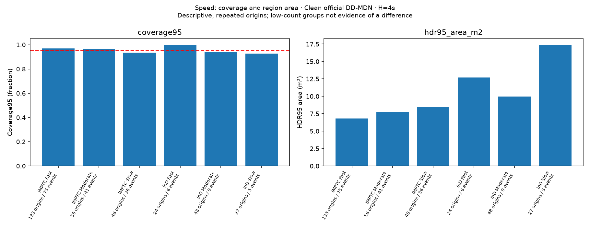
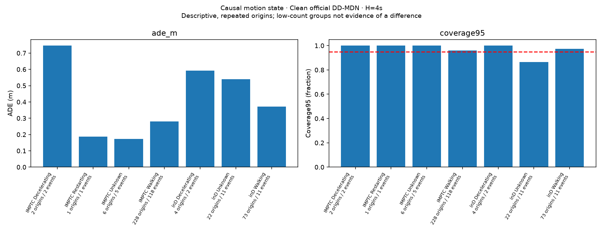
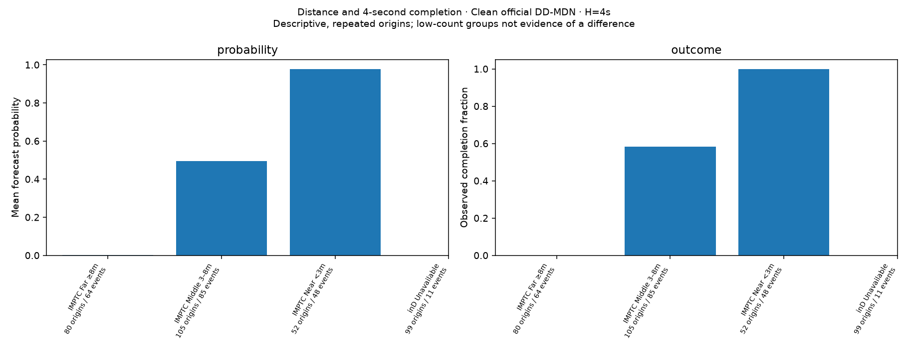
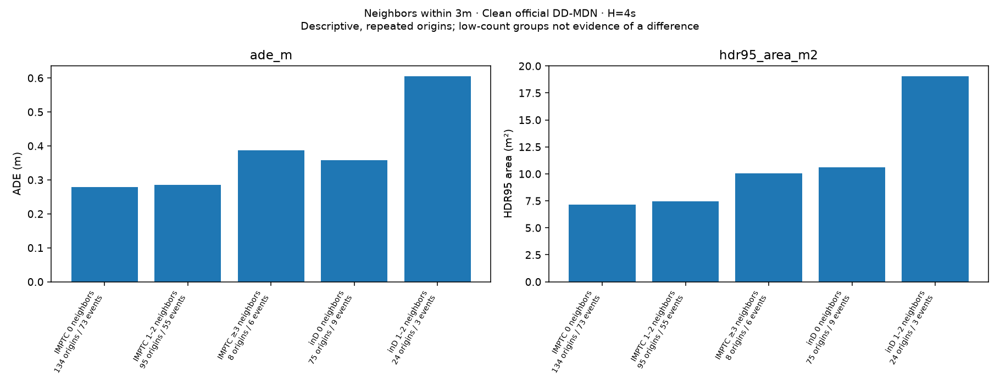
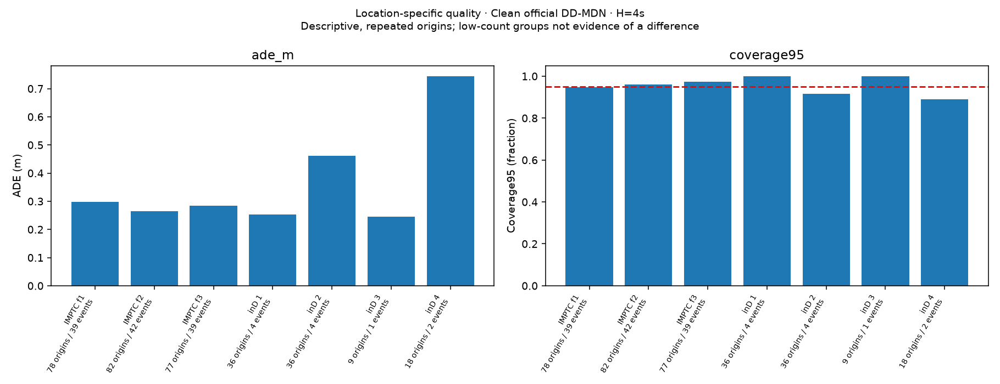
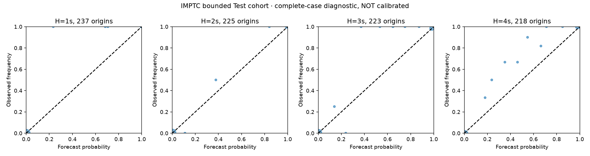
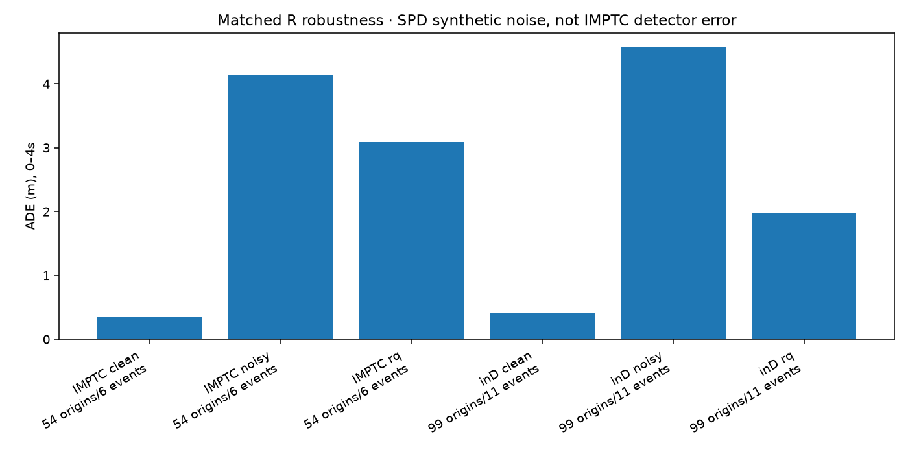

# View2Risk — Final Condition-Aware UQ Analysis

Status: PARTIAL — supported analyses executed; independent completion calibration and inD Exit validation remain unavailable.

## Executive summary

Existing 302-event rolling predictions are reused separately from a bounded completion cohort of 120 events. No neural training, checkpoint changes, GPU jobs or full official Test rerun. The official 120,871-window evaluation is preserved.

Completion results are uncalibrated, complete-case diagnostics on historically reused Test data. Repeated origins are not independent pedestrians. Selection and causal feature thresholds were frozen before new inference. inD Exit is not validated and has no completion probability.

| horizon_s | n_origins | n_events | n_recordings | n_completion_evaluable | n_complete | brier | baseline_brier | brier_ci_low | brier_ci_high |
| --- | --- | --- | --- | --- | --- | --- | --- | --- | --- |
| 1 | 237 | 120 | 55 | 237 | 26 | 0.0033 | 0.0084 | 0.0000 | 0.0087 |
| 2 | 237 | 120 | 55 | 225 | 48 | 0.0066 | 0.0089 | 0.0003 | 0.0154 |
| 3 | 237 | 120 | 55 | 223 | 79 | 0.0201 | 0.0269 | 0.0096 | 0.0329 |
| 4 | 237 | 120 | 55 | 218 | 111 | 0.0347 | 0.0183 | 0.0252 | 0.0458 |

## 1. Research objective

Assess when short-horizon position and opposite-Exit predictions can be trusted. Observational condition differences are not causal effects.

## 2. Input → model → output

Real causal observations → unchanged official DD-MDN → step GMM + joint anchor mixture → position HDR and 1–4s first passage. Q-only default; Legacy R+Q optional. PedPy descriptors are analysis variables, not new neural inputs.

## 3. Mathematical definition of conditions

{
  "plan": {
    "version": "condition_v1",
    "history_speed_s": 0.6,
    "acceleration_delta_s": 0.4,
    "state_grid_s": 0.1,
    "stop_speed": 0.2,
    "stop_duration_s": 1.0,
    "decel_acceleration": -0.3,
    "decel_duration_s": 0.4,
    "restart_speed": 0.3,
    "restart_window_s": 1.0,
    "neighbor_radius_m": 3.0,
    "neighbor_staleness_s": 0.061,
    "density_max_age_s": 1.01,
    "speed_groups": "Train/Validation causal origin speed terciles, separately per dataset",
    "distance_groups_m": [
      3.0,
      8.0
    ],
    "crowding_groups": "0 / 1-2 / >=3 other pedestrians within 3m",
    "completion_budget_events": 120,
    "completion_origins_per_event": 2,
    "bootstrap_replicates": 400,
    "seed": 20261121,
    "selection": "Stable SHA256 event order, round-robin crosswalk/date; two SHA256-ranked eligible origins per event; no model metrics used",
    "insufficient": "fewer than 20 events OR 5 recordings; completion additionally fewer than 5 positive OR 5 negative events",
    "evaluation": "complete-case, horizon-specific; no IPCW or calibration fit",
    "gpu": false,
    "training": false
  },
  "speed_thresholds": {
    "IMPTC": [
      1.3172731380745946,
      1.4958003349875173
    ],
    "inD": [
      1.2420755433423591,
      1.4910991236437978
    ]
  },
  "fit_n": {
    "IMPTC": 6520,
    "inD": 63587
  },
  "frozen_at": 1795261233.0838866,
  "code_sha256": "95071c1638e85ad0171c6f024c4dea9ad270462ec7b93a64db46ea675c5ac014",
  "GT_sha256": "8835387ac039a42f9541be6e12d2ea27ec5f8365c3aa13d253e3afdd9c189df5",
  "geometry_sha256": "2a47f0b137a73b2ce21ff0e42f635d46cb16f63ea1777d038d0093386c5a84d5"
}

v(t)=||x(t)-x(t−0.6)||/0.6; a(t)=[v(t)−v(t−0.4)]/0.4. Interpolation uses records ≤origin only. State durations use a causal 0.1s grid, and Unknown is retained when insufficient. Rerouting/longitudinal vector acceleration is not inferred: a is tangential speed derivative. d is the directional axial distance to the lateral-dependent semantic Exit; r=d/(end_B(l)−end_A(l)). Neighbor count includes other pedestrians within 3m at their latest observation no older than0.061s. PedPy density uses latest stored frame ≤origin, maximum age1.01s; corridor/camera footprints are not comparable.

## 4. Dataset and eligibility flow

{
  "catalog_events": 1415,
  "catalog_decisions": {
    "complete": 1019,
    "unresolved": 218,
    "right_censored": 170,
    "returned": 8
  },
  "catalog_splits": {
    "train": 548,
    "test": 502,
    "calibration": 275,
    "validation": 90
  },
  "existing_rolling_events": 301,
  "existing_rolling_origins": 3142,
  "eligible_origins": 2326,
  "selected_events": 120,
  "selected_origins": 237,
  "remaining_events_not_inferred": "Bounded budget, deterministic pre-inference sampling; not failures"
}

Every catalog event is retained in event_eligibility.csv. Every cached origin is audited in origin_eligibility.csv. Unresolved/returns/already-completed/ambiguous geometry have unknown completion outcomes, not failures. Censored noncompletion is known only when observation extends through H. Crossing-time intervals straddling H are unknown. Original date splits and official pretraining-overlap flags remain separate.

## 5. Condition-wise position UQ results

| dataset | cohort | horizon_s | n_origins | n_events | ade_m | fde_m | coverage68 | coverage95 | hdr95_area_m2 | nll |
| --- | --- | --- | --- | --- | --- | --- | --- | --- | --- | --- |
| IMPTC | expanded_completion | 1 | 237 | 120 | 0.0427 | 0.0655 | 0.6793 | 0.9451 | 0.0704 | -3.2134 |
| IMPTC | expanded_completion | 2 | 237 | 120 | 0.1039 | 0.2091 | 0.6987 | 0.9520 | 0.9760 | -0.7597 |
| IMPTC | expanded_completion | 3 | 237 | 120 | 0.1855 | 0.4104 | 0.7069 | 0.9655 | 3.5393 | 0.5372 |
| IMPTC | expanded_completion | 4 | 237 | 120 | 0.2832 | 0.6814 | 0.7237 | 0.9605 | 7.3664 | 1.4051 |
| IMPTC | legacy_rolling_position | 1 | 3142 | 301 | 0.0417 | 0.0639 | 0.7244 | 0.9550 | 0.0805 | -3.2717 |
| IMPTC | legacy_rolling_position | 2 | 3142 | 301 | 0.1096 | 0.2263 | 0.7329 | 0.9617 | 1.0849 | -0.7135 |
| IMPTC | legacy_rolling_position | 3 | 3142 | 301 | 0.1966 | 0.4310 | 0.7337 | 0.9695 | 4.1965 | 0.5746 |
| IMPTC | legacy_rolling_position | 4 | 3142 | 301 | 0.2990 | 0.6814 | 0.7345 | 0.9577 | 8.1592 | 1.4139 |
| IMPTC | matched_R | 1 | 54 | 6 | 0.0353 | 0.0537 | 0.7593 | 0.9815 | 0.0717 | -3.3986 |
| IMPTC | matched_R | 2 | 54 | 6 | 0.1040 | 0.2247 | 0.7407 | 1.0000 | 0.9804 | -0.6950 |
| IMPTC | matched_R | 3 | 54 | 6 | 0.2134 | 0.5098 | 0.7037 | 0.9630 | 3.6092 | 0.7296 |
| IMPTC | matched_R | 4 | 54 | 6 | 0.3565 | 0.8834 | 0.7037 | 0.9630 | 7.9040 | 1.6559 |
| inD | inD_existing | 1 | 99 | 11 | 0.0601 | 0.0934 | 0.7980 | 0.9798 | 0.1765 | -2.5990 |
| inD | inD_existing | 2 | 99 | 11 | 0.1562 | 0.3097 | 0.7172 | 0.9394 | 1.7645 | -0.2462 |
| inD | inD_existing | 3 | 99 | 11 | 0.2762 | 0.5914 | 0.7071 | 0.9394 | 5.6091 | 0.8703 |
| inD | inD_existing | 4 | 99 | 11 | 0.4181 | 0.9298 | 0.7273 | 0.9495 | 12.6458 | 1.5744 |

ADE averages valid full0–H predictions; FDE, coverage, NLL and HDR area refer to endpoint H. Probabilistic position metrics use normalized per-step GMM, not discrete confidence scores. Legacy rolling HDR and final_uq HDR quadrature differ and cohorts are not pooled.

## 6. Condition-wise crossing completion UQ results

### speed

| dataset | group | n_origins | n_events | n_recordings | n_complete_events | ade_m | coverage95 | hdr95_area_m2 | brier | status | completion_status |
| --- | --- | --- | --- | --- | --- | --- | --- | --- | --- | --- | --- |
| IMPTC | Fast | 133 | 75 | 46 | 48 | 0.2582 | 0.9688 | 6.8114 | 0.0407 | DESCRIPTIVE_ONLY | UNCALIBRATED_COMPLETE_CASE |
| IMPTC | Moderate | 56 | 41 | 30 | 23 | 0.3409 | 0.9630 | 7.7733 | 0.0329 | DESCRIPTIVE_ONLY | UNCALIBRATED_COMPLETE_CASE |
| IMPTC | Slow | 48 | 36 | 27 | 17 | 0.2869 | 0.9348 | 8.4297 | 0.0188 | DESCRIPTIVE_ONLY | UNCALIBRATED_COMPLETE_CASE |
| inD | Fast | 24 | 6 | 6 | 0 | 0.3600 | 1.0000 | 12.6890 | NA | INSUFFICIENT DATA | UNAVAILABLE |
| inD | Moderate | 48 | 9 | 9 | 0 | 0.4254 | 0.9375 | 9.9511 | NA | INSUFFICIENT DATA | UNAVAILABLE |
| inD | Slow | 27 | 5 | 5 | 0 | 0.4568 | 0.9259 | 17.3981 | NA | INSUFFICIENT DATA | UNAVAILABLE |

### motion

| dataset | group | n_origins | n_events | n_recordings | n_complete_events | ade_m | coverage95 | hdr95_area_m2 | brier | status | completion_status |
| --- | --- | --- | --- | --- | --- | --- | --- | --- | --- | --- | --- |
| IMPTC | Decelerating | 2 | 2 | 2 | 0 | 0.7458 | 1.0000 | 19.4488 | 0.0000 | INSUFFICIENT DATA | INSUFFICIENT DATA |
| IMPTC | Restarting | 1 | 1 | 1 | 0 | 0.1871 | 1.0000 | 3.1756 | 0.0000 | INSUFFICIENT DATA | INSUFFICIENT DATA |
| IMPTC | Unknown | 6 | 5 | 4 | 0 | 0.1736 | 1.0000 | 5.7767 | 0.0000 | INSUFFICIENT DATA | INSUFFICIENT DATA |
| IMPTC | Walking | 228 | 118 | 55 | 87 | 0.2808 | 0.9589 | 7.3207 | 0.0357 | DESCRIPTIVE_ONLY | UNCALIBRATED_COMPLETE_CASE |
| inD | Decelerating | 4 | 2 | 2 | 0 | 0.5920 | 1.0000 | 35.4818 | NA | INSUFFICIENT DATA | UNAVAILABLE |
| inD | Unknown | 22 | 11 | 11 | 0 | 0.5386 | 0.8636 | 14.4036 | NA | INSUFFICIENT DATA | UNAVAILABLE |
| inD | Walking | 73 | 11 | 11 | 0 | 0.3722 | 0.9726 | 10.8648 | NA | INSUFFICIENT DATA | UNAVAILABLE |

### distance

| dataset | group | n_origins | n_events | n_recordings | n_complete_events | ade_m | coverage95 | hdr95_area_m2 | brier | status | completion_status |
| --- | --- | --- | --- | --- | --- | --- | --- | --- | --- | --- | --- |
| IMPTC | Far ≥8m | 80 | 64 | 38 | 0 | 0.2383 | 0.9595 | 5.9355 | 0.0001 | DESCRIPTIVE_ONLY | INSUFFICIENT DATA |
| IMPTC | Middle 3–8m | 105 | 85 | 48 | 55 | 0.2502 | 0.9714 | 6.6309 | 0.0706 | DESCRIPTIVE_ONLY | UNCALIBRATED_COMPLETE_CASE |
| IMPTC | Near <3m | 52 | 48 | 38 | 48 | 0.4106 | 0.9388 | 11.0531 | 0.0083 | DESCRIPTIVE_ONLY | INSUFFICIENT DATA |
| inD | Unavailable | 99 | 11 | 11 | 0 | 0.4181 | 0.9495 | 12.6458 | NA | INSUFFICIENT DATA | UNAVAILABLE |

### crowding

| dataset | group | n_origins | n_events | n_recordings | n_complete_events | ade_m | coverage95 | hdr95_area_m2 | brier | status | completion_status |
| --- | --- | --- | --- | --- | --- | --- | --- | --- | --- | --- | --- |
| IMPTC | 0 neighbors | 134 | 73 | 45 | 61 | 0.2784 | 0.9618 | 7.1632 | 0.0298 | DESCRIPTIVE_ONLY | UNCALIBRATED_COMPLETE_CASE |
| IMPTC | 1–2 neighbors | 95 | 55 | 30 | 29 | 0.2845 | 0.9556 | 7.4289 | 0.0450 | DESCRIPTIVE_ONLY | UNCALIBRATED_COMPLETE_CASE |
| IMPTC | ≥3 neighbors | 8 | 6 | 5 | 1 | 0.3876 | 1.0000 | 10.0292 | 0.0000 | INSUFFICIENT DATA | INSUFFICIENT DATA |
| inD | 0 neighbors | 75 | 9 | 9 | 0 | 0.3580 | 0.9600 | 10.5903 | NA | INSUFFICIENT DATA | UNAVAILABLE |
| inD | 1–2 neighbors | 24 | 3 | 3 | 0 | 0.6058 | 0.9167 | 19.0693 | NA | INSUFFICIENT DATA | UNAVAILABLE |

### location

| dataset | group | n_origins | n_events | n_recordings | n_complete_events | ade_m | coverage95 | hdr95_area_m2 | brier | status | completion_status |
| --- | --- | --- | --- | --- | --- | --- | --- | --- | --- | --- | --- |
| IMPTC | f1 | 78 | 39 | 30 | 31 | 0.2988 | 0.9481 | 6.9813 | 0.0479 | DESCRIPTIVE_ONLY | UNCALIBRATED_COMPLETE_CASE |
| IMPTC | f2 | 82 | 42 | 28 | 23 | 0.2654 | 0.9610 | 6.9592 | 0.0342 | DESCRIPTIVE_ONLY | UNCALIBRATED_COMPLETE_CASE |
| IMPTC | f3 | 77 | 39 | 33 | 33 | 0.2842 | 0.9730 | 8.1903 | 0.0220 | DESCRIPTIVE_ONLY | UNCALIBRATED_COMPLETE_CASE |
| inD | 1 | 36 | 4 | 4 | 0 | 0.2539 | 1.0000 | 9.1219 | NA | INSUFFICIENT DATA | UNAVAILABLE |
| inD | 2 | 36 | 4 | 4 | 0 | 0.4623 | 0.9167 | 12.3567 | NA | INSUFFICIENT DATA | UNAVAILABLE |
| inD | 3 | 9 | 1 | 1 | 0 | 0.2456 | 1.0000 | 7.9900 | NA | INSUFFICIENT DATA | UNAVAILABLE |
| inD | 4 | 18 | 2 | 2 | 0 | 0.7442 | 0.8889 | 22.5999 | NA | INSUFFICIENT DATA | UNAVAILABLE |

## 7. Calibration and baseline comparison

Raw probabilities were NOT recalibrated. Constant-speed baseline uses causal velocity projected onto the known traversal axis and same d/GT cohort. It is a deterministic forecast, not a survival model. Brier CIs use 400 recording-cluster bootstrap draws with all repeated origins retained; fewer than5 recordings yields NA. Dates are reported separately; recording CIs do not prove new-date generalization. ci_low/ci_high refer only to Brier; metric-specific CI columns are explicit. Reliability bins are fixed width0.1 and show sample counts. No IPCW correction is claimed.

## 8. R robustness findings

Existing matched 6 IMPTC events and11 inD tracks only. SPD Train annotation-disagreement proxy, not independently validated camera detector noise. R+Q remains optional; CA6 and variance calibration are not substituted. Latest R_UQ_FINAL_DECISION.md remains authoritative.

## 9. Main findings

Numerical subgroup tables above provide the evidence. Sparse stop/restart or location groups are marked INSUFFICIENT DATA. Prediction regions and coverage must be interpreted together; high coverage with very wide regions is not improvement. Crowding comparisons are descriptive and confounded by speed/distance/location. No adjusted causal claim is made.

## 10. Limitations and final conclusions

No independent completion Calibration; complete-case selection may depend on censoring. GT v1 is algorithmic semantic-boundary audit, not per-event human video GT. Joint sampled first crossing differs from GT0.12s confirmation. 0.5s output spacing and piecewise linear paths limit crossing-time precision. No 15/20s claims. inD semantic Exit BLOCKED. Licensed per-origin records, trajectories, maps and private case files remain server-only. No age/gender inference. No additional model search.

## Plots

## Reproduction

`[private-source] [private-source] prepare`

`[private-source] [private-source] infer`

`[private-source] [private-source] analyze`

Sources: official DD-MDN https://github.com/kav-institute/ddmdn ; PedPy https://github.com/PedestrianDynamics/PedPy ; FilterPy https://github.com/rlabbe/filterpy ; inD tools https://github.com/ika-rwth-aachen/drone-dataset-tools ; SPD https://github.com/AIR-THU/DAIR-V2X-Seq

## Additional reporting verification

Mean forecast and observed frequency use the identical known-outcome probability cohort. Constant-speed Brier uses that same cohort. Results use NaN/NA for unavailable values. n_complete counts completed origins; n_complete_events counts distinct events with a positive outcome. Counts are never summed across rolling origins as independent pedestrians.

The existing rolling index lists302 events, but only301 have successful forecast origins. The zero-origin event is not silently counted as evaluated. All1415 catalog events remain in event_eligibility.csv. Eligibility is not a new GT adjudication.

## Adjusted crowding association

Descriptive OLS of log(HDR95 area) and ADE on causal speed, remaining distance, neighbor count and crosswalk indicators; recording-cluster sandwich SE. This is an explanatory association, not a new predictor, significance claim or causal effect.

| Outcome | Neighbor coefficient | Cluster SE | Origins / events / recordings |
|---|---:|---:|---|
| log_hdr95_area | 0.14034 | 0.05155 | 215 / 110 / 55 |
| ade_m | 0.05386 | 0.02916 | 215 / 110 / 55 |

## Evidence-based answers

**speed:** Fast: n=133 origins/75 events, Coverage95=0.969, area=6.811m², ADE=0.258m; DESCRIPTIVE_ONLY. Moderate: n=56 origins/41 events, Coverage95=0.963, area=7.773m², ADE=0.341m; DESCRIPTIVE_ONLY. Slow: n=48 origins/36 events, Coverage95=0.935, area=8.430m², ADE=0.287m; DESCRIPTIVE_ONLY. These conditional averages do not by themselves establish a statistically reliable difference.

**motion:** Decelerating: n=2 origins/2 events, Coverage95=1.000, area=19.449m², ADE=0.746m; INSUFFICIENT DATA. Restarting: n=1 origins/1 events, Coverage95=1.000, area=3.176m², ADE=0.187m; INSUFFICIENT DATA. Unknown: n=6 origins/5 events, Coverage95=1.000, area=5.777m², ADE=0.174m; INSUFFICIENT DATA. Walking: n=228 origins/118 events, Coverage95=0.959, area=7.321m², ADE=0.281m; DESCRIPTIVE_ONLY. These conditional averages do not by themselves establish a statistically reliable difference.

**distance:** Far ≥8m: n=80 origins/64 events, Coverage95=0.959, area=5.936m², ADE=0.238m; DESCRIPTIVE_ONLY. Middle 3–8m: n=105 origins/85 events, Coverage95=0.971, area=6.631m², ADE=0.250m; DESCRIPTIVE_ONLY. Near <3m: n=52 origins/48 events, Coverage95=0.939, area=11.053m², ADE=0.411m; DESCRIPTIVE_ONLY. These conditional averages do not by themselves establish a statistically reliable difference.

**crowding:** 0 neighbors: n=134 origins/73 events, Coverage95=0.962, area=7.163m², ADE=0.278m; DESCRIPTIVE_ONLY. 1–2 neighbors: n=95 origins/55 events, Coverage95=0.956, area=7.429m², ADE=0.284m; DESCRIPTIVE_ONLY. ≥3 neighbors: n=8 origins/6 events, Coverage95=1.000, area=10.029m², ADE=0.388m; INSUFFICIENT DATA. These conditional averages do not by themselves establish a statistically reliable difference.

**location:** f1: n=78 origins/39 events, Coverage95=0.948, area=6.981m², ADE=0.299m; DESCRIPTIVE_ONLY. f2: n=82 origins/42 events, Coverage95=0.961, area=6.959m², ADE=0.265m; DESCRIPTIVE_ONLY. f3: n=77 origins/39 events, Coverage95=0.973, area=8.190m², ADE=0.284m; DESCRIPTIVE_ONLY. These conditional averages do not by themselves establish a statistically reliable difference.

## Final numerical interpretation and denominators

Coverage numerator/denominator and ADE/HDR eligible counts are explicit in the aggregate CSV. HDR area uses all available predictive distributions, while endpoint coverage/NLL use available endpoint GT; ADE requires every GT point through H. These denominators can differ.

| H(s) | DD-MDN Brier | Constant-speed Brier | Paired difference (DD-MDN − baseline), recording CI | Known outcomes |
|---|---:|---:|---|---:|
| 1 | 0.003285 | 0.008439 | -0.005154 [-0.017086, 0.001474] | 237 |
| 2 | 0.006597 | 0.008889 | -0.002291 [-0.015159, 0.005183] | 225 |
| 3 | 0.020117 | 0.026906 | -0.006789 [-0.026767, 0.008198] | 223 |
| 4 | 0.034718 | 0.018349 | 0.016369 [-0.000331, 0.032105] | 218 |

On this bounded cohort, DD-MDN has lower point-estimate Brier at1–3s but higher Brier at4s than constant speed. This is a negative application-level result despite near95% positional coverage. CIs above, historical Test reuse, three dates and complete-case censoring must be considered. This does not establish independent calibration.

| Expanded IMPTC causal state | Origins | Events |
|---|---:|---:|
| Walking | 228 | 118 |
| Decelerating | 2 | 2 |
| Stopped | 0 | 0 |
| Restarting | 1 | 1 |
| Unknown | 6 | 5 |

Zero Stopped examples means no stopped-origin performance estimate in this bounded completion cohort. One restart event cannot validate restart behavior. Additional inference/model development is not initiated.
