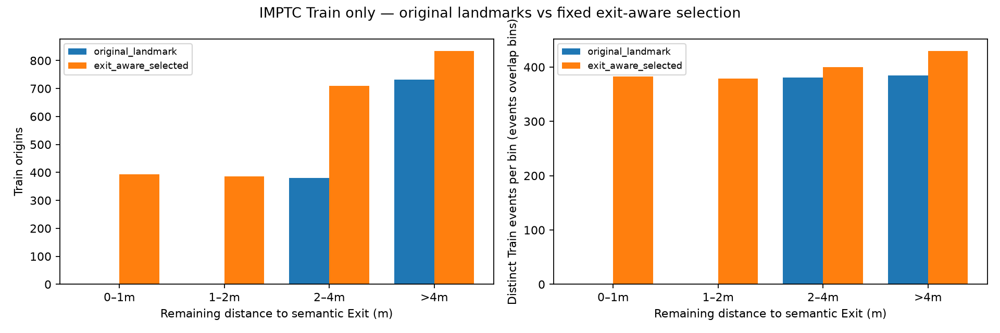
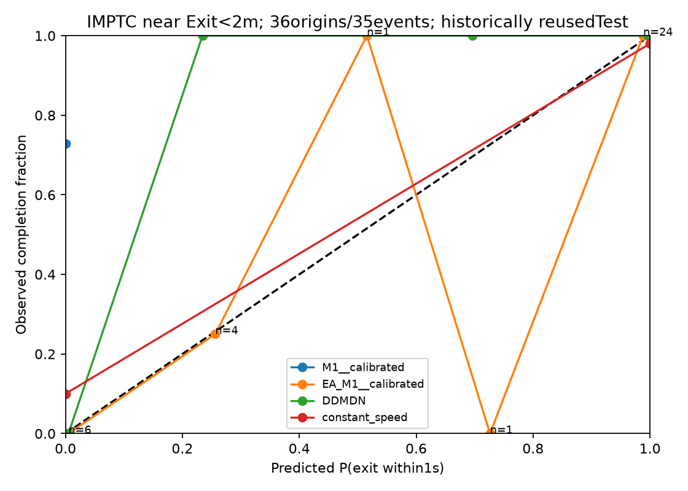
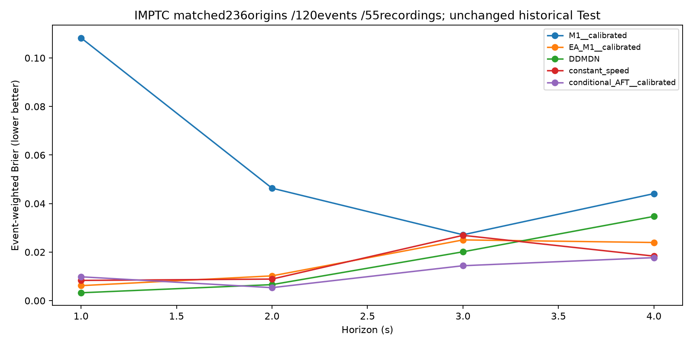
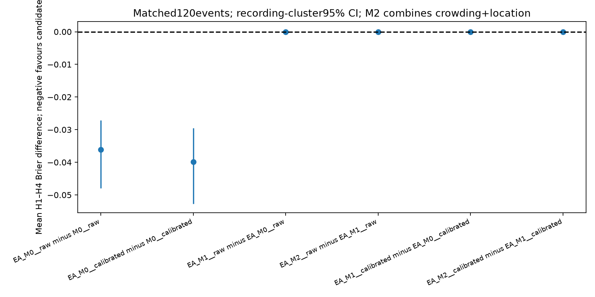
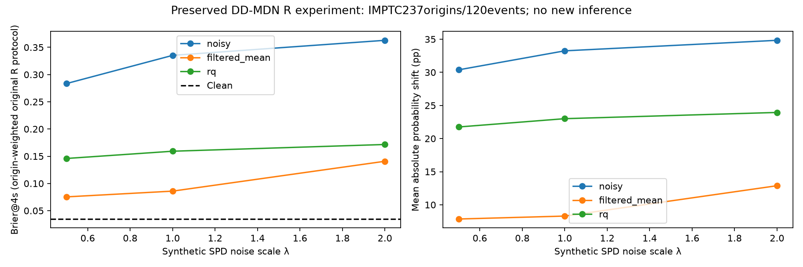
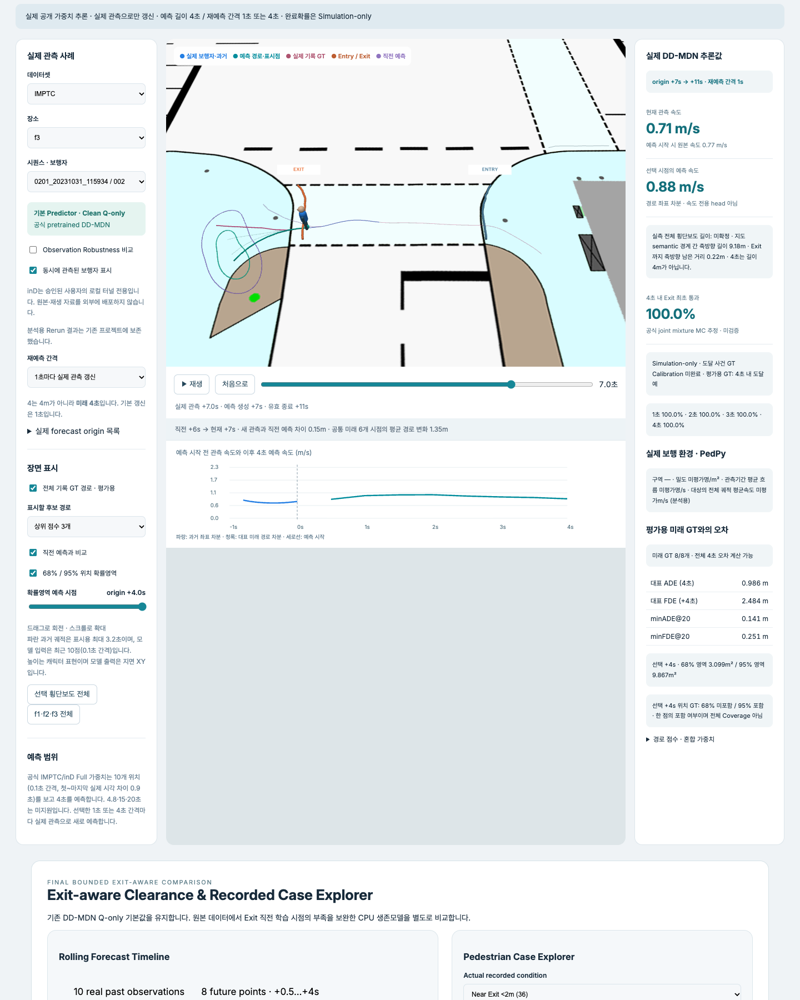

# View2Risk — Exit-Aware Final Report

Status: COMPLETE_WITH_LIMITATIONS — CPU experiment and browser integration verified

## Executive summary

1. **Near-Exit Train support: YES.** 693 eligible0.4s-grid origins, 393 events, 118 recordings and 8 dates at distance<1m. No Test transfer or synthetic labels.

2. **Coverage:** original Train min 2.191900m → 0.058504m; selected near1m origins0 → 393. Previously39/236 matched origins were below Train min; now 0/236.

3. **Sampling improvement: SUPPORTED relative to original XGBoost.** Raw M0 matched mean Brier difference -0.036159,95%CI[-0.047933,-0.027108]; controlled Validation difference -0.073025. This is not a fresh independent benchmark.

4. **H1:** selected M1 calibrated Brier 0.108270 → 0.006183. Among26 actual H1positive origins, mean predicted probability 0.000294 → 0.943497.

5. **Acceleration: NOT SUPPORTED.** Matched raw M1−M0 meanΔBrier -0.000018, CI[-0.000426,0.000302]. Small Validation gain is not sufficient evidence.

6. **Crowding: NOT SUPPORTED as isolated effect.** M2 adds neighbors and location together; no new crowding-only model fitted. Joint-context paired comparison retained.

7. **Calibration:** selected raw vs calibrated mean ECE {'EA_M1__calibrated': 0.0147967224741101, 'EA_M1__raw': 0.020523595356588598}; mean Brier 0.017639 → 0.016345. Report both; Calibration fit observations are not independent evidence of calibration. The selected calibrated U95 conditional coverage is0.908163 on97evaluable origins with predicted U95<=4s (103supported,6unknown); this does not establish95% population coverage. Raw and calibrated supported subsets differ and their coverage cannot be treated as a fixed-population improvement.

8. **Default:** DD-MDN Q-only remains. New Exit-aware XGBoost may be shown as an optional comparison; neither constant speed nor DD-MDN is conclusively beaten on mean1–4s Brier. Existing conditional linear AFT remains stronger in this cohort.

9. **Limits:** historical Test reuse,3Test dates, event dependence, conditional GT population, censoring assumptions, sparse stopping/restarting, location+crowding confounding. Stop this bounded development; no further Test-driven tuning.

## 1. Original-event and near-Exit audit

{
  "split_disjoint": true,
  "event_weight_one": true,
  "max8origins": true,
  "future_mutation_invariant": true,
  "selected_rows": 5834,
  "eligible_rows": 20536,
  "candidate_rows": 29293,
  "excluded_events": 226,
  "gt_sha_unchanged": true,
  "geometry_sha_unchanged": true
}

Candidate audit samples the first real accepted frame at/after each0.4s tick within each existing event observation interval, after observed Entry when present. It is a cadence-defined audit, not a count of all raw camera frames. The exact audit CSV retains invalid origins and reasons. Unresolved/returned events are listed separately, not converted to negative labels. Same operational semantic Exit first-crossing interval,0.12s confirmation, and date splits as prior work. No GT modifications.

| split | distance_bin | n_origins | n_events | n_tracks | n_recordings | n_dates | history_duration_s_min | history_duration_s_median | h1_known | h1_complete | h1_unknown | h2_known | h2_complete | h2_unknown | h3_known | h3_complete | h3_unknown | h4_known | h4_complete | h4_unknown |
|---|---|---|---|---|---|---|---|---|---|---|---|---|---|---|---|---|---|---|---|---|
| calibration | 0–1m | 334 | 199 | 183 | 40 | 2 | 1.200015 | 21.160009 | 334 | 332 | 0 | 334 | 334 | 0 | 334 | 334 | 0 | 334 | 334 | 0 |
| calibration | 1–2m | 349 | 200 | 184 | 40 | 2 | 1.200015 | 18.839994 | 317 | 131 | 32 | 337 | 337 | 12 | 338 | 338 | 11 | 338 | 338 | 11 |
| calibration | 2–4m | 696 | 205 | 188 | 40 | 2 | 1.200015 | 18.119997 | 674 | 4 | 22 | 633 | 272 | 63 | 646 | 606 | 50 | 651 | 650 | 45 |
| calibration | >4m | 2662 | 220 | 198 | 40 | 2 | 1.000000 | 17.819997 | 2607 | 0 | 55 | 2555 | 8 | 107 | 2485 | 141 | 177 | 2430 | 546 | 232 |
| test | 0–1m | 593 | 345 | 330 | 67 | 3 | 1.200015 | 19.360021 | 586 | 578 | 7 | 589 | 589 | 4 | 589 | 589 | 4 | 589 | 589 | 4 |
| test | 1–2m | 601 | 346 | 330 | 67 | 3 | 1.200015 | 18.799985 | 557 | 246 | 44 | 585 | 574 | 16 | 587 | 586 | 14 | 587 | 587 | 14 |
| test | 2–4m | 1172 | 353 | 338 | 67 | 3 | 1.200015 | 17.399970 | 1149 | 1 | 23 | 1102 | 485 | 70 | 1108 | 1022 | 64 | 1116 | 1102 | 56 |
| test | >4m | 4476 | 383 | 350 | 67 | 3 | 1.000000 | 15.559976 | 4360 | 0 | 116 | 4255 | 3 | 221 | 4142 | 260 | 334 | 4074 | 956 | 402 |
| train | 0–1m | 693 | 393 | 363 | 118 | 8 | 1.200015 | 21.399986 | 687 | 682 | 6 | 688 | 688 | 5 | 688 | 688 | 5 | 688 | 688 | 5 |
| train | 1–2m | 705 | 396 | 367 | 118 | 8 | 1.200015 | 20.639979 | 653 | 253 | 52 | 693 | 688 | 12 | 693 | 693 | 12 | 693 | 693 | 12 |
| train | 2–4m | 1372 | 400 | 371 | 118 | 8 | 1.200015 | 19.799985 | 1353 | 5 | 19 | 1306 | 530 | 66 | 1316 | 1222 | 56 | 1327 | 1323 | 45 |
| train | >4m | 5561 | 430 | 384 | 118 | 8 | 1.080000 | 20.119997 | 5473 | 0 | 88 | 5396 | 10 | 165 | 5279 | 255 | 282 | 5215 | 1076 | 346 |
| validation | 0–1m | 121 | 70 | 64 | 24 | 2 | 3.639979 | 19.600045 | 120 | 120 | 1 | 121 | 121 | 0 | 121 | 121 | 0 | 121 | 121 | 0 |
| validation | 1–2m | 124 | 71 | 65 | 24 | 2 | 3.239949 | 22.500000 | 115 | 49 | 9 | 124 | 124 | 0 | 124 | 124 | 0 | 124 | 124 | 0 |
| validation | 2–4m | 241 | 71 | 65 | 24 | 2 | 2.039979 | 21.199970 | 239 | 1 | 2 | 235 | 101 | 6 | 239 | 224 | 2 | 241 | 241 | 0 |
| validation | >4m | 836 | 71 | 65 | 24 | 2 | 1.119997 | 20.419975 | 836 | 0 | 0 | 836 | 3 | 0 | 826 | 56 | 10 | 830 | 216 | 6 |

Known, censored-unknown and interval-ambiguous counts separately for each horizon are in exit_coverage_aggregate.csv. Valid history is≥1s in original status2/jump-free segmentation. Features retain0.6s causal longitudinal velocity and0.4s derivative, same3m neighbor radius. speed_mps in audit is magnitude; v_long_mps is the signed predictor. No intent/demographic/weather input.

| split | distance_bin | v_long_mps_mean | v_long_mps_p10 | v_long_mps_median | v_long_mps_p90 | a_long_mps2_mean | a_long_mps2_p10 | a_long_mps2_p90 | neighbor_count_mean | neighbor_count_p90 |
|---|---|---|---|---|---|---|---|---|---|---|
| calibration | 0–1m | 1.433242 | 1.117572 | 1.429416 | 1.688378 | -0.028183 | -0.132004 | 0.087233 | 0.511976 | 2.000000 |
| calibration | 1–2m | 1.430113 | 1.141758 | 1.425090 | 1.699518 | -0.026993 | -0.122814 | 0.089896 | 0.570201 | 2.000000 |
| calibration | 2–4m | 1.458864 | 1.189242 | 1.424930 | 1.733943 | -0.030047 | -0.133918 | 0.082251 | 0.613506 | 2.000000 |
| calibration | >4m | 1.502065 | 1.204469 | 1.487953 | 1.810300 | 0.052203 | -0.136110 | 0.305820 | 0.805785 | 2.000000 |
| test | 0–1m | 1.418581 | 1.065244 | 1.444876 | 1.704433 | -0.031499 | -0.189017 | 0.096474 | 0.625632 | 2.000000 |
| test | 1–2m | 1.448319 | 1.114975 | 1.461614 | 1.715981 | -0.024272 | -0.137439 | 0.086426 | 0.632280 | 2.000000 |
| test | 2–4m | 1.469070 | 1.165807 | 1.481495 | 1.741737 | -0.025724 | -0.120052 | 0.088687 | 0.759386 | 2.000000 |
| test | >4m | 1.498412 | 1.183471 | 1.522659 | 1.803503 | 0.060720 | -0.128771 | 0.366018 | 0.942359 | 2.000000 |
| train | 0–1m | 1.394009 | 1.112101 | 1.389197 | 1.654475 | -0.033358 | -0.167439 | 0.074991 | 0.639250 | 2.000000 |
| train | 1–2m | 1.426009 | 1.160634 | 1.414143 | 1.689516 | -0.018479 | -0.122801 | 0.070603 | 0.683688 | 2.000000 |
| train | 2–4m | 1.452999 | 1.188029 | 1.435602 | 1.702345 | -0.025495 | -0.115678 | 0.058964 | 0.716472 | 2.000000 |
| train | >4m | 1.483845 | 1.192568 | 1.479903 | 1.754303 | 0.060819 | -0.113461 | 0.312383 | 0.945513 | 2.000000 |
| validation | 0–1m | 1.444352 | 1.143886 | 1.426826 | 1.739734 | -0.035002 | -0.139604 | 0.060016 | 0.314050 | 1.000000 |
| validation | 1–2m | 1.487124 | 1.206492 | 1.444034 | 1.739048 | -0.028706 | -0.096864 | 0.061838 | 0.290323 | 1.000000 |
| validation | 2–4m | 1.518346 | 1.240357 | 1.489205 | 1.754998 | -0.023130 | -0.099692 | 0.056738 | 0.323651 | 1.000000 |
| validation | >4m | 1.545002 | 1.292794 | 1.522308 | 1.772984 | 0.059137 | -0.115621 | 0.359339 | 0.307416 | 1.000000 |

## 2. Exit-aware origin policy and representation

{
  "version": "ExitAware_v1",
  "created": 1795275862.537988,
  "code_sha": "54dfebd20c31ff3efaf4eb2f263eb51eb73879ade9d8a70b0f9aa30f48ba94d9",
  "reference_model_sha": "bbcad42216affb395ed508c041bb69e1555f42e80f287771cb8254f88204cdd2",
  "gt_sha": "8835387ac039a42f9541be6e12d2ea27ec5f8365c3aa13d253e3afdd9c189df5",
  "geometry_sha": "2a47f0b137a73b2ce21ff0e42f635d46cb16f63ea1777d038d0093386c5a84d5",
  "candidate_cadence_s": 0.4,
  "candidate_policy": "First real accepted frame at or after each0.4s tick from max(event observation start, observed Entry). Stop at observed event interval, not selected future outcome. Keep all rejections.",
  "history_s": 1.0,
  "history_policy": "same0.6s displacement /0.4s longitudinal velocity difference; also verify original status/jump segmentation",
  "distance_bins": [
    "[0,1)",
    "[1,2)",
    "[2,4]",
    "(4,infinity)"
  ],
  "sample_policy": "Chronological first two eligible origins per distance bin with >=0.8s within-bin gap; >=0.4s global gap. Maximum8/event. No future outcome used to rank/select.",
  "weighting": "each event total1, training rescaled to row mean1; no positive/negative balancing",
  "gate": "Train0\u20131m >=30 events, >=5 recordings and >=3 dates, with valid1s history; gate does not inspect Test performance",
  "models": {
    "M0": {
      "features": [
        "distance_m",
        "v_long_mps"
      ],
      "rounds": 209,
      "max_depth": 2,
      "aft_loss_distribution_scale": 0.15
    },
    "M1": {
      "features": [
        "distance_m",
        "v_long_mps",
        "a_long_mps2"
      ],
      "rounds": 229,
      "max_depth": 2,
      "aft_loss_distribution_scale": 0.15
    },
    "M2": {
      "features": [
        "distance_m",
        "v_long_mps",
        "a_long_mps2",
        "neighbor_count",
        "crosswalk_f2",
        "crosswalk_f3"
      ],
      "rounds": 227,
      "max_depth": 2,
      "aft_loss_distribution_scale": 0.15
    }
  },
  "fixed": {
    "objective": "survival:aft",
    "eval_metric": "aft-nloglik",
    "aft_loss_distribution": "normal",
    "eta": 0.03,
    "min_child_weight": 10,
    "reg_lambda": 10,
    "subsample": 1,
    "colsample_bytree": 1,
    "tree_method": "hist",
    "device": "cpu",
    "nthread": 2,
    "seed": 42
  },
  "selection": "Lowest raw event-weighted mean BrierH1\u2013H4 on new Exit-aware Validation; tie interval NLL then M0/M1/M2 order. Rounds and all hyperparameters fixed to original selected configs, no early-stop changes or search.",
  "calibration": "same bounded log-time bias and scale likelihood fit, new Exit-aware Calibration dates only; always raw+calibrated Test reported",
  "evaluation": "Original236 DD-matched and936landmark Test unchanged; separate new Exit-aware origins. Historical reusedTest, no independent new split.",
  "near_exit": "remaining distance <2m; complementary >=2m, frozen",
  "metrics": "Same interval outcomes, event weighting, Train reverseKM IPCW and0..4s truncatedCRPS;400 recording clusters",
  "new_features": false,
  "no_gpu": true,
  "no_ddmdn_inference": true,
  "weather": "NOT_IMPLEMENTED optional; no observed labels"
}

| split | n_origins | n_events | n_tracks | n_recordings | n_dates | completed_events | censored_events |
|---|---|---|---|---|---|---|---|
| calibration | 1167 | 237 | 206 | 40 | 2 | 199 | 38 |
| test | 1957 | 412 | 362 | 67 | 3 | 342 | 70 |
| train | 2322 | 446 | 390 | 118 | 8 | 391 | 55 |
| validation | 388 | 71 | 65 | 24 | 2 | 71 | 0 |

| sampling_version | split | distance_bin | n_origins | n_events | h1_complete | h2_complete | h3_complete | h4_complete | v_long_mps_mean | a_long_mps2_mean |
|---|---|---|---|---|---|---|---|---|---|---|
| original_landmark | calibration | 2–4m | 194 | 194 | 2 | 90 | 177 | 184 | 1.519366 | -0.029021 |
| original_landmark | calibration | >4m | 375 | 197 | 0 | 4 | 28 | 105 | 1.564636 | -0.001861 |
| original_landmark | test | 1–2m | 1 | 1 | 0 | 1 | 1 | 1 | 0.834425 | -0.309421 |
| original_landmark | test | 2–4m | 326 | 326 | 0 | 148 | 295 | 316 | 1.505313 | -0.014622 |
| original_landmark | test | >4m | 609 | 329 | 0 | 0 | 37 | 154 | 1.555677 | -0.010535 |
| original_landmark | train | 2–4m | 381 | 381 | 0 | 159 | 332 | 369 | 1.488256 | -0.031307 |
| original_landmark | train | >4m | 732 | 385 | 0 | 0 | 34 | 172 | 1.513724 | -0.017319 |
| original_landmark | validation | 2–4m | 71 | 71 | 1 | 39 | 71 | 71 | 1.551806 | -0.030947 |
| original_landmark | validation | >4m | 135 | 68 | 0 | 1 | 14 | 47 | 1.581767 | 0.014672 |
| exit_aware_selected | calibration | 0–1m | 194 | 192 | 192 | 194 | 194 | 194 | 1.466906 | -0.029824 |
| exit_aware_selected | calibration | 1–2m | 194 | 191 | 49 | 188 | 188 | 188 | 1.465119 | -0.028549 |
| exit_aware_selected | calibration | 2–4m | 352 | 205 | 1 | 110 | 296 | 328 | 1.470447 | -0.035917 |
| exit_aware_selected | calibration | >4m | 427 | 220 | 0 | 1 | 8 | 16 | 1.474691 | 0.214888 |
| exit_aware_selected | test | 0–1m | 328 | 320 | 316 | 324 | 324 | 324 | 1.442529 | -0.021028 |
| exit_aware_selected | test | 1–2m | 332 | 328 | 106 | 317 | 323 | 324 | 1.476918 | -0.024080 |
| exit_aware_selected | test | 2–4m | 555 | 353 | 0 | 179 | 471 | 518 | 1.477124 | -0.027064 |
| exit_aware_selected | test | >4m | 742 | 383 | 0 | 0 | 8 | 34 | 1.465870 | 0.247234 |
| exit_aware_selected | train | 0–1m | 393 | 383 | 385 | 390 | 390 | 390 | 1.425713 | -0.031862 |
| exit_aware_selected | train | 1–2m | 385 | 379 | 82 | 374 | 377 | 377 | 1.451553 | -0.023965 |
| exit_aware_selected | train | 2–4m | 709 | 400 | 1 | 244 | 611 | 683 | 1.469959 | -0.025166 |
| exit_aware_selected | train | >4m | 835 | 430 | 0 | 2 | 10 | 35 | 1.442785 | 0.263753 |
| exit_aware_selected | validation | 0–1m | 68 | 66 | 67 | 68 | 68 | 68 | 1.477475 | -0.029563 |
| exit_aware_selected | validation | 1–2m | 65 | 64 | 19 | 65 | 65 | 65 | 1.516389 | -0.029630 |
| exit_aware_selected | validation | 2–4m | 115 | 71 | 0 | 35 | 103 | 115 | 1.529060 | -0.024158 |
| exit_aware_selected | validation | >4m | 140 | 71 | 0 | 0 | 2 | 10 | 1.513932 | 0.205803 |

| version | n_train_origins | n_train_events | min_distance_m | max_distance_m | n_train_lt1 | n_train_lt2 | matched_origins | below_train_min | above_train_max |
|---|---|---|---|---|---|---|---|---|---|
| original | 1113 | 404 | 2.191900 | 11.979417 | 0 | 0 | 236 | 39 | 29 |
| exit_aware | 2322 | 446 | 0.058504 | 15.967998 | 393 | 778 | 236 | 0 | 0 |

Counts in different distance bins share events and must not be summed as independent pedestrians. New sampling also admits additional previously unrepresented eligible events; this is a protocol-level sampling comparison, not an isolated causal estimate of distance alone. Training weights per-event equal1, rescaled to row-mean1 as before. Neighbor count/direction are causal; future GT only constructs residual interval labels and audit outcomes, never ranks selected origins. All raw accepted candidates, selected masks and exclusions saved.

## 3. Fixed configurations, Validation selection and Calibration

| model | rounds | val_mean_brier | val_interval_nll |
|---|---|---|---|
| M0 | 209 | 0.013388 | 3.239676 |
| M1 | 229 | 0.013230 | 3.222805 |
| M2 | 227 | 0.013241 | 3.221391 |

Selected by raw Exit-aware Validation only: M1. Original max_depth2, σ0.15, eta0.03, min_child_weight10,L2=10, full rows/columns, seed42; original M0/M1/M2 tree counts209/229/227. No search or early-stop changes. Same survival:aft, aft-nloglik,DMatrix bounds; same bounded Calibration log-location/scale likelihood, new separate Calibration origins. Calibration changes are evaluated separately from raw fitting.

| model | bias | scale | at_bound |
|---|---|---|---|
| M0 | -0.010265 | 0.657060 | False |
| M1 | -0.011850 | 0.631227 | False |
| M2 | -0.012388 | 0.633288 | False |

## 4. Matched historical Test comparison

| model | h1 | h4 | mean_brier | mean_ece | n_origins | n_events |
|---|---|---|---|---|---|---|
| DDMDN | 0.003244 | 0.034718 | 0.016172 | 0.021153 | 236 | 120 |
| EA_M0__calibrated | 0.007204 | 0.023839 | 0.016351 | 0.015660 | 236 | 120 |
| EA_M0__raw | 0.007125 | 0.026999 | 0.017657 | 0.020884 | 236 | 120 |
| EA_M1__calibrated | 0.006183 | 0.023960 | 0.016345 | 0.014797 | 236 | 120 |
| EA_M1__raw | 0.006441 | 0.026922 | 0.017639 | 0.020524 | 236 | 120 |
| EA_M2__calibrated | 0.006402 | 0.023867 | 0.016266 | 0.016101 | 236 | 120 |
| EA_M2__raw | 0.006578 | 0.026907 | 0.017592 | 0.025676 | 236 | 120 |
| M0__calibrated | 0.108277 | 0.045214 | 0.056214 | 0.057430 | 236 | 120 |
| M0__raw | 0.107016 | 0.040039 | 0.053816 | 0.051502 | 236 | 120 |
| M1__calibrated | 0.108270 | 0.044101 | 0.056465 | 0.057333 | 236 | 120 |
| M1__raw | 0.106704 | 0.038707 | 0.053944 | 0.052114 | 236 | 120 |
| M2__calibrated | 0.108249 | 0.044369 | 0.056571 | 0.057346 | 236 | 120 |
| M2__raw | 0.106615 | 0.039077 | 0.054138 | 0.051681 | 236 | 120 |
| conditional_AFT__calibrated | 0.009827 | 0.017725 | 0.011823 | 0.014410 | 236 | 120 |
| conditional_AFT__raw | 0.009914 | 0.018363 | 0.012111 | 0.017351 | 236 | 120 |
| constant_speed | 0.008333 | 0.018349 | 0.015619 | 0.015619 | 236 | 120 |
| distance_speed__calibrated | 0.010025 | 0.018381 | 0.012267 | 0.012934 | 236 | 120 |
| distance_speed__raw | 0.009881 | 0.018881 | 0.012430 | 0.013941 | 236 | 120 |

| model | horizon_s | n_known | n_complete | n_complete_events | event_weighted_brier | brier_ci_low | brier_ci_high | ece | predicted_frequency | observed_frequency | nll | truncated_crps | conditional_width90_le4_s | n_width_evaluable |
|---|---|---|---|---|---|---|---|---|---|---|---|---|---|---|
| constant_speed | 1 | 236 | 26 | 26 | 0.008333 | 0.000000 | 0.021566 | 0.008333 | 0.108333 | 0.108333 | NA | 0.066831 | 0.000000 | 116 |
| constant_speed | 2 | 224 | 48 | 44 | 0.008889 | 0.000000 | 0.024166 | 0.008889 | 0.213333 | 0.213333 | NA | 0.066831 | 0.000000 | 116 |
| constant_speed | 3 | 222 | 79 | 66 | 0.026906 | 0.005225 | 0.049512 | 0.026906 | 0.376682 | 0.358744 | NA | 0.066831 | 0.000000 | 116 |
| constant_speed | 4 | 217 | 111 | 87 | 0.018349 | 0.004463 | 0.036082 | 0.018349 | 0.532110 | 0.513761 | NA | 0.066831 | 0.000000 | 116 |
| distance_speed__raw | 1 | 236 | 26 | 26 | 0.009881 | 0.001914 | 0.021699 | 0.010379 | 0.099983 | 0.108333 | 3.709537 | 0.042754 | 0.519231 | 91 |
| distance_speed__raw | 2 | 224 | 48 | 44 | 0.006489 | 0.000697 | 0.016704 | 0.003541 | 0.213100 | 0.213333 | 3.709537 | 0.042754 | 0.519231 | 91 |
| distance_speed__raw | 3 | 222 | 79 | 66 | 0.014469 | 0.005089 | 0.024349 | 0.015721 | 0.354701 | 0.358744 | 3.709537 | 0.042754 | 0.519231 | 91 |
| distance_speed__raw | 4 | 217 | 111 | 87 | 0.018881 | 0.009841 | 0.030337 | 0.026122 | 0.520368 | 0.513761 | 3.709537 | 0.042754 | 0.519231 | 91 |
| distance_speed__calibrated | 1 | 236 | 26 | 26 | 0.010025 | 0.001856 | 0.022144 | 0.010567 | 0.099996 | 0.108333 | 3.799580 | 0.042383 | 0.495109 | 92 |
| distance_speed__calibrated | 2 | 224 | 48 | 44 | 0.006499 | 0.000581 | 0.016988 | 0.002180 | 0.213060 | 0.213333 | 3.799580 | 0.042383 | 0.495109 | 92 |
| distance_speed__calibrated | 3 | 222 | 79 | 66 | 0.014161 | 0.004739 | 0.024146 | 0.015445 | 0.355108 | 0.358744 | 3.799580 | 0.042383 | 0.495109 | 92 |
| distance_speed__calibrated | 4 | 217 | 111 | 87 | 0.018381 | 0.009059 | 0.030153 | 0.023545 | 0.521036 | 0.513761 | 3.799580 | 0.042383 | 0.495109 | 92 |
| conditional_AFT__raw | 1 | 236 | 26 | 26 | 0.009914 | 0.001277 | 0.022050 | 0.012465 | 0.102600 | 0.108333 | 3.623703 | 0.041446 | 0.494505 | 91 |
| conditional_AFT__raw | 2 | 224 | 48 | 44 | 0.005403 | 0.000775 | 0.014119 | 0.007545 | 0.211574 | 0.213333 | 3.623703 | 0.041446 | 0.494505 | 91 |
| conditional_AFT__raw | 3 | 222 | 79 | 66 | 0.014766 | 0.004836 | 0.025436 | 0.023909 | 0.354460 | 0.358744 | 3.623703 | 0.041446 | 0.494505 | 91 |
| conditional_AFT__raw | 4 | 217 | 111 | 87 | 0.018363 | 0.007760 | 0.030913 | 0.025487 | 0.511453 | 0.513761 | 3.623703 | 0.041446 | 0.494505 | 91 |
| conditional_AFT__calibrated | 1 | 236 | 26 | 26 | 0.009827 | 0.001053 | 0.022262 | 0.010609 | 0.103122 | 0.108333 | 3.684586 | 0.041271 | 0.469231 | 91 |
| conditional_AFT__calibrated | 2 | 224 | 48 | 44 | 0.005350 | 0.000674 | 0.014164 | 0.009001 | 0.212319 | 0.213333 | 3.684586 | 0.041271 | 0.469231 | 91 |
| conditional_AFT__calibrated | 3 | 222 | 79 | 66 | 0.014390 | 0.004592 | 0.024955 | 0.018562 | 0.356965 | 0.358744 | 3.684586 | 0.041271 | 0.469231 | 91 |
| conditional_AFT__calibrated | 4 | 217 | 111 | 87 | 0.017725 | 0.007174 | 0.030332 | 0.019468 | 0.515282 | 0.513761 | 3.684586 | 0.041271 | 0.469231 | 91 |
| M0__raw | 1 | 236 | 26 | 26 | 0.107016 | 0.073063 | 0.146647 | 0.107200 | 0.001134 | 0.108333 | 7.662881 | 0.200514 | 0.984483 | 87 |
| M0__raw | 2 | 224 | 48 | 44 | 0.038515 | 0.021674 | 0.059409 | 0.020061 | 0.222992 | 0.213333 | 7.662881 | 0.200514 | 0.984483 | 87 |
| M0__raw | 3 | 222 | 79 | 66 | 0.029694 | 0.017136 | 0.042010 | 0.036294 | 0.387901 | 0.358744 | 7.662881 | 0.200514 | 0.984483 | 87 |
| M0__raw | 4 | 217 | 111 | 87 | 0.040039 | 0.024226 | 0.059415 | 0.042453 | 0.556214 | 0.513761 | 7.662881 | 0.200514 | 0.984483 | 87 |
| M0__calibrated | 1 | 236 | 26 | 26 | 0.108277 | 0.073728 | 0.147933 | 0.108296 | 0.000037 | 0.108333 | 14.906064 | 0.211961 | 0.649519 | 104 |
| M0__calibrated | 2 | 224 | 48 | 44 | 0.043555 | 0.021346 | 0.068488 | 0.043409 | 0.230937 | 0.213333 | 14.906064 | 0.211961 | 0.649519 | 104 |
| M0__calibrated | 3 | 222 | 79 | 66 | 0.027810 | 0.013296 | 0.040848 | 0.024884 | 0.383628 | 0.358744 | 14.906064 | 0.211961 | 0.649519 | 104 |
| M0__calibrated | 4 | 217 | 111 | 87 | 0.045214 | 0.024413 | 0.070169 | 0.053133 | 0.566894 | 0.513761 | 14.906064 | 0.211961 | 0.649519 | 104 |
| M1__raw | 1 | 236 | 26 | 26 | 0.106704 | 0.072777 | 0.146050 | 0.107114 | 0.001219 | 0.108333 | 7.608440 | 0.200942 | 0.983908 | 87 |
| M1__raw | 2 | 224 | 48 | 44 | 0.041405 | 0.022462 | 0.064140 | 0.022820 | 0.221200 | 0.213333 | 7.608440 | 0.200942 | 0.983908 | 87 |
| M1__raw | 3 | 222 | 79 | 66 | 0.028959 | 0.016381 | 0.041177 | 0.035609 | 0.387999 | 0.358744 | 7.608440 | 0.200942 | 0.983908 | 87 |
| M1__raw | 4 | 217 | 111 | 87 | 0.038707 | 0.023344 | 0.057434 | 0.042912 | 0.556673 | 0.513761 | 7.608440 | 0.200942 | 0.983908 | 87 |
| M1__calibrated | 1 | 236 | 26 | 26 | 0.108270 | 0.073711 | 0.147956 | 0.108296 | 0.000037 | 0.108333 | 14.737900 | 0.212540 | 0.647596 | 104 |
| M1__calibrated | 2 | 224 | 48 | 44 | 0.046344 | 0.022645 | 0.075184 | 0.041793 | 0.229125 | 0.213333 | 14.737900 | 0.212540 | 0.647596 | 104 |
| M1__calibrated | 3 | 222 | 79 | 66 | 0.027144 | 0.013385 | 0.039952 | 0.025403 | 0.384113 | 0.358744 | 14.737900 | 0.212540 | 0.647596 | 104 |
| M1__calibrated | 4 | 217 | 111 | 87 | 0.044101 | 0.023452 | 0.070008 | 0.053841 | 0.567603 | 0.513761 | 14.737900 | 0.212540 | 0.647596 | 104 |
| M2__raw | 1 | 236 | 26 | 26 | 0.106615 | 0.072712 | 0.145798 | 0.107052 | 0.001281 | 0.108333 | 7.632808 | 0.201909 | 0.990230 | 87 |
| M2__raw | 2 | 224 | 48 | 44 | 0.042148 | 0.023609 | 0.064642 | 0.022107 | 0.220006 | 0.213333 | 7.632808 | 0.201909 | 0.990230 | 87 |
| M2__raw | 3 | 222 | 79 | 66 | 0.028713 | 0.016210 | 0.041552 | 0.035333 | 0.386101 | 0.358744 | 7.632808 | 0.201909 | 0.990230 | 87 |
| M2__raw | 4 | 217 | 111 | 87 | 0.039077 | 0.022873 | 0.058498 | 0.042232 | 0.555993 | 0.513761 | 7.632808 | 0.201909 | 0.990230 | 87 |
| M2__calibrated | 1 | 236 | 26 | 26 | 0.108249 | 0.073695 | 0.147940 | 0.108285 | 0.000048 | 0.108333 | 14.609599 | 0.212915 | 0.657212 | 104 |
| M2__calibrated | 2 | 224 | 48 | 44 | 0.047007 | 0.024244 | 0.075106 | 0.041518 | 0.228047 | 0.213333 | 14.609599 | 0.212915 | 0.657212 | 104 |
| M2__calibrated | 3 | 222 | 79 | 66 | 0.026661 | 0.012650 | 0.039508 | 0.026285 | 0.382054 | 0.358744 | 14.609599 | 0.212915 | 0.657212 | 104 |
| M2__calibrated | 4 | 217 | 111 | 87 | 0.044369 | 0.023084 | 0.070667 | 0.053295 | 0.567056 | 0.513761 | 14.609599 | 0.212915 | 0.657212 | 104 |
| EA_M0__raw | 1 | 236 | 26 | 26 | 0.007125 | 0.002036 | 0.015138 | 0.007893 | 0.108284 | 0.108333 | 3.326364 | 0.058999 | 0.813415 | 82 |
| EA_M0__raw | 2 | 224 | 48 | 44 | 0.010048 | 0.003838 | 0.018721 | 0.014762 | 0.217452 | 0.213333 | 3.326364 | 0.058999 | 0.813415 | 82 |
| EA_M0__raw | 3 | 222 | 79 | 66 | 0.026456 | 0.015671 | 0.038022 | 0.018200 | 0.362915 | 0.358744 | 3.326364 | 0.058999 | 0.813415 | 82 |
| EA_M0__raw | 4 | 217 | 111 | 87 | 0.026999 | 0.016701 | 0.037976 | 0.042680 | 0.526683 | 0.513761 | 3.326364 | 0.058999 | 0.813415 | 82 |
| EA_M0__calibrated | 1 | 236 | 26 | 26 | 0.007204 | 0.001108 | 0.016764 | 0.004660 | 0.108357 | 0.108333 | 3.362953 | 0.055706 | 0.607732 | 97 |
| EA_M0__calibrated | 2 | 224 | 48 | 44 | 0.009923 | 0.002578 | 0.019584 | 0.010038 | 0.215524 | 0.213333 | 3.362953 | 0.055706 | 0.607732 | 97 |
| EA_M0__calibrated | 3 | 222 | 79 | 66 | 0.024437 | 0.011929 | 0.037768 | 0.018815 | 0.361372 | 0.358744 | 3.362953 | 0.055706 | 0.607732 | 97 |
| EA_M0__calibrated | 4 | 217 | 111 | 87 | 0.023839 | 0.011745 | 0.035991 | 0.029126 | 0.530269 | 0.513761 | 3.362953 | 0.055706 | 0.607732 | 97 |
| EA_M1__raw | 1 | 236 | 26 | 26 | 0.006441 | 0.001968 | 0.012916 | 0.007776 | 0.108204 | 0.108333 | 3.308801 | 0.058993 | 0.799383 | 81 |
| EA_M1__raw | 2 | 224 | 48 | 44 | 0.010183 | 0.003987 | 0.018527 | 0.014872 | 0.217933 | 0.213333 | 3.308801 | 0.058993 | 0.799383 | 81 |
| EA_M1__raw | 3 | 222 | 79 | 66 | 0.027009 | 0.016303 | 0.038692 | 0.018320 | 0.364289 | 0.358744 | 3.308801 | 0.058993 | 0.799383 | 81 |
| EA_M1__raw | 4 | 217 | 111 | 87 | 0.026922 | 0.016004 | 0.038207 | 0.041127 | 0.525513 | 0.513761 | 3.308801 | 0.058993 | 0.799383 | 81 |
| EA_M1__calibrated | 1 | 236 | 26 | 26 | 0.006183 | 0.001167 | 0.013936 | 0.006518 | 0.108532 | 0.108333 | 3.345331 | 0.056476 | 0.609709 | 103 |
| EA_M1__calibrated | 2 | 224 | 48 | 44 | 0.010210 | 0.002735 | 0.020215 | 0.009077 | 0.216094 | 0.213333 | 3.345331 | 0.056476 | 0.609709 | 103 |
| EA_M1__calibrated | 3 | 222 | 79 | 66 | 0.025028 | 0.012418 | 0.038217 | 0.019128 | 0.363437 | 0.358744 | 3.345331 | 0.056476 | 0.609709 | 103 |
| EA_M1__calibrated | 4 | 217 | 111 | 87 | 0.023960 | 0.011566 | 0.036498 | 0.024463 | 0.528589 | 0.513761 | 3.345331 | 0.056476 | 0.609709 | 103 |
| EA_M2__raw | 1 | 236 | 26 | 26 | 0.006578 | 0.001993 | 0.013297 | 0.007796 | 0.108117 | 0.108333 | 3.306293 | 0.058603 | 0.807927 | 82 |
| EA_M2__raw | 2 | 224 | 48 | 44 | 0.010186 | 0.003983 | 0.018560 | 0.014911 | 0.217673 | 0.213333 | 3.306293 | 0.058603 | 0.807927 | 82 |
| EA_M2__raw | 3 | 222 | 79 | 66 | 0.026699 | 0.016449 | 0.037746 | 0.031280 | 0.364801 | 0.358744 | 3.306293 | 0.058603 | 0.807927 | 82 |
| EA_M2__raw | 4 | 217 | 111 | 87 | 0.026907 | 0.016047 | 0.038376 | 0.048716 | 0.525775 | 0.513761 | 3.306293 | 0.058603 | 0.807927 | 82 |
| EA_M2__calibrated | 1 | 236 | 26 | 26 | 0.006402 | 0.001219 | 0.014450 | 0.006638 | 0.108536 | 0.108333 | 3.339019 | 0.056119 | 0.612981 | 104 |
| EA_M2__calibrated | 2 | 224 | 48 | 44 | 0.010209 | 0.002777 | 0.020245 | 0.009072 | 0.215897 | 0.213333 | 3.339019 | 0.056119 | 0.612981 | 104 |
| EA_M2__calibrated | 3 | 222 | 79 | 66 | 0.024587 | 0.012603 | 0.037377 | 0.012566 | 0.364619 | 0.358744 | 3.339019 | 0.056119 | 0.612981 | 104 |
| EA_M2__calibrated | 4 | 217 | 111 | 87 | 0.023867 | 0.011555 | 0.036363 | 0.036129 | 0.528801 | 0.513761 | 3.339019 | 0.056119 | 0.612981 | 104 |
| DDMDN | 1 | 236 | 26 | 26 | 0.003244 | 0.000046 | 0.009605 | 0.006389 | 0.102652 | 0.108333 | NA | 0.050458 | 0.327612 | 67 |
| DDMDN | 2 | 224 | 48 | 44 | 0.006597 | 0.000290 | 0.017610 | 0.007200 | 0.206133 | 0.213333 | NA | 0.050458 | 0.327612 | 67 |
| DDMDN | 3 | 222 | 79 | 66 | 0.020129 | 0.008699 | 0.032259 | 0.022230 | 0.336515 | 0.358744 | NA | 0.050458 | 0.327612 | 67 |
| DDMDN | 4 | 217 | 111 | 87 | 0.034718 | 0.025545 | 0.045987 | 0.048792 | 0.468201 | 0.513761 | NA | 0.050458 | 0.327612 | 67 |

Primary Brier is event-weighted; ordinary origin-mean Brier is also saved under brier. MeanH1–H4 gives each horizon equal weight. CIs resample55whole recordings400times, preserving repeated origins, conditional on fitted models and censor reference. GT and predictions from old models exactly match prior saved artifacts. Historical Test is not untouched.

## 5. Required paired ablations and near/far groups

| group | candidate | reference | n_events | n_origins | delta_brier | ci_low | ci_high |
|---|---|---|---|---|---|---|---|
| all | EA_M0__raw | M0__raw | 120 | 236 | -0.036159 | -0.047933 | -0.027108 |
| near_<2m | EA_M0__raw | M0__raw | 35 | 36 | -0.182633 | -0.218250 | -0.141321 |
| outside_>=2m | EA_M0__raw | M0__raw | 119 | 200 | -0.011807 | -0.018608 | -0.004879 |
| all | EA_M0__calibrated | M0__calibrated | 120 | 236 | -0.039863 | -0.052756 | -0.029565 |
| near_<2m | EA_M0__calibrated | M0__calibrated | 35 | 36 | -0.184211 | -0.218962 | -0.142675 |
| outside_>=2m | EA_M0__calibrated | M0__calibrated | 119 | 200 | -0.016650 | -0.026902 | -0.007392 |
| all | EA_M1__raw | EA_M0__raw | 120 | 236 | -0.000018 | -0.000426 | 0.000302 |
| near_<2m | EA_M1__raw | EA_M0__raw | 35 | 36 | -0.000826 | -0.001975 | 0.000035 |
| outside_>=2m | EA_M1__raw | EA_M0__raw | 119 | 200 | 0.000180 | -0.000169 | 0.000505 |
| all | EA_M2__raw | EA_M1__raw | 120 | 236 | -0.000046 | -0.000265 | 0.000172 |
| near_<2m | EA_M2__raw | EA_M1__raw | 35 | 36 | 0.000198 | 0.000012 | 0.000453 |
| outside_>=2m | EA_M2__raw | EA_M1__raw | 119 | 200 | -0.000129 | -0.000367 | 0.000063 |
| all | EA_M1__calibrated | EA_M0__calibrated | 120 | 236 | -0.000005 | -0.000586 | 0.000453 |
| near_<2m | EA_M1__calibrated | EA_M0__calibrated | 35 | 36 | -0.001319 | -0.002952 | -0.000136 |
| outside_>=2m | EA_M1__calibrated | EA_M0__calibrated | 119 | 200 | 0.000360 | -0.000122 | 0.000901 |
| all | EA_M2__calibrated | EA_M1__calibrated | 120 | 236 | -0.000079 | -0.000399 | 0.000214 |
| near_<2m | EA_M2__calibrated | EA_M1__calibrated | 35 | 36 | 0.000301 | 0.000068 | 0.000641 |
| outside_>=2m | EA_M2__calibrated | EA_M1__calibrated | 119 | 200 | -0.000173 | -0.000526 | 0.000088 |
| all | EA_M1__calibrated | constant_speed | 120 | 236 | 0.000726 | -0.005459 | 0.007021 |
| near_<2m | EA_M1__calibrated | constant_speed | 35 | 36 | -0.001993 | -0.011557 | 0.005644 |
| outside_>=2m | EA_M1__calibrated | constant_speed | 119 | 200 | -0.001290 | -0.009147 | 0.006455 |
| all | EA_M1__calibrated | conditional_AFT__calibrated | 120 | 236 | 0.004522 | 0.001913 | 0.006741 |
| near_<2m | EA_M1__calibrated | conditional_AFT__calibrated | 35 | 36 | -0.005471 | -0.013780 | 0.000126 |
| outside_>=2m | EA_M1__calibrated | conditional_AFT__calibrated | 119 | 200 | 0.007034 | 0.004212 | 0.010307 |
| all | EA_M1__calibrated | DDMDN | 120 | 236 | 0.000173 | -0.005734 | 0.005946 |
| near_<2m | EA_M1__calibrated | DDMDN | 35 | 36 | -0.005399 | -0.021246 | 0.007134 |
| outside_>=2m | EA_M1__calibrated | DDMDN | 119 | 200 | 0.000726 | -0.005413 | 0.006545 |

| candidate | reference | n_events | n_origins | delta_brier | ci_low | ci_high |
|---|---|---|---|---|---|---|
| EA_M0__raw | M0__raw | 71 | 388 | -0.073025 | -0.078195 | -0.067612 |
| EA_M0__calibrated | M0__calibrated | 71 | 388 | -0.079155 | -0.085439 | -0.073180 |
| EA_M1__raw | EA_M0__raw | 71 | 388 | -0.000158 | -0.000445 | 0.000054 |
| EA_M2__raw | EA_M1__raw | 71 | 388 | 0.000011 | -0.000077 | 0.000128 |
| EA_M1__calibrated | EA_M0__calibrated | 71 | 388 | -0.000208 | -0.000440 | 0.000016 |
| EA_M2__calibrated | EA_M1__calibrated | 71 | 388 | -0.000001 | -0.000104 | 0.000132 |
| EA_M1__calibrated | constant_speed | 71 | 388 | -0.003006 | -0.007172 | 0.001274 |
| EA_M1__calibrated | conditional_AFT__calibrated | 71 | 388 | 0.001907 | 0.000152 | 0.003808 |

| model | group | horizon_s | n_origins | n_events | n_known | n_complete | event_weighted_brier | ci_low | ci_high | ece |
|---|---|---|---|---|---|---|---|---|---|---|
| DDMDN | near_<2m | 1 | 36 | 35 | 36 | 26 | 0.022171 | 0.000213 | 0.058417 | 0.042768 |
| DDMDN | outside_>=2m | 1 | 200 | 119 | 200 | 0 | 0.000000 | 0.000000 | 0.000000 | 0.000001 |
| DDMDN | near_<2m | 4 | 36 | 35 | 36 | 36 | 0.011032 | 0.000003 | 0.030493 | 0.019067 |
| DDMDN | outside_>=2m | 4 | 200 | 119 | 181 | 75 | 0.040273 | 0.028345 | 0.052805 | 0.053456 |
| EA_M0__raw | near_<2m | 1 | 36 | 35 | 36 | 26 | 0.041715 | 0.013641 | 0.081125 | 0.039704 |
| EA_M0__raw | outside_>=2m | 1 | 200 | 119 | 200 | 0 | 0.000056 | 0.000000 | 0.000147 | 0.000851 |
| EA_M0__raw | near_<2m | 4 | 36 | 35 | 36 | 36 | 0.000000 | 0.000000 | 0.000000 | 0.000000 |
| EA_M0__raw | outside_>=2m | 4 | 200 | 119 | 181 | 75 | 0.031295 | 0.020148 | 0.042206 | 0.049020 |
| EA_M1__calibrated | near_<2m | 1 | 36 | 35 | 36 | 26 | 0.034850 | 0.008407 | 0.075143 | 0.033608 |
| EA_M1__calibrated | outside_>=2m | 1 | 200 | 119 | 200 | 0 | 0.000002 | 0.000000 | 0.000006 | 0.000119 |
| EA_M1__calibrated | near_<2m | 4 | 36 | 35 | 36 | 36 | 0.000000 | 0.000000 | 0.000000 | 0.000000 |
| EA_M1__calibrated | outside_>=2m | 4 | 200 | 119 | 181 | 75 | 0.027386 | 0.014099 | 0.040336 | 0.033319 |
| M0__raw | near_<2m | 1 | 36 | 35 | 36 | 26 | 0.719492 | 0.553928 | 0.854939 | 0.723398 |
| M0__raw | outside_>=2m | 1 | 200 | 119 | 200 | 0 | 0.000010 | 0.000001 | 0.000023 | 0.000516 |
| M0__raw | near_<2m | 4 | 36 | 35 | 36 | 36 | 0.000000 | 0.000000 | 0.000000 | 0.000023 |
| M0__raw | outside_>=2m | 4 | 200 | 119 | 181 | 75 | 0.052634 | 0.029074 | 0.082762 | 0.059807 |
| M1__calibrated | near_<2m | 1 | 36 | 35 | 36 | 26 | 0.728135 | 0.560189 | 0.861656 | 0.728346 |
| M1__calibrated | outside_>=2m | 1 | 200 | 119 | 200 | 0 | 0.000000 | 0.000000 | 0.000000 | 0.000006 |
| M1__calibrated | near_<2m | 4 | 36 | 35 | 36 | 36 | 0.000000 | 0.000000 | 0.000000 | 0.000000 |
| M1__calibrated | outside_>=2m | 4 | 200 | 119 | 181 | 75 | 0.059251 | 0.028296 | 0.097351 | 0.073949 |
| constant_speed | near_<2m | 1 | 36 | 35 | 36 | 26 | 0.042857 | 0.000000 | 0.112903 | 0.042857 |
| constant_speed | outside_>=2m | 1 | 200 | 119 | 200 | 0 | 0.000000 | 0.000000 | 0.000000 | 0.000000 |
| constant_speed | near_<2m | 4 | 36 | 35 | 36 | 36 | 0.000000 | 0.000000 | 0.000000 | 0.000000 |
| constant_speed | outside_>=2m | 4 | 200 | 119 | 181 | 75 | 0.023148 | 0.004473 | 0.046734 | 0.023148 |

NearExit<2m was predeclared; all other origins retained as≥2m. No favorable filtering. Point gains in M1/M2 do not establish independent feature value when CIs includezero. M2 cannot isolate crowding from location.

## 6. Distribution quality, censoring and support

Interval NLL uses P(lower<T≤upper), survival for right censoring; it differs from historical density NLL. No artificial continuous density for CV/empirical DD-MDN:NA. IPCW uses common new Train reverseKM for all models; alternative original Train reference saved in censor_sensitivity.csv. Independence and transport of tracking censoring are assumptions, not proven. Frame brackets spanningH remain unknown. CRPS is numerical IPCW integral0–4s at0.05s, not full-tail CRPS. U95 coverage only for predicted bounds≤4s and known GT; unknown and beyond-support counts retained. Width90 conditional on both quantiles lying≤4s is not unconditional sharpness.

| model | n_origins | n_supported | n_known | n_unknown | coverage | ci_low | ci_high | median_u95_within4 |
|---|---|---|---|---|---|---|---|---|
| constant_speed | 236 | 116 | 98 | 18 | 0.212121 | 0.135352 | 0.304765 | 2.201638 |
| distance_speed__raw | 236 | 91 | 89 | 2 | 0.966667 | 0.913955 | 1.000000 | 2.161853 |
| distance_speed__calibrated | 236 | 92 | 90 | 2 | 0.967033 | 0.915789 | 1.000000 | 2.145826 |
| conditional_AFT__raw | 236 | 91 | 89 | 2 | 0.955556 | 0.903775 | 1.000000 | 2.140863 |
| conditional_AFT__calibrated | 236 | 91 | 86 | 5 | 0.954023 | 0.898745 | 1.000000 | 2.114158 |
| M0__raw | 236 | 87 | 86 | 1 | 0.919540 | 0.862060 | 0.977279 | 2.237795 |
| M0__calibrated | 236 | 104 | 101 | 3 | 0.764706 | 0.670319 | 0.862811 | 2.195135 |
| M1__raw | 236 | 87 | 87 | 0 | 0.909091 | 0.851288 | 0.971902 | 2.219877 |
| M1__calibrated | 236 | 104 | 101 | 3 | 0.764706 | 0.673060 | 0.862745 | 2.236618 |
| M2__raw | 236 | 87 | 87 | 0 | 0.920455 | 0.863131 | 0.977279 | 2.271250 |
| M2__calibrated | 236 | 104 | 101 | 3 | 0.774510 | 0.689601 | 0.864635 | 2.248343 |
| EA_M0__raw | 236 | 82 | 79 | 3 | 0.975000 | 0.939002 | 1.000000 | 2.070885 |
| EA_M0__calibrated | 236 | 97 | 91 | 6 | 0.945652 | 0.893195 | 0.989250 | 2.335495 |
| EA_M1__raw | 236 | 81 | 79 | 2 | 0.975000 | 0.940440 | 1.000000 | 2.053338 |
| EA_M1__calibrated | 236 | 103 | 97 | 6 | 0.908163 | 0.834824 | 0.971954 | 2.352957 |
| EA_M2__raw | 236 | 82 | 80 | 2 | 0.975309 | 0.940440 | 1.000000 | 2.067125 |
| EA_M2__calibrated | 236 | 104 | 100 | 4 | 0.910891 | 0.839241 | 0.973787 | 2.400521 |
| DDMDN | 236 | 67 | 57 | 10 | 0.965517 | 0.910708 | 1.000000 | 1.403435 |

## 7. Distinct supplementary cohorts

The original936landmark Test and new Exit-aware Test are separate populations, not pooled with236DD-matched origins. No new DD-MDN inference generated for these additional origins.

| cohort | model | n_origins | n_events | n_known | event_weighted_brier | ece |
|---|---|---|---|---|---|---|
| exit_aware | constant_speed | 1957 | 412 | 1894 | 0.012055 | 0.012055 |
| exit_aware | distance_speed__raw | 1957 | 412 | 1894 | 0.012053 | 0.013971 |
| exit_aware | distance_speed__calibrated | 1957 | 412 | 1894 | 0.012071 | 0.013904 |
| exit_aware | conditional_AFT__raw | 1957 | 412 | 1894 | 0.010273 | 0.009638 |
| exit_aware | conditional_AFT__calibrated | 1957 | 412 | 1894 | 0.009841 | 0.008414 |
| exit_aware | M0__raw | 1957 | 412 | 1894 | 0.217917 | 0.219247 |
| exit_aware | M0__calibrated | 1957 | 412 | 1894 | 0.221972 | 0.222161 |
| exit_aware | M1__raw | 1957 | 412 | 1894 | 0.217233 | 0.218849 |
| exit_aware | M1__calibrated | 1957 | 412 | 1894 | 0.221745 | 0.222038 |
| exit_aware | M2__raw | 1957 | 412 | 1894 | 0.217020 | 0.218715 |
| exit_aware | M2__calibrated | 1957 | 412 | 1894 | 0.221664 | 0.221984 |
| exit_aware | EA_M0__raw | 1957 | 412 | 1894 | 0.010411 | 0.011788 |
| exit_aware | EA_M0__calibrated | 1957 | 412 | 1894 | 0.009240 | 0.004626 |
| exit_aware | EA_M1__raw | 1957 | 412 | 1894 | 0.010019 | 0.013189 |
| exit_aware | EA_M1__calibrated | 1957 | 412 | 1894 | 0.008617 | 0.005002 |
| exit_aware | EA_M2__raw | 1957 | 412 | 1894 | 0.010007 | 0.012560 |
| exit_aware | EA_M2__calibrated | 1957 | 412 | 1894 | 0.008612 | 0.005354 |
| original_landmarks | constant_speed | 936 | 354 | 922 | 0.000000 | 0.000000 |
| original_landmarks | distance_speed__raw | 936 | 354 | 922 | 0.000017 | 0.000175 |
| original_landmarks | distance_speed__calibrated | 936 | 354 | 922 | 0.000013 | 0.000154 |
| original_landmarks | conditional_AFT__raw | 936 | 354 | 922 | 0.000001 | 0.000046 |
| original_landmarks | conditional_AFT__calibrated | 936 | 354 | 922 | 0.000001 | 0.000045 |
| original_landmarks | M0__raw | 936 | 354 | 922 | 0.000008 | 0.000523 |
| original_landmarks | M0__calibrated | 936 | 354 | 922 | 0.000000 | 0.000011 |
| original_landmarks | M1__raw | 936 | 354 | 922 | 0.000008 | 0.000558 |
| original_landmarks | M1__calibrated | 936 | 354 | 922 | 0.000000 | 0.000011 |
| original_landmarks | M2__raw | 936 | 354 | 922 | 0.000008 | 0.000574 |
| original_landmarks | M2__calibrated | 936 | 354 | 922 | 0.000000 | 0.000012 |
| original_landmarks | EA_M0__raw | 936 | 354 | 922 | 0.000050 | 0.000958 |
| original_landmarks | EA_M0__calibrated | 936 | 354 | 922 | 0.000005 | 0.000159 |
| original_landmarks | EA_M1__raw | 936 | 354 | 922 | 0.000043 | 0.000892 |
| original_landmarks | EA_M1__calibrated | 936 | 354 | 922 | 0.000003 | 0.000117 |
| original_landmarks | EA_M2__raw | 936 | 354 | 922 | 0.000037 | 0.000853 |
| original_landmarks | EA_M2__calibrated | 936 | 354 | 922 | 0.000002 | 0.000104 |

## 8. Simulator and preserved R experiments

Default Q-only unchanged. Optional table compares OriginalXGB, Exit-awareXGB, DD-MDN and constant-speed CDFs at aligned saved origins. Complete and remain probabilities are complementary, not new models. Existing Clean/IID0.5/1/2/AR/dropout real packets retained. R coverage shown with area; single-case inclusion is not empirical coverage. R plot reuses prior237-origin experiment and origin weighting, distinct from236-origin AFT comparison. No new R training or posterior modification.

Recorded-case explorer uses stored causal speed/state/distance categories. Top5large-error cases use future GT and are explicitly retrospective. Top5noise-sensitive cases use evaluated predictions and are retrospective stress examples. Stopping/restarting counts are reported; unavailable categories disabled. No synthetic history/age/gender/weather introduced. Optional weather panel omitted to keep scope bounded.

## 9. Final decision

{
  "exit_aware_sampling": "PASSED",
  "completion_uq_improvement": "SUPPORTED",
  "acceleration_benefit": "NOT SUPPORTED",
  "crowding_benefit": "NOT SUPPORTED",
  "simulator_integration": "PENDING_BROWSER",
  "support_scope": "Relative to original landmark-trained XGBoost, on controlled Validation and historically reused matched Test only; not superiority over DD-MDN or population validation",
  "default": "DDMDN_Q_ONLY"
}

Evidence supports a bounded correction to original XGBoost training support only if the predeclared checks above pass. Do not interpret this as universal superiority, physically identified uncertainty, or independent calibration. Preserve old models and show new model only as optional comparison. No further model search after this experiment.

## 10. Reproduction and provenance

Experiment: `[private-source]`. Immutable protocol:configs/protocol.json; decision policy:configs/decision_policy.json; fixed configurations and hashes:models/frozen.json; original:`[private-source]`.

```bash

cd [private-source]

export CUDA_VISIBLE_DEVICES="" OMP_NUM_THREADS=2 OPENBLAS_NUM_THREADS=1

export PYTHONPATH=[private-source]

../../.venv/bin/python exit_aware.py freeze

../../.venv/bin/python exit_aware.py audit

../../.venv/bin/python exit_aware.py train

../../.venv/bin/python exit_aware.py evaluate

../../.venv/bin/python finalize.py

```

These commands were executed; completed stages guard against overwrites. For a fresh reproduction use a new W version, never overwrite this run. API remains localhost, per-origin CSV/private packets not exported as public static files. No GitHub push.

Sources: official XGBoost AFT https://xgboost.readthedocs.io/en/stable/tutorials/aft_survival_analysis.html ; https://github.com/dmlc/xgboost ; DD-MDN https://github.com/kav-institute/ddmdn ; IMPTC https://github.com/kav-institute/imptc-dataset ; FilterPy https://github.com/rlabbe/filterpy ; PedPy https://github.com/PedestrianDynamics/PedPy











## 11. Final integration evidence

39 browser assertions passed; zero runtime errors. Desktop/mobile screenshots reviewed. Original-source hash verification: 2184/2186 unchanged; only backed-up index/server integration edits. See [FINAL_SIMULATOR_CHECK.md](FINAL_SIMULATOR_CHECK.md).


