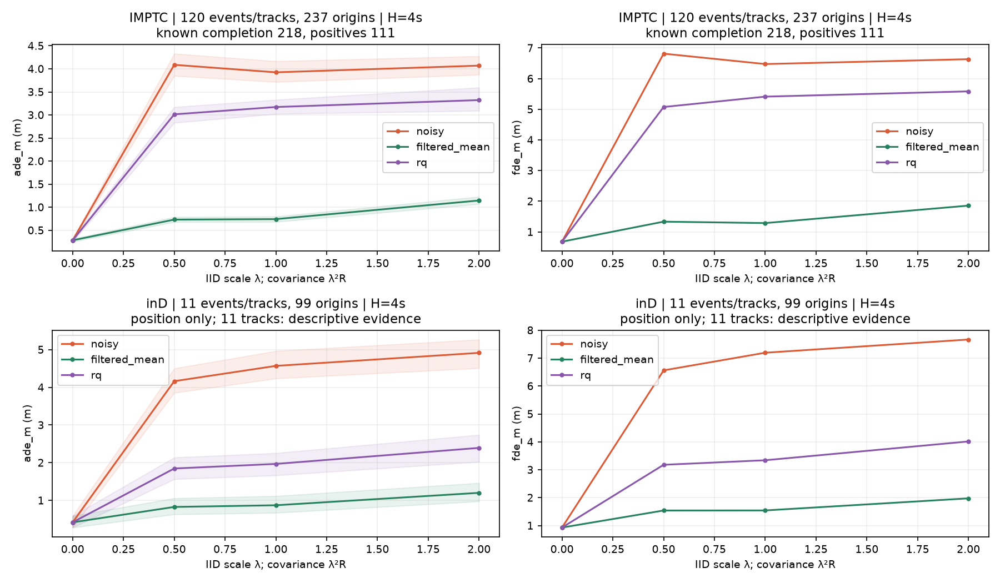
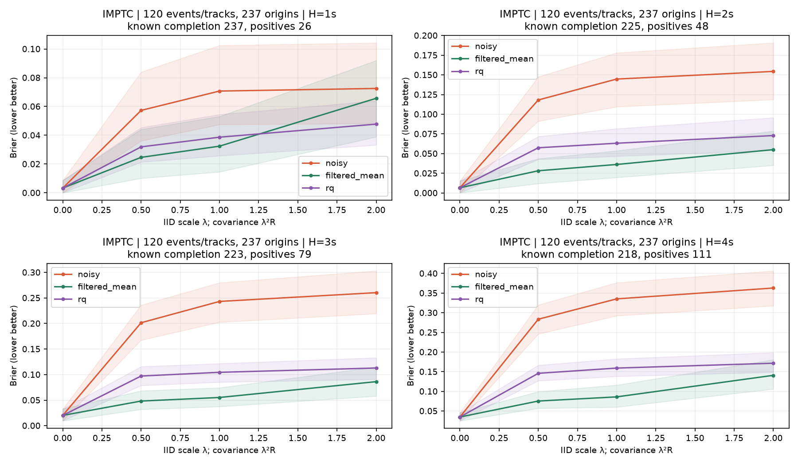
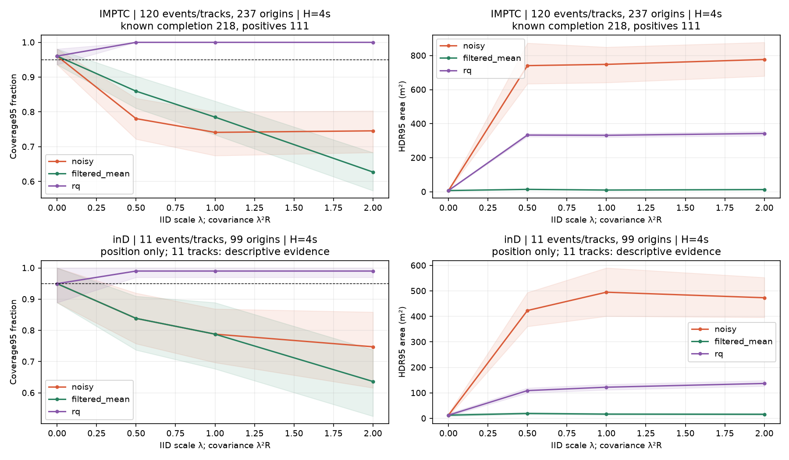
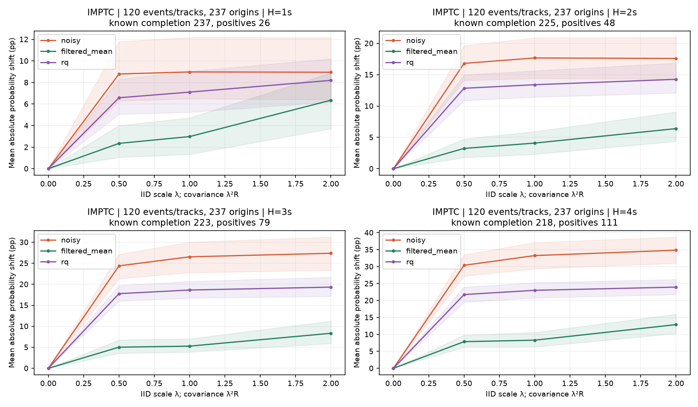
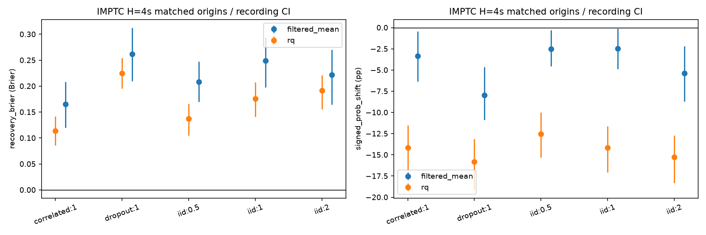
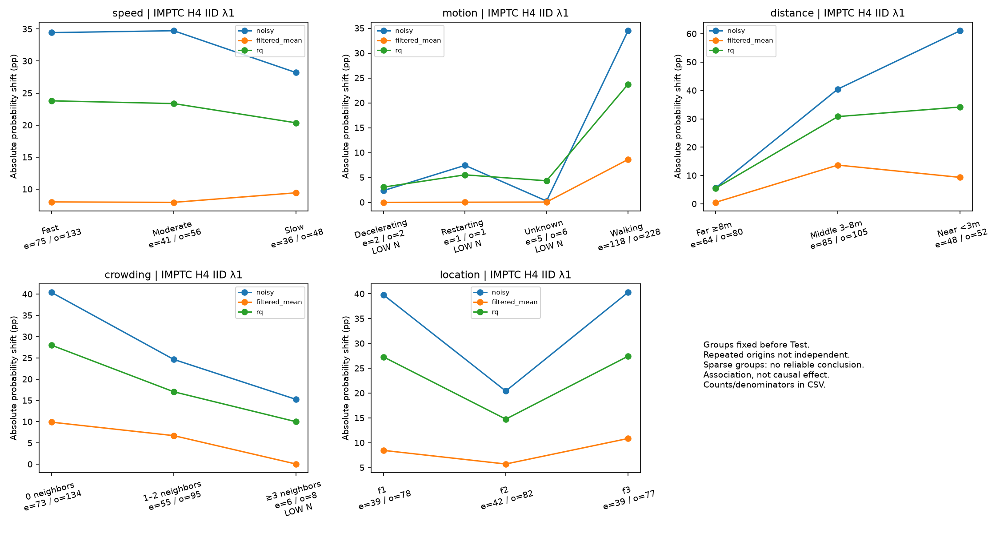
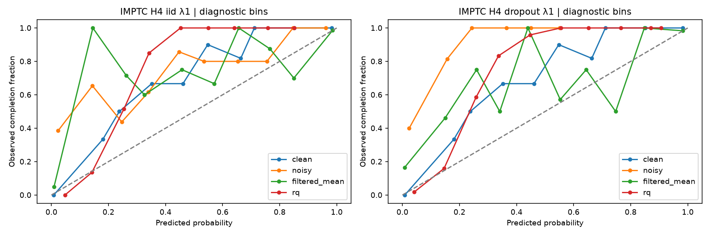

# View2Risk — Final Observation Robustness Report

Status: COMPLETE for planned exploratory comparisons; scientific limitations below

## 1. Executive summary

### Principal measured finding

R-aware state estimation substantially reduces the damage caused by synthetic observations, but neither method restores Clean predictive quality. The filtered mean has the best point-error and Brier recovery of these fixed comparisons while under-covering position GT; FFBS is much broader and can over-cover. Keep Q-only as the default.

At IID λ1, IMPTC ADE is Clean0.283m / Noisy3.925m / filtered-mean0.742m / FFBS3.173m. Corresponding H4 Brier is0.03472 /0.33527 /0.08594 /0.15922 on218 known outcomes (111 positive origins). Filtered-mean recovery relative to Noisy is0.24933, recording-cluster95%CI[0.19773,0.29349]; FFBS recovery is0.17605,[0.14124,0.20727]. These are within-cohort improvements under an assumed synthetic sensor model, not independent calibration evidence.

IMPTC endpoint Coverage95 is96.05% /74.12% /78.51% /100.00%, with HDR95 area7.37 /748.20 /10.27 /331.61m². Thus filtered-mean is under-covering and FFBS attains100% with an area about45times Clean. No successful full UQ restoration claim is justified. The frozen constant-speed baseline Brier0.01835 is also below the Clean DD-MDN point estimate on this cohort.

inD shows the same tradeoff: ADE0.418 /4.569 /0.871 /1.968m; Coverage95 94.95% /78.79% /78.79% /98.99%; HDR95 12.65 /494.96 /16.78 /122.29m². These are endpoint+4s Coverage/area, not the historical mean across8 future horizons. inD has99origins from11tracks/recordings and no verified Exit outcome.

Official DD-MDN and default Q-only are unchanged. Existing predictions are reused only after matching event, origin, clean history, future GT and synthetic-history seed. Missing combinations use CPU inference; no retraining or hyperparameter selection. Historically reused Test data provide exploratory robustness evidence, not independent calibration.

| dataset | noise_type | noise_scale | mode | n_events | n_origins | n_completion_evaluable | ade_m | fde_m | coverage95 | hdr95_area_m2 | nll | brier | mean_abs_prob_shift |
| --- | --- | --- | --- | --- | --- | --- | --- | --- | --- | --- | --- | --- | --- |
| IMPTC | clean | 0.00000 | clean | 120 | 237 | 218 | 0.28316 | 0.68144 | 0.96053 | 7.36643 | 1.40512 | 0.03472 | 0.00000 |
| IMPTC | correlated | 1.00000 | filtered_mean | 120 | 237 | 218 | 0.82338 | 1.36290 | 0.71491 | 10.80843 | 3.25877 | 0.11114 | 10.76042 |
| IMPTC | correlated | 1.00000 | noisy | 120 | 237 | 218 | 4.11696 | 6.88030 | 0.82018 | 806.51553 | 7.28743 | 0.27654 | 30.54879 |
| IMPTC | correlated | 1.00000 | rq | 120 | 237 | 218 | 3.12402 | 5.29459 | 1.00000 | 334.64099 | 4.85696 | 0.16234 | 23.26279 |
| IMPTC | dropout | 1.00000 | filtered_mean | 120 | 237 | 218 | 1.25416 | 1.94900 | 0.57456 | 13.20940 | 4.58706 | 0.14442 | 14.71690 |
| IMPTC | dropout | 1.00000 | noisy | 120 | 237 | 218 | 4.08625 | 6.65184 | 0.65789 | 169.84855 | 7.25780 | 0.40616 | 37.92392 |
| IMPTC | dropout | 1.00000 | rq | 120 | 237 | 218 | 3.41780 | 5.63127 | 0.99123 | 356.28645 | 4.92248 | 0.18147 | 25.27637 |
| IMPTC | iid | 0.50000 | filtered_mean | 120 | 237 | 218 | 0.73191 | 1.33482 | 0.85965 | 14.32174 | 2.80635 | 0.07538 | 7.85245 |
| IMPTC | iid | 0.50000 | noisy | 120 | 237 | 218 | 4.08767 | 6.81484 | 0.78070 | 740.85778 | 7.61984 | 0.28351 | 30.37751 |
| IMPTC | iid | 0.50000 | rq | 120 | 237 | 218 | 3.01412 | 5.07448 | 1.00000 | 333.01663 | 4.79743 | 0.14591 | 21.74868 |
| IMPTC | iid | 1.00000 | filtered_mean | 120 | 237 | 218 | 0.74209 | 1.28849 | 0.78509 | 10.27236 | 3.02088 | 0.08594 | 8.29589 |
| IMPTC | iid | 1.00000 | noisy | 120 | 237 | 218 | 3.92505 | 6.47570 | 0.74123 | 748.19666 | 7.54952 | 0.33527 | 33.24552 |
| IMPTC | iid | 1.00000 | rq | 120 | 237 | 218 | 3.17267 | 5.41307 | 1.00000 | 331.60912 | 4.85590 | 0.15922 | 23.00277 |
| IMPTC | iid | 2.00000 | filtered_mean | 120 | 237 | 218 | 1.14625 | 1.85769 | 0.62719 | 13.13932 | 4.25507 | 0.14079 | 12.88041 |
| IMPTC | iid | 2.00000 | noisy | 120 | 237 | 218 | 4.07022 | 6.63420 | 0.74561 | 776.84808 | 7.56028 | 0.36292 | 34.83373 |
| IMPTC | iid | 2.00000 | rq | 120 | 237 | 218 | 3.32305 | 5.58460 | 1.00000 | 342.45347 | 4.94289 | 0.17159 | 23.94211 |
| inD | clean | 0.00000 | clean | 11 | 99 | 0 | 0.41809 | 0.92982 | 0.94949 | 12.64584 | 1.57442 | NA | NA |
| inD | correlated | 1.00000 | filtered_mean | 11 | 99 | 0 | 0.94668 | 1.61127 | 0.74747 | 16.88399 | 3.64519 | NA | NA |
| inD | correlated | 1.00000 | noisy | 11 | 99 | 0 | 4.15202 | 6.59427 | 0.81818 | 409.81478 | 6.35389 | NA | NA |
| inD | correlated | 1.00000 | rq | 11 | 99 | 0 | 2.05916 | 3.48220 | 0.98990 | 124.67109 | 3.75949 | NA | NA |
| inD | dropout | 1.00000 | filtered_mean | 11 | 99 | 0 | 1.41275 | 2.26226 | 0.41414 | 14.45125 | 5.61883 | NA | NA |
| inD | dropout | 1.00000 | noisy | 11 | 99 | 0 | 2.92056 | 4.78443 | 0.82828 | 246.24069 | 5.67212 | NA | NA |
| inD | dropout | 1.00000 | rq | 11 | 99 | 0 | 2.33276 | 3.70024 | 0.98990 | 146.90447 | 3.95842 | NA | NA |
| inD | iid | 0.50000 | filtered_mean | 11 | 99 | 0 | 0.82663 | 1.54097 | 0.83838 | 19.30759 | 3.17527 | NA | NA |
| inD | iid | 0.50000 | noisy | 11 | 99 | 0 | 4.16321 | 6.56128 | 0.83838 | 423.16893 | 6.18080 | NA | NA |
| inD | iid | 0.50000 | rq | 11 | 99 | 0 | 1.84668 | 3.17850 | 0.98990 | 109.02469 | 3.63029 | NA | NA |
| inD | iid | 1.00000 | filtered_mean | 11 | 99 | 0 | 0.87139 | 1.54354 | 0.78788 | 16.77721 | 3.48371 | NA | NA |
| inD | iid | 1.00000 | noisy | 11 | 99 | 0 | 4.56883 | 7.19323 | 0.78788 | 494.95656 | 6.75786 | NA | NA |
| inD | iid | 1.00000 | rq | 11 | 99 | 0 | 1.96817 | 3.34138 | 0.98990 | 122.29150 | 3.67178 | NA | NA |
| inD | iid | 2.00000 | filtered_mean | 11 | 99 | 0 | 1.20139 | 1.97598 | 0.63636 | 16.12987 | 4.41877 | NA | NA |
| inD | iid | 2.00000 | noisy | 11 | 99 | 0 | 4.91486 | 7.66606 | 0.74747 | 473.19984 | 7.01766 | NA | NA |
| inD | iid | 2.00000 | rq | 11 | 99 | 0 | 2.39361 | 4.01435 | 0.98990 | 136.94902 | 3.92525 | NA | NA |

## 2. Main research question
How do observation perturbations affect position UQ and Exit probability? Can Legacy state estimation recover error without excessive area? Conditions are observational descriptors, never new neural inputs.

## 3. R observation model and assumptions
y=x+b+λε; ε~N(0,R), covariance λ²R. λ0 has no bias/noise. SPD Train fit only (2465 pairs):
```json
{
  "n": 2465,
  "bias_m": [
    -0.006966842335597911,
    -0.02212357604419024
  ],
  "covariance_m2": [
    [
      0.02459720430659077,
      -0.00390237020313375
    ],
    [
      -0.00390237020313375,
      0.03151372718510289
    ]
  ],
  "RMSE_m": 0.23801033801246074,
  "p90_p95_p99_m": [
    0.33795493445136493,
    0.4226147200651803,
    0.7066090724266983
  ]
}
```
SPD axes are transferred directly to dataset XY: an unvalidated sensor/coordinate transfer assumption. It is camera–virtual-LiDAR annotation disagreement, not measured IMPTC/inD detector error. Target-only perturbation; surrounding objects, maps and signals assumed exact. DD-MDN may already contain annotation noise; physical R/Q decomposition is not identified.

## 4. Experimental setup
| dataset | candidate_origins | eligible_origins | events | tracks | recordings | unavailable | existing_mode_origins |
| --- | --- | --- | --- | --- | --- | --- | --- |
| IMPTC | 237 | 237 | 120 | 116 | 55 | 0 | 5 |
| inD | 99 | 99 | 11 | 11 | 11 | 0 | 99 |

Previous catalog/eligibility flow (unchanged):
```json
{
  "catalog_events": 1415,
  "catalog_decisions": {
    "complete": 1019,
    "unresolved": 218,
    "right_censored": 170,
    "returned": 8
  },
  "catalog_splits": {
    "train": 548,
    "test": 502,
    "calibration": 275,
    "validation": 90
  },
  "existing_rolling_events": 301,
  "existing_rolling_origins": 3142,
  "eligible_origins": 2326,
  "selected_events": 120,
  "selected_origins": 237,
  "remaining_events_not_inferred": "Bounded budget, deterministic pre-inference sampling; not failures"
}
```
Ten observed positions at0.1s, eight future positions +0.5…4s. CV4 [x,y,vx,vy], q_filter=.5m²/s³, P0=diag(1e6,1e6,25,25). Filter measurement covariance is the known λ²R; bias is subtracted. No Test fit. FFBS8 histories, 400 joint samples each, combined3200 with equal1/8 weights. Single-history output3200 samples. Step GMM HDR:2500 samples and120² grid. Official normalized mixture weights only; 20 discrete confidences are not path probabilities.

Each history generates its own position, official-style finite differences, causal heading, world-to-ego map and neighbor transforms, and inverse output transform. The Legacy causal heading differs from the upstream offline future-assisted branch. Posterior smoothing uses observations only through origin. Condition groups use clean observed causal features fixed in the previous Train/Validation plan; thus the membership is identical across perturbations.

Common normal draws and seeds are reused across scales/modes where compatible. Reused cached clean and some modes can have pre-existing Monte Carlo draws; cache provenance is recorded and no model mean is altered. This is one noise realization per origin, not a full noise-seed ensemble.

## 5. Clean / Noisy / R-aware comparisons
Coverage and NLL below are endpoint-H metrics; ADE uses all points through H and FDE the endpoint. HDR area uses all predictive distributions, coverage requires GT. `n_<metric>` fields give exact denominators. `coverage95_mean_through_h` is also available for comparison with historical 8-horizon-average results.

## 6. Noise magnitude analysis
| noise_scale | mode | horizon_s | n_completion_evaluable | brier | brier_ci_low | brier_ci_high | mean_abs_prob_shift | signed_prob_shift |
| --- | --- | --- | --- | --- | --- | --- | --- | --- |
| 0.00000 | clean | 1 | 237 | 0.00329 | 0.00004 | 0.00869 | 0.00000 | 0.00000 |
| 0.00000 | clean | 2 | 225 | 0.00660 | 0.00026 | 0.01536 | 0.00000 | 0.00000 |
| 0.00000 | clean | 3 | 223 | 0.02012 | 0.00962 | 0.03290 | 0.00000 | 0.00000 |
| 0.00000 | clean | 4 | 218 | 0.03472 | 0.02515 | 0.04577 | 0.00000 | 0.00000 |
| 0.50000 | filtered_mean | 1 | 237 | 0.02465 | 0.01013 | 0.04413 | 2.35034 | -0.94027 |
| 0.50000 | filtered_mean | 2 | 225 | 0.02821 | 0.01197 | 0.04366 | 3.24037 | 0.48774 |
| 0.50000 | filtered_mean | 3 | 223 | 0.04824 | 0.03201 | 0.06840 | 5.02439 | -1.61379 |
| 0.50000 | filtered_mean | 4 | 218 | 0.07538 | 0.05701 | 0.09951 | 7.85245 | -2.51912 |
| 0.50000 | noisy | 1 | 237 | 0.05729 | 0.03611 | 0.08398 | 8.78824 | -2.99420 |
| 0.50000 | noisy | 2 | 225 | 0.11814 | 0.09123 | 0.14759 | 16.80380 | -6.84942 |
| 0.50000 | noisy | 3 | 223 | 0.20149 | 0.16749 | 0.23616 | 24.38001 | -13.88423 |
| 0.50000 | noisy | 4 | 218 | 0.28351 | 0.24614 | 0.31998 | 30.37751 | -22.34138 |
| 0.50000 | rq | 1 | 237 | 0.03195 | 0.02139 | 0.04542 | 6.58373 | -2.44554 |
| 0.50000 | rq | 2 | 225 | 0.05742 | 0.04267 | 0.07181 | 12.83281 | -3.21387 |
| 0.50000 | rq | 3 | 223 | 0.09720 | 0.07876 | 0.11577 | 17.76490 | -7.27835 |
| 0.50000 | rq | 4 | 218 | 0.14591 | 0.12692 | 0.16661 | 21.74868 | -12.52954 |
| 1.00000 | filtered_mean | 1 | 237 | 0.03242 | 0.01456 | 0.05312 | 2.98233 | -0.48655 |
| 1.00000 | filtered_mean | 2 | 225 | 0.03619 | 0.01971 | 0.05362 | 4.08703 | 0.13054 |
| 1.00000 | filtered_mean | 3 | 223 | 0.05522 | 0.03745 | 0.07429 | 5.27558 | -0.87526 |
| 1.00000 | filtered_mean | 4 | 218 | 0.08594 | 0.06009 | 0.11608 | 8.29589 | -2.47653 |
| 1.00000 | noisy | 1 | 237 | 0.07074 | 0.04748 | 0.10247 | 8.97877 | -5.22297 |
| 1.00000 | noisy | 2 | 225 | 0.14469 | 0.10955 | 0.17804 | 17.67102 | -10.52123 |
| 1.00000 | noisy | 3 | 223 | 0.24317 | 0.20259 | 0.27984 | 26.53165 | -17.86287 |
| 1.00000 | noisy | 4 | 218 | 0.33527 | 0.29233 | 0.37657 | 33.24552 | -26.39873 |
| 1.00000 | rq | 1 | 237 | 0.03867 | 0.02575 | 0.05448 | 7.10746 | -2.94792 |
| 1.00000 | rq | 2 | 225 | 0.06318 | 0.04668 | 0.08170 | 13.39966 | -4.19264 |
| 1.00000 | rq | 3 | 223 | 0.10448 | 0.08531 | 0.12173 | 18.62922 | -8.40005 |
| 1.00000 | rq | 4 | 218 | 0.15922 | 0.13821 | 0.18279 | 23.00277 | -14.13647 |
| 2.00000 | filtered_mean | 1 | 237 | 0.06569 | 0.03888 | 0.09199 | 6.35641 | -0.78995 |
| 2.00000 | filtered_mean | 2 | 225 | 0.05504 | 0.03506 | 0.07872 | 6.39992 | -1.00699 |
| 2.00000 | filtered_mean | 3 | 223 | 0.08619 | 0.05801 | 0.11503 | 8.33043 | -1.63687 |
| 2.00000 | filtered_mean | 4 | 218 | 0.14079 | 0.10611 | 0.18083 | 12.88041 | -5.38964 |
| 2.00000 | noisy | 1 | 237 | 0.07254 | 0.04821 | 0.10428 | 8.94976 | -5.79417 |
| 2.00000 | noisy | 2 | 225 | 0.15441 | 0.11867 | 0.19075 | 17.58900 | -12.24697 |
| 2.00000 | noisy | 3 | 223 | 0.26034 | 0.21931 | 0.30311 | 27.37856 | -19.97455 |
| 2.00000 | noisy | 4 | 218 | 0.36292 | 0.31778 | 0.40670 | 34.83373 | -28.76912 |
| 2.00000 | rq | 1 | 237 | 0.04774 | 0.03326 | 0.06399 | 8.19647 | -3.03059 |
| 2.00000 | rq | 2 | 225 | 0.07293 | 0.05424 | 0.09568 | 14.26121 | -4.72271 |
| 2.00000 | rq | 3 | 223 | 0.11289 | 0.09082 | 0.13311 | 19.31857 | -9.18935 |
| 2.00000 | rq | 4 | 218 | 0.17159 | 0.14880 | 0.19875 | 23.94211 | -15.24011 |

## 7. Temporal correlation and dropout analysis
AR(1) rho=.8 starts from stationary N(0,λ²R) and innovations sqrt(1−rho²)λε. The Legacy Kalman observation model remains white: deliberate model misspecification, not a correlation-aware filter. Dropout masks the last4 positions (0.4s); noisy baseline carries the last observed position, filters skip missing updates. Never fill with future GT. Filtered-mean and FFBS compared separately.

For iid dt=.1s: Cov(delta velocity)=2λ²R/dt², Cov(delta acceleration)=6λ²R/dt⁴. AR(1): velocity variance multiplier2(1−rho), acceleration multiplier6−8rho+2rho², so reduced derivative noise does not guarantee better DD-MDN predictions. Heading and context rotation also change.

| dataset | noise_type | noise_scale | mode | position_rms_m | velocity_rms_mps | acceleration_rms_mps2 | heading_error_deg | recent_speed_mps | stop_proxy_last_06s |
| --- | --- | --- | --- | --- | --- | --- | --- | --- | --- |
| IMPTC | clean | 0.00000 | clean | 0.00000 | 0.00000 | 0.00000 | 0.00000 | 1.51084 | 0.00000 |
| IMPTC | correlated | 1.00000 | filtered_mean | 0.19312 | 0.35461 | 0.51710 | 8.91026 | 1.52494 | 0.00000 |
| IMPTC | correlated | 1.00000 | noisy | 0.23026 | 1.48747 | 21.79847 | 35.64812 | 1.54836 | 0.00000 |
| IMPTC | correlated | 1.00000 | rq | 0.22940 | 0.56118 | 2.52186 | 15.90461 | 1.55070 | 0.00105 |
| IMPTC | dropout | 1.00000 | filtered_mean | 0.19990 | 0.50063 | 0.34441 | 13.03243 | 1.57767 | 0.00000 |
| IMPTC | dropout | 1.00000 | noisy | 0.33612 | 2.67973 | 42.26047 | 57.00113 | 0.73452 | 0.08017 |
| IMPTC | dropout | 1.00000 | rq | 0.31155 | 0.86003 | 2.55842 | 26.29165 | 1.69094 | 0.00686 |
| IMPTC | iid | 0.50000 | filtered_mean | 0.05487 | 0.19743 | 0.70030 | 6.07894 | 1.50479 | 0.00000 |
| IMPTC | iid | 0.50000 | noisy | 0.11942 | 1.64688 | 28.23633 | 37.82992 | 1.52396 | 0.00000 |
| IMPTC | iid | 0.50000 | rq | 0.08170 | 0.35869 | 2.44589 | 10.96755 | 1.51037 | 0.00000 |
| IMPTC | iid | 1.00000 | filtered_mean | 0.10184 | 0.28083 | 0.55758 | 7.88764 | 1.50611 | 0.00000 |
| IMPTC | iid | 1.00000 | noisy | 0.23564 | 3.29377 | 56.47265 | 58.51210 | 1.56805 | 0.00000 |
| IMPTC | iid | 1.00000 | rq | 0.15338 | 0.50270 | 2.52864 | 14.80247 | 1.52856 | 0.00000 |
| IMPTC | iid | 2.00000 | filtered_mean | 0.19918 | 0.48445 | 0.39682 | 13.61305 | 1.52985 | 0.00000 |
| IMPTC | iid | 2.00000 | noisy | 0.46974 | 6.58753 | 112.94530 | 74.59626 | 1.77080 | 0.00422 |
| IMPTC | iid | 2.00000 | rq | 0.29556 | 0.78409 | 2.55343 | 22.83733 | 1.59811 | 0.00422 |
| inD | clean | 0.00000 | clean | 0.00000 | 0.00000 | 0.00000 | 0.00000 | 1.31489 | 0.02020 |
| inD | correlated | 1.00000 | filtered_mean | 0.18890 | 0.36291 | 0.54328 | 13.23424 | 1.38798 | 0.00000 |
| inD | correlated | 1.00000 | noisy | 0.22640 | 1.47380 | 21.77600 | 44.70486 | 1.41220 | 0.00000 |
| inD | correlated | 1.00000 | rq | 0.22505 | 0.56670 | 2.53916 | 19.14208 | 1.42597 | 0.00505 |
| inD | dropout | 1.00000 | filtered_mean | 0.19868 | 0.52476 | 0.40481 | 19.11085 | 1.38663 | 0.01010 |
| inD | dropout | 1.00000 | noisy | 0.32034 | 2.55856 | 40.93326 | 62.22543 | 0.62040 | 0.11111 |
| inD | dropout | 1.00000 | rq | 0.30190 | 0.84338 | 2.57533 | 29.43820 | 1.53334 | 0.00758 |
| inD | iid | 0.50000 | filtered_mean | 0.05626 | 0.21127 | 0.75570 | 9.18419 | 1.33610 | 0.01010 |
| inD | iid | 0.50000 | noisy | 0.11908 | 1.64190 | 28.59107 | 42.44977 | 1.33999 | 0.02020 |
| inD | iid | 0.50000 | rq | 0.08318 | 0.37081 | 2.46585 | 14.79187 | 1.34040 | 0.01263 |
| inD | iid | 1.00000 | filtered_mean | 0.10291 | 0.29363 | 0.64462 | 12.62937 | 1.36002 | 0.01010 |
| inD | iid | 1.00000 | noisy | 0.23469 | 3.28381 | 57.18215 | 63.92711 | 1.39627 | 0.02020 |
| inD | iid | 1.00000 | rq | 0.15398 | 0.50987 | 2.56224 | 17.87379 | 1.39597 | 0.01136 |
| inD | iid | 2.00000 | filtered_mean | 0.19955 | 0.48909 | 0.49109 | 17.92854 | 1.42526 | 0.01010 |
| inD | iid | 2.00000 | noisy | 0.46760 | 6.56761 | 114.36429 | 74.63894 | 1.63181 | 0.00000 |
| inD | iid | 2.00000 | rq | 0.29457 | 0.77901 | 2.58226 | 25.17048 | 1.52371 | 0.00884 |

## 8. Crossing-completion probability robustness
Joint future anchor samples cross the correct piecewise semantic opposite Exit. First crossing differs from GT0.12s confirmation. GT intervals touching H remain unknown; censored outcomes are negative only with sufficient observation through H. Complete-case evaluation; no IPCW. No inD Exit metric. `mean_abs_prob_shift` and `signed_prob_shift` are percentage points, not accuracy. ΔBrier=noisy−clean; recovery=noisy−method on matched origins. Positive recovery improves Brier for that scenario only. Recording-cluster bootstrap400 draws; fewer than5 recordings means unavailable CI.

| noise_type | noise_scale | mode | brier | baseline_brier | delta_brier | recovery_brier | recovery_brier_ci_low | recovery_brier_ci_high |
| --- | --- | --- | --- | --- | --- | --- | --- | --- |
| clean | 0.00000 | clean | 0.03472 | 0.01835 | 0.00000 | NA | NA | NA |
| correlated | 1.00000 | filtered_mean | 0.11114 | 0.01835 | 0.07642 | 0.16539 | 0.12024 | 0.20793 |
| correlated | 1.00000 | noisy | 0.27654 | 0.01835 | 0.24182 | 0.00000 | 0.00000 | 0.00000 |
| correlated | 1.00000 | rq | 0.16234 | 0.01835 | 0.12762 | 0.11419 | 0.08608 | 0.14197 |
| dropout | 1.00000 | filtered_mean | 0.14442 | 0.01835 | 0.10970 | 0.26175 | 0.20968 | 0.31277 |
| dropout | 1.00000 | noisy | 0.40616 | 0.01835 | 0.37145 | 0.00000 | 0.00000 | 0.00000 |
| dropout | 1.00000 | rq | 0.18147 | 0.01835 | 0.14675 | 0.22469 | 0.19554 | 0.25449 |
| iid | 0.50000 | filtered_mean | 0.07538 | 0.01835 | 0.04066 | 0.20813 | 0.16950 | 0.24723 |
| iid | 0.50000 | noisy | 0.28351 | 0.01835 | 0.24879 | 0.00000 | 0.00000 | 0.00000 |
| iid | 0.50000 | rq | 0.14591 | 0.01835 | 0.11119 | 0.13760 | 0.10511 | 0.16582 |
| iid | 1.00000 | filtered_mean | 0.08594 | 0.01835 | 0.05122 | 0.24933 | 0.19773 | 0.29349 |
| iid | 1.00000 | noisy | 0.33527 | 0.01835 | 0.30056 | 0.00000 | 0.00000 | 0.00000 |
| iid | 1.00000 | rq | 0.15922 | 0.01835 | 0.12451 | 0.17605 | 0.14124 | 0.20727 |
| iid | 2.00000 | filtered_mean | 0.14079 | 0.01835 | 0.10607 | 0.22214 | 0.16422 | 0.26982 |
| iid | 2.00000 | noisy | 0.36292 | 0.01835 | 0.32821 | 0.00000 | 0.00000 | 0.00000 |
| iid | 2.00000 | rq | 0.17159 | 0.01835 | 0.13687 | 0.19133 | 0.15568 | 0.22136 |

The existing first_exit counts an inside-to-outside sign crossing at h>0. A perturbed/posterior start already beyond Exit is NOT automatically assigned T=0; it contributes only if it later crosses from inside again. Histories are not truncated to an at-risk posterior. This affects interpretation near Exit and is preserved, not tuned. Lateral validity is checked at the interpolated crossing.

| noise_type | noise_scale | mode | posterior_start_beyond_exit_fraction | posterior_start_outside_corridor_fraction |
| --- | --- | --- | --- | --- |
| clean | 0.00000 | clean | 0.00000 | 0.00000 |
| correlated | 1.00000 | filtered_mean | 0.00000 | 0.00422 |
| correlated | 1.00000 | noisy | 0.00000 | 0.00422 |
| correlated | 1.00000 | rq | 0.00422 | 0.01160 |
| dropout | 1.00000 | filtered_mean | 0.00844 | 0.02532 |
| dropout | 1.00000 | noisy | 0.00000 | 0.00422 |
| dropout | 1.00000 | rq | 0.01530 | 0.04747 |
| iid | 0.50000 | filtered_mean | 0.00000 | 0.00000 |
| iid | 0.50000 | noisy | 0.00000 | 0.00422 |
| iid | 0.50000 | rq | 0.00000 | 0.00264 |
| iid | 1.00000 | filtered_mean | 0.00000 | 0.00422 |
| iid | 1.00000 | noisy | 0.00000 | 0.00844 |
| iid | 1.00000 | rq | 0.00158 | 0.00791 |
| iid | 2.00000 | filtered_mean | 0.00000 | 0.00844 |
| iid | 2.00000 | noisy | 0.00000 | 0.03376 |
| iid | 2.00000 | rq | 0.00527 | 0.02373 |

## 9. Condition-wise R sensitivity
| condition | group | n_origins | n_events | n_recordings | n_complete | mean_abs_prob_shift | recovery_brier | coverage95 | hdr95_area_m2 | status |
| --- | --- | --- | --- | --- | --- | --- | --- | --- | --- | --- |
| speed | Fast | 133 | 75 | 46 | 64 | 23.80005 | 0.17939 | 1.00000 | 339.49001 | EXPLORATORY |
| speed | Moderate | 56 | 41 | 30 | 28 | 23.36942 | 0.19233 | 1.00000 | 321.34262 | EXPLORATORY |
| speed | Slow | 48 | 36 | 27 | 19 | 20.36589 | 0.14522 | 1.00000 | 321.75009 | EXPLORATORY |
| motion | Decelerating | 2 | 2 | 2 | 0 | 3.06250 | -0.00034 | 1.00000 | 307.12200 | INSUFFICIENT DATA |
| motion | Restarting | 1 | 1 | 1 | 0 | 5.53125 | 0.00247 | 1.00000 | 180.61108 | INSUFFICIENT DATA |
| motion | Unknown | 6 | 5 | 4 | 0 | 4.33333 | -0.00856 | 1.00000 | 308.50241 | INSUFFICIENT DATA |
| motion | Walking | 228 | 118 | 55 | 111 | 23.74561 | 0.18115 | 1.00000 | 333.09427 | EXPLORATORY |
| distance | Far ≥8m | 80 | 64 | 38 | 0 | 5.52344 | 0.00552 | 1.00000 | 338.17468 | EXPLORATORY |
| distance | Middle 3–8m | 105 | 85 | 48 | 59 | 30.79375 | 0.19159 | 1.00000 | 330.94920 | EXPLORATORY |
| distance | Near <3m | 52 | 48 | 38 | 52 | 34.16226 | 0.35904 | 1.00000 | 322.84081 | EXPLORATORY |
| crowding | 0 neighbors | 134 | 73 | 45 | 79 | 28.00210 | 0.19833 | 1.00000 | 333.91319 | EXPLORATORY |
| crowding | 1–2 neighbors | 95 | 55 | 30 | 31 | 17.04572 | 0.14377 | 1.00000 | 327.83732 | EXPLORATORY |
| crowding | ≥3 neighbors | 8 | 6 | 5 | 1 | 10.00391 | 0.10002 | 1.00000 | 337.80618 | INSUFFICIENT DATA |
| location | f1 | 78 | 39 | 30 | 41 | 27.28886 | 0.21782 | 1.00000 | 331.25837 | EXPLORATORY |
| location | f2 | 82 | 42 | 28 | 26 | 14.76258 | 0.10977 | 1.00000 | 328.38006 | EXPLORATORY |
| location | f3 | 77 | 39 | 33 | 44 | 27.43628 | 0.19699 | 1.00000 | 335.40318 | EXPLORATORY |

Groups with fewer than20events/5recordings are INSUFFICIENT DATA; completion also needs5positive/5negative events. Stop/restart are especially sparse. Last0.6s speed<.2 is only a short-window smoothing diagnostic, not the1s stopped-state definition. Slowing/restart state comparisons cannot support intent claims. Density has different IMPTC/inD spatial denominators; neighbor count within3m is retained separately. No demographics or causal claims.

## 10. Successes, failures, and limitations

**IMPTC IID λ1 vs Clean:**
| mode | ade_m | coverage95 | hdr95_area_m2 | brier |
| --- | --- | --- | --- | --- |
| clean | 0.28316 | 0.96053 | 7.36643 | 0.03472 |
| filtered_mean | 0.74209 | 0.78509 | 10.27236 | 0.08594 |
| noisy | 3.92505 | 0.74123 | 748.19666 | 0.33527 |
| rq | 3.17267 | 1.00000 | 331.60912 | 0.15922 |

**inD IID λ1 vs Clean:**
| mode | ade_m | coverage95 | hdr95_area_m2 | brier |
| --- | --- | --- | --- | --- |
| clean | 0.41809 | 0.94949 | 12.64584 | NA |
| filtered_mean | 0.87139 | 0.78788 | 16.77721 | NA |
| noisy | 4.56883 | 0.78788 | 494.95656 | NA |
| rq | 1.96817 | 0.98990 | 122.29150 | NA |

High Coverage with very large area is not successful recovery. Compare all errors/proper scores and sharpness. Non-significant or negative recovery is retained. Finite FFBS/HDR/joint Monte Carlo and historically reused Test limit conclusions. One observation-noise seed per origin does not characterize noise-seed variation. No long-horizon completion or population calibration claim.

Failures: 0. See reports/failures.json.

## 11. Final recommendation
Keep official DD-MDN Q-only default and Legacy R+Q optional. Do not replace the predictor based on this diagnostic. XGBoost AFT: NOT_IMPLEMENTED; no independently trained/evaluated artifact found, no AFT training performed. Preserve inD private data and all original results. End modeling expansion after integration.

## Figures















## Reproduction and sources
Run `robustness.py test`, `robustness.py prepare` only for a new version, `robustness.py infer WORKER NWORKERS`, then `analyze_robustness.py` in the versioned directory using ../../.venv/bin/python. Completed origins are skipped. Config includes source hashes; raw/per-origin records remain private.

DD-MDN https://github.com/kav-institute/ddmdn ; FilterPy https://github.com/rlabbe/filterpy ; PedPy https://github.com/PedestrianDynamics/PedPy ; inD Tools https://github.com/ika-rwth-aachen/drone-dataset-tools ; SPD https://github.com/AIR-THU/DAIR-V2X-Seq

## Answers to the condition questions

- **Slower is not necessarily more sensitive.** At IID λ1/H4, Noisy absolute probability shift is28.21pp for Slow (48origins/36events),34.73pp Moderate (56/41),34.44pp Fast (133/75). FFBS shifts are20.37/23.37/23.80pp. This is descriptive, with overlapping events across groups; it does not establish a speed effect independent of distance.
- **Distance is strongly associated with probability instability in this cohort.** Noisy shift is61.08pp near Exit<3m (52origins/48events),40.50pp at3–8m (105/85),5.63pp at≥8m (80/64). FFBS reduces these to34.16/30.79/5.52pp. Starting-boundary convention and different baseline completion likelihoods contribute.
- **Crowding does not support a monotonic worsening claim.** Noisy shifts are40.41pp with0neighbors,24.65pp with1–2,15.26pp with≥3. The ≥3 group has only8origins/6events. These are confounded condition differences, not protective crowding effects.
- **Location recovery is positive at IID λ1/H4**, with FFBS Brier recovery0.21782(f1),0.10977(f2),0.19699(f3). f2's probability shifts are smaller, but differing speed/distance populations and3dates limit generalization. CIs and subgroup denominators are in CSV.
- **Deceleration/stop/restart evidence is insufficient.** IMPTC contains2decelerating events,1restart event and0stopped origins. inD contains2decelerating tracks and no eligible stopped/restart origins here. Do not interpret the small negative FFBS recovery in deceleration or Unknown groups as a stable effect.
- **Noise scale is not a monotonic point-error guarantee.** IMPTC Noisy ADE at λ0.5/1/2 is4.088/3.925/4.070m; H4 Brier increases0.284/0.335/0.363. Heading changes, nonlinear DD-MDN response and finite paired realizations matter.

## Final verification and outputs

336/336 planned origins,5376 scenario-method outputs and21504 per-horizon rows completed; zero prediction failures.1064 outputs reused (including336Clean),4312 newly evaluated.18 math/Legacy unit checks and exact Clean GMM reproduction for both datasets passed. Final numeric/source checks and browser evidence are in FINAL_R_INTEGRATION_CHECK.md and reports/.

Private individual outputs remain on the server. No GitHub push, neural training, checkpoint replacement or GPU allocation. The optional R comparison is an explanatory robustness diagnostic and does not change the final predictor policy.
