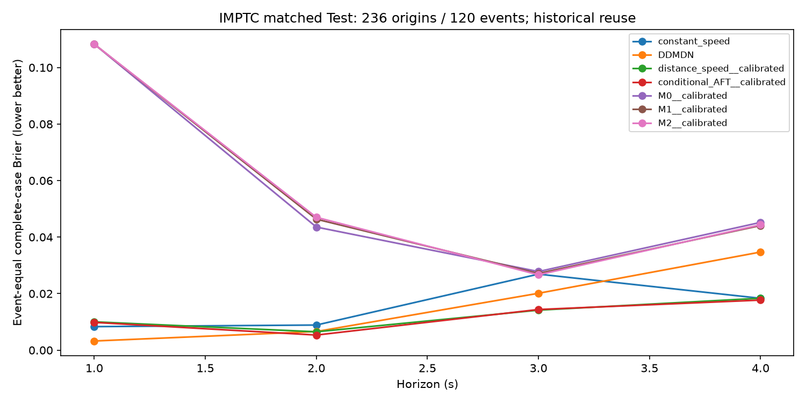
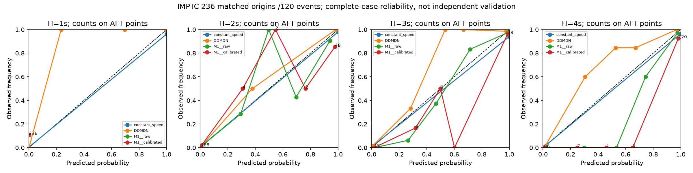
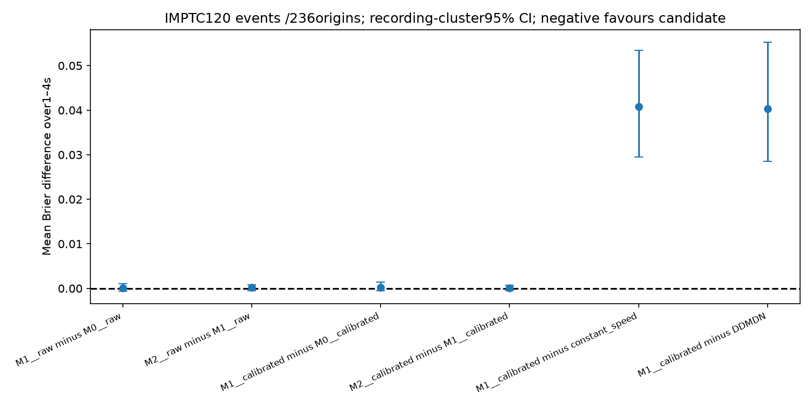
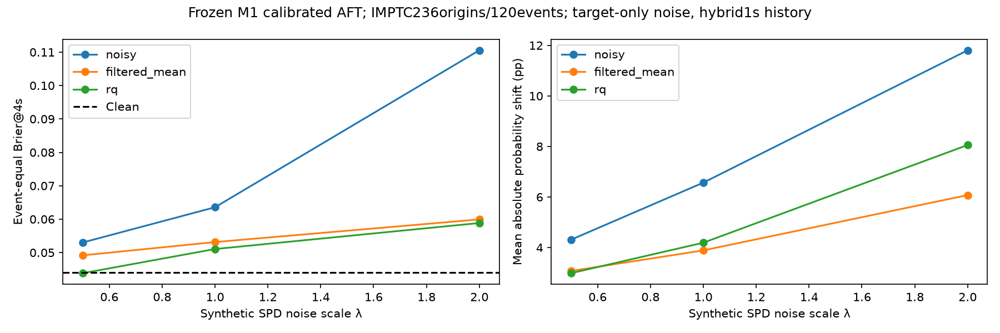

# View2Risk — XGBoost AFT Final Report

Status: COMPLETE_WITH_LIMITATIONS

## Executive answer

1. **Outperformed CV/DD-MDN? No overall improvement established.** Matched Test mean Brier1–4s: selected M1 calibrated 0.05646, constant speed 0.01562, DD-MDN 0.01617. H4: 0.04410, 0.01835, 0.03472. These are paired exploratory comparisons; see clustered intervals, not proof of new-date generalization.

2. **Acceleration? No established improvement on matched Test; paired intervals include zero.** Validation raw mean Brier M0 0.02294 → M1 0.02249. Small validation gain; matched Test paired intervals below determine whether evidence excludes zero. No Test-driven reselection.

3. **Crowding?** M2 Validation 0.02263; M2 adds both crowding and crosswalk. It did not beat selected M1 on Validation. No isolated beneficial crowding effect is established; validation permutation is model reliance only.

4. **Well calibrated? Not established; Calibration worsened matched Test Brier.** Separate Calibration fitted log-time shift/scale. Matched Test H4 ECE 0.05384; report raw/calibrated reliability and Brier together. Fitting Calibration is not evidence of population calibration, and supported U95 is conditional, not a blanket95% guarantee.

5. **R-aware robustness?** IIDλ1 Brier@4: filtered_mean 0.05315, noisy 0.06357, rq 0.05106. Lower R-aware point estimates are not a statistically established recovery: the IIDλ1 recovery intervals include zero. No R refit. Hybrid history and out-of-domain feature limitations apply.

6. **Main simulator?** Suitable as an optional measured Clearance-Time UQ comparison. Keep DD-MDN trajectories/default unchanged; no automatic replacement or Validated label. Negative/inconclusive comparisons are retained.

## 1. Data, labels and eligibility

| cohort | split | n_origins | n_events | n_tracks | n_recordings | n_dates | complete_events | censored_events |
|---|---|---|---|---|---|---|---|---|
| dd_matched | test | 236 | 120 | 116 | 55 | 3 | 107 | 13 |
| landmarks | calibration | 569 | 208 | 191 | 40 | 2 | 184 | 24 |
| landmarks | test | 936 | 354 | 336 | 66 | 3 | 317 | 37 |
| landmarks | train | 1113 | 404 | 374 | 117 | 8 | 369 | 35 |
| landmarks | validation | 206 | 71 | 65 | 24 | 2 | 71 | 0 |

Original catalog: {'complete': 1019, 'unresolved': 218, 'right_censored': 170, 'returned': 8}. Existing landmark rows 2878; excluded 55 rows across both cohorts; every exclusion and reason saved. No source events were modified. Returns are excluded competing events, unresolved cases never assigned noncompletion.

| cohort | split | reason | n |
|---|---|---|---|
| dd_matched | test | INSUFFICIENT_CONTINUOUS_1S_HISTORY | 1 |
| landmarks | calibration | DIRECTION_NOT_CAUSALLY_IDENTIFIED | 1 |
| landmarks | calibration | INVALID_CURRENT_EXIT_GEOMETRY | 8 |
| landmarks | test | INVALID_CURRENT_EXIT_GEOMETRY | 21 |
| landmarks | train | INVALID_CURRENT_EXIT_GEOMETRY | 20 |
| landmarks | validation | INVALID_CURRENT_EXIT_GEOMETRY | 4 |

GT first Exit frame interval is retained; confirmation requires0.12s beyond boundary but residual target uses first passage, not confirmation time. Right-censored bounds are [last valid observation−origin,+infinity). Date/event/track separation verified. Current Exit geometry and causal direction/history requirements can exclude old landmarks; numbers were not forced to match older reports. Complete-case comparisons use the same horizon-specific known outcomes across all methods. Unknowns remain NA.

## 2. Causal features and bounded learning

M0: remaining axial distance to opposite piecewise semantic Exit and signed longitudinal velocity over0.6s. M1 adds change in0.6s velocity over0.4s. M2 adds neighbors within3m at current causal observations and f2/f3 one-hot indicators. No age/gender; no future positions as features. Direction is established by observed Entry or adequate past displacement. Neighbor counts use same physical radius; no inferred density denominator.

Official xgboost.train / survival:aft / aft-nloglik, normal log-time error, DMatrix lower/upper bounds. Log T=f(X)+σZ. CDF Φ((log t−f(X))/σ). Exact labels use density, interval labels use F(upper)−F(lower), censoring uses survival. Stored intervals were used in training; old linear AFT artifacts were not retrained.

| variant | candidate | max_depth | aft_loss_distribution_scale | rounds | val_mean_brier | val_interval_nll |
|---|---|---|---|---|---|---|
| M0 | 0 | 2 | 0.15000 | 209 | 0.02294 | 3.61642 |
| M0 | 1 | 2 | 0.30000 | 400 | 0.03453 | 4.18020 |
| M0 | 2 | 3 | 0.15000 | 171 | 0.02318 | 3.61582 |
| M0 | 3 | 3 | 0.30000 | 391 | 0.03481 | 4.17996 |
| M1 | 0 | 2 | 0.15000 | 229 | 0.02249 | 3.61559 |
| M1 | 1 | 2 | 0.30000 | 400 | 0.03436 | 4.18008 |
| M1 | 2 | 3 | 0.15000 | 199 | 0.02372 | 3.62146 |
| M1 | 3 | 3 | 0.30000 | 382 | 0.03482 | 4.18179 |
| M2 | 0 | 2 | 0.15000 | 227 | 0.02263 | 3.61793 |
| M2 | 1 | 2 | 0.30000 | 399 | 0.03444 | 4.18111 |
| M2 | 2 | 3 | 0.15000 | 174 | 0.02283 | 3.61427 |
| M2 | 3 | 3 | 0.30000 | 399 | 0.03473 | 4.17931 |

Each event has total training mass1, rescaled to mean row weight1. Trees2/3, scale0.15/0.30, learning rate0.03, min_child_weight10, L2=10, max400 rounds, validation NLL early stop30. Per-variant/global selection: Validation mean event-equal Brier1–4; tie NLL then depth. Calibration is separate interval/censor log-likelihood shift and scale. No Test model changes. No neural training, GPU, new data, or official full-Test rerun.

| model | bias | scale | at_bound |
|---|---|---|---|
| M0 | -0.01065 | 0.60595 | False |
| M1 | -0.01170 | 0.60641 | False |
| M2 | -0.01130 | 0.61163 | False |

## 3. Exactly matched DD-MDN cohort

All listed methods share the same236origins/120events; horizon-specific denominators are shown. Event-equal Brier differs from earlier origin-equal R report and must not be numerically equated. DD-MDN CDF uses stored joint first-exit samples with denominator3200, including nonarrival. Its discrete hypothesis confidence is not used.

| method | horizon_s | n_origins | n_events | n_known | n_complete | n_complete_events | brier | ci_low | ci_high | brier_ipcw | ece |
|---|---|---|---|---|---|---|---|---|---|---|---|
| constant_speed | 1 | 236 | 120 | 236 | 26 | 26 | 0.00833 | 0.00000 | 0.02157 | 0.00853 | 0.00833 |
| constant_speed | 2 | 236 | 120 | 224 | 48 | 44 | 0.00889 | 0.00000 | 0.02417 | 0.00886 | 0.00889 |
| constant_speed | 3 | 236 | 120 | 222 | 79 | 66 | 0.02691 | 0.00522 | 0.04951 | 0.02692 | 0.02691 |
| constant_speed | 4 | 236 | 120 | 217 | 111 | 87 | 0.01835 | 0.00446 | 0.03608 | 0.01830 | 0.01835 |
| distance_speed__raw | 1 | 236 | 120 | 236 | 26 | 26 | 0.00988 | 0.00191 | 0.02170 | 0.01011 | 0.01038 |
| distance_speed__raw | 2 | 236 | 120 | 224 | 48 | 44 | 0.00649 | 0.00070 | 0.01670 | 0.00646 | 0.00354 |
| distance_speed__raw | 3 | 236 | 120 | 222 | 79 | 66 | 0.01447 | 0.00509 | 0.02435 | 0.01446 | 0.01572 |
| distance_speed__raw | 4 | 236 | 120 | 217 | 111 | 87 | 0.01888 | 0.00984 | 0.03034 | 0.01877 | 0.02612 |
| distance_speed__calibrated | 1 | 236 | 120 | 236 | 26 | 26 | 0.01002 | 0.00186 | 0.02214 | 0.01026 | 0.01057 |
| distance_speed__calibrated | 2 | 236 | 120 | 224 | 48 | 44 | 0.00650 | 0.00058 | 0.01699 | 0.00647 | 0.00218 |
| distance_speed__calibrated | 3 | 236 | 120 | 222 | 79 | 66 | 0.01416 | 0.00474 | 0.02415 | 0.01415 | 0.01545 |
| distance_speed__calibrated | 4 | 236 | 120 | 217 | 111 | 87 | 0.01838 | 0.00906 | 0.03015 | 0.01828 | 0.02355 |
| conditional_AFT__raw | 1 | 236 | 120 | 236 | 26 | 26 | 0.00991 | 0.00128 | 0.02205 | 0.01014 | 0.01246 |
| conditional_AFT__raw | 2 | 236 | 120 | 224 | 48 | 44 | 0.00540 | 0.00077 | 0.01412 | 0.00537 | 0.00755 |
| conditional_AFT__raw | 3 | 236 | 120 | 222 | 79 | 66 | 0.01477 | 0.00484 | 0.02544 | 0.01475 | 0.02391 |
| conditional_AFT__raw | 4 | 236 | 120 | 217 | 111 | 87 | 0.01836 | 0.00776 | 0.03091 | 0.01824 | 0.02549 |
| conditional_AFT__calibrated | 1 | 236 | 120 | 236 | 26 | 26 | 0.00983 | 0.00105 | 0.02226 | 0.01005 | 0.01061 |
| conditional_AFT__calibrated | 2 | 236 | 120 | 224 | 48 | 44 | 0.00535 | 0.00067 | 0.01416 | 0.00532 | 0.00900 |
| conditional_AFT__calibrated | 3 | 236 | 120 | 222 | 79 | 66 | 0.01439 | 0.00459 | 0.02496 | 0.01438 | 0.01856 |
| conditional_AFT__calibrated | 4 | 236 | 120 | 217 | 111 | 87 | 0.01773 | 0.00717 | 0.03033 | 0.01762 | 0.01947 |
| M0__raw | 1 | 236 | 120 | 236 | 26 | 26 | 0.10702 | 0.07306 | 0.14665 | 0.10831 | 0.10720 |
| M0__raw | 2 | 236 | 120 | 224 | 48 | 44 | 0.03851 | 0.02167 | 0.05941 | 0.03806 | 0.02006 |
| M0__raw | 3 | 236 | 120 | 222 | 79 | 66 | 0.02969 | 0.01714 | 0.04201 | 0.02968 | 0.03629 |
| M0__raw | 4 | 236 | 120 | 217 | 111 | 87 | 0.04004 | 0.02423 | 0.05941 | 0.03988 | 0.04245 |
| M0__calibrated | 1 | 236 | 120 | 236 | 26 | 26 | 0.10828 | 0.07373 | 0.14793 | 0.10958 | 0.10830 |
| M0__calibrated | 2 | 236 | 120 | 224 | 48 | 44 | 0.04355 | 0.02135 | 0.06849 | 0.04309 | 0.04341 |
| M0__calibrated | 3 | 236 | 120 | 222 | 79 | 66 | 0.02781 | 0.01330 | 0.04085 | 0.02781 | 0.02488 |
| M0__calibrated | 4 | 236 | 120 | 217 | 111 | 87 | 0.04521 | 0.02441 | 0.07017 | 0.04507 | 0.05313 |
| M1__raw | 1 | 236 | 120 | 236 | 26 | 26 | 0.10670 | 0.07278 | 0.14605 | 0.10799 | 0.10711 |
| M1__raw | 2 | 236 | 120 | 224 | 48 | 44 | 0.04141 | 0.02246 | 0.06414 | 0.04090 | 0.02282 |
| M1__raw | 3 | 236 | 120 | 222 | 79 | 66 | 0.02896 | 0.01638 | 0.04118 | 0.02895 | 0.03561 |
| M1__raw | 4 | 236 | 120 | 217 | 111 | 87 | 0.03871 | 0.02334 | 0.05743 | 0.03856 | 0.04291 |
| M1__calibrated | 1 | 236 | 120 | 236 | 26 | 26 | 0.10827 | 0.07371 | 0.14796 | 0.10957 | 0.10830 |
| M1__calibrated | 2 | 236 | 120 | 224 | 48 | 44 | 0.04634 | 0.02264 | 0.07518 | 0.04583 | 0.04179 |
| M1__calibrated | 3 | 236 | 120 | 222 | 79 | 66 | 0.02714 | 0.01339 | 0.03995 | 0.02715 | 0.02540 |
| M1__calibrated | 4 | 236 | 120 | 217 | 111 | 87 | 0.04410 | 0.02345 | 0.07001 | 0.04397 | 0.05384 |
| M2__raw | 1 | 236 | 120 | 236 | 26 | 26 | 0.10662 | 0.07271 | 0.14580 | 0.10790 | 0.10705 |
| M2__raw | 2 | 236 | 120 | 224 | 48 | 44 | 0.04215 | 0.02361 | 0.06464 | 0.04161 | 0.02211 |
| M2__raw | 3 | 236 | 120 | 222 | 79 | 66 | 0.02871 | 0.01621 | 0.04155 | 0.02870 | 0.03533 |
| M2__raw | 4 | 236 | 120 | 217 | 111 | 87 | 0.03908 | 0.02287 | 0.05850 | 0.03893 | 0.04223 |
| M2__calibrated | 1 | 236 | 120 | 236 | 26 | 26 | 0.10825 | 0.07370 | 0.14794 | 0.10955 | 0.10829 |
| M2__calibrated | 2 | 236 | 120 | 224 | 48 | 44 | 0.04701 | 0.02424 | 0.07511 | 0.04646 | 0.04152 |
| M2__calibrated | 3 | 236 | 120 | 222 | 79 | 66 | 0.02666 | 0.01265 | 0.03951 | 0.02666 | 0.02629 |
| M2__calibrated | 4 | 236 | 120 | 217 | 111 | 87 | 0.04437 | 0.02308 | 0.07067 | 0.04424 | 0.05329 |
| DDMDN | 1 | 236 | 120 | 236 | 26 | 26 | 0.00324 | 0.00005 | 0.00960 | 0.00332 | 0.00639 |
| DDMDN | 2 | 236 | 120 | 224 | 48 | 44 | 0.00660 | 0.00029 | 0.01761 | 0.00654 | 0.00720 |
| DDMDN | 3 | 236 | 120 | 222 | 79 | 66 | 0.02013 | 0.00870 | 0.03226 | 0.02001 | 0.02223 |
| DDMDN | 4 | 236 | 120 | 217 | 111 | 87 | 0.03472 | 0.02555 | 0.04599 | 0.03414 | 0.04879 |

## 4. Incremental value and paired uncertainty

Negative ΔBrier favours candidate. These400 recording-cluster resamples hold fitted models and Train censor distribution fixed. They do not include model-fitting uncertainty; only3 Test dates exist. Repeated origins remain within recordings. Mean-horizon differences give equal weight to H1/2/3/4, not a favorable horizon chosen after testing.

| cohort | split | candidate | reference | mean_delta_brier | ci_low | ci_high |
|---|---|---|---|---|---|---|
| landmarks | validation | M1__raw | M0__raw | -0.00045 | -0.00132 | 0.00034 |
| landmarks | validation | M2__raw | M1__raw | 0.00015 | -0.00025 | 0.00055 |
| landmarks | validation | M1__calibrated | M0__calibrated | -0.00040 | -0.00154 | 0.00071 |
| landmarks | validation | M2__calibrated | M1__calibrated | 0.00024 | -0.00036 | 0.00082 |
| landmarks | validation | M1__calibrated | constant_speed | -0.00960 | -0.01956 | -0.00067 |
| landmarks | test | M1__raw | M0__raw | 0.00005 | -0.00037 | 0.00039 |
| landmarks | test | M2__raw | M1__raw | 0.00028 | -0.00008 | 0.00073 |
| landmarks | test | M1__calibrated | M0__calibrated | 0.00006 | -0.00052 | 0.00054 |
| landmarks | test | M2__calibrated | M1__calibrated | 0.00034 | -0.00008 | 0.00080 |
| landmarks | test | M1__calibrated | constant_speed | -0.00756 | -0.01170 | -0.00285 |
| dd_matched | test | M1__raw | M0__raw | 0.00013 | -0.00063 | 0.00107 |
| dd_matched | test | M2__raw | M1__raw | 0.00019 | -0.00049 | 0.00078 |
| dd_matched | test | M1__calibrated | M0__calibrated | 0.00025 | -0.00055 | 0.00141 |
| dd_matched | test | M2__calibrated | M1__calibrated | 0.00011 | -0.00055 | 0.00071 |
| dd_matched | test | M1__calibrated | constant_speed | 0.04085 | 0.02955 | 0.05339 |
| dd_matched | test | M1__calibrated | DDMDN | 0.04029 | 0.02848 | 0.05532 |

Validation neighbor permutation within crosswalk:

{
  "delta_mean": 0.0,
  "range95": [
    0.0,
    0.0
  ],
  "repeats": 50,
  "n_validation_events": 71,
  "warning": "Within-crosswalk row permutation; correlated origins remain. This is model reliance, not retrained ablation, causal effect or independent CI."
}

This diagnostic is not a new model, not a causal estimate, and cannot separate crowding from all location/context interactions. M2−M1 is a joint context comparison. No evidence of isolated crowding gain is claimed.

## 5. Censoring, NLL, truncated CRPS and U95

IPCW uses event-weighted Train reverse Kaplan–Meier. Conditions: independent censoring, transport of censor mechanism across dates, G≥0.05 and≥5Train tail events. Test track-loss may be informative. Pooled/crosswalk sensitivity is saved in censor_sensitivity.csv. Frame brackets straddling H remain unknown; interval-ambiguous rows are excluded from each horizon denominator, censored-before-H retain zero IPCW weight. Inverse weighting is not proof that censoring bias is removed.

| cohort | method | nll_interval | truncated_crps_0_4 |
|---|---|---|---|
| landmarks | constant_speed | NA | 0.08759 |
| landmarks | distance_speed__raw | 3.26507 | 0.06056 |
| landmarks | distance_speed__calibrated | 3.29120 | 0.06016 |
| landmarks | conditional_AFT__raw | 3.24749 | 0.05845 |
| landmarks | conditional_AFT__calibrated | 3.27107 | 0.05774 |
| landmarks | M0__raw | 3.37453 | 0.07737 |
| landmarks | M0__calibrated | 3.35804 | 0.06966 |
| landmarks | M1__raw | 3.37591 | 0.07753 |
| landmarks | M1__calibrated | 3.36386 | 0.06986 |
| landmarks | M2__raw | 3.37957 | 0.07876 |
| landmarks | M2__calibrated | 3.36834 | 0.07140 |
| dd_matched | constant_speed | NA | 0.06487 |
| dd_matched | distance_speed__raw | 3.70954 | 0.04153 |
| dd_matched | distance_speed__calibrated | 3.79958 | 0.04118 |
| dd_matched | conditional_AFT__raw | 3.62370 | 0.04025 |
| dd_matched | conditional_AFT__calibrated | 3.68459 | 0.04008 |
| dd_matched | M0__raw | 7.66288 | 0.19618 |
| dd_matched | M0__calibrated | 14.90606 | 0.20731 |
| dd_matched | M1__raw | 7.60844 | 0.19659 |
| dd_matched | M1__calibrated | 14.73790 | 0.20786 |
| dd_matched | M2__raw | 7.63281 | 0.19754 |
| dd_matched | M2__calibrated | 14.60960 | 0.20824 |
| dd_matched | DDMDN | NA | 0.04899 |

NLL here is negative log interval probability or censor survival, so it is not comparable to the older density-NLL report or DD-MDN positional NLL. CV and empirical DD-MDN do not supply continuous event density: NLL=NA. Truncated CRPS is numerical IPCW integrated Brier0–4s at0.05s grid; no full-tail score. DD-MDN uses saved finite first-exit sample times without new inference.

| method | n_total | n_u95_within4 | n_known | n_unknown | n_beyond4_or_unavailable | coverage | ci_low | ci_high |
|---|---|---|---|---|---|---|---|---|
| constant_speed | 236 | 116 | 98 | 18 | 120 | 0.21212 | 0.13535 | 0.30476 |
| distance_speed__raw | 236 | 91 | 89 | 2 | 145 | 0.96667 | 0.91396 | 1.00000 |
| distance_speed__calibrated | 236 | 92 | 90 | 2 | 144 | 0.96703 | 0.91579 | 1.00000 |
| conditional_AFT__raw | 236 | 91 | 89 | 2 | 145 | 0.95556 | 0.90377 | 1.00000 |
| conditional_AFT__calibrated | 236 | 91 | 86 | 5 | 145 | 0.95402 | 0.89874 | 1.00000 |
| M0__raw | 236 | 87 | 86 | 1 | 149 | 0.91954 | 0.86206 | 0.97728 |
| M0__calibrated | 236 | 104 | 101 | 3 | 132 | 0.76471 | 0.67032 | 0.86281 |
| M1__raw | 236 | 87 | 87 | 0 | 149 | 0.90909 | 0.85129 | 0.97190 |
| M1__calibrated | 236 | 104 | 101 | 3 | 132 | 0.76471 | 0.67306 | 0.86275 |
| M2__raw | 236 | 87 | 87 | 0 | 149 | 0.92045 | 0.86313 | 0.97728 |
| M2__calibrated | 236 | 104 | 101 | 3 | 132 | 0.77451 | 0.68960 | 0.86464 |
| DDMDN | 236 | 67 | 57 | 10 | 169 | 0.96552 | 0.91071 | 1.00000 |

U95 rows only assess quantiles at most4s with observed outcomes; beyond4 and censored-before-quantile cases are explicitly unassessed. Conditional observed-subset coverage is not population coverage. DD-MDN U95 is the empirical 95th order statistic over all3200 joint samples, only if that many samples exit within4s; otherwise unavailable. No tail is extrapolated. Calibration-scale narrowing may worsen coverage despite better likelihood. Sparse probability bins have weak evidence.

## 6. Independent landmark Test (no DD-MDN inference available)

Do not compare these936landmarks/354events to the236-origin DD-MDN cohort. This supplementary cohort uses frozen models and same protocol.

| method | n_origins | n_events | n_known | brier | ci_low | ci_high | brier_ipcw | ece |
|---|---|---|---|---|---|---|---|---|
| constant_speed | 936 | 354 | 888 | 0.04626 | 0.03289 | 0.06003 | 0.04600 | 0.04626 |
| distance_speed__raw | 936 | 354 | 888 | 0.02650 | 0.01898 | 0.03474 | 0.02632 | 0.01704 |
| distance_speed__calibrated | 936 | 354 | 888 | 0.02657 | 0.01887 | 0.03491 | 0.02639 | 0.01807 |
| conditional_AFT__raw | 936 | 354 | 888 | 0.02256 | 0.01621 | 0.02963 | 0.02239 | 0.01071 |
| conditional_AFT__calibrated | 936 | 354 | 888 | 0.02290 | 0.01632 | 0.02973 | 0.02273 | 0.01220 |
| M0__raw | 936 | 354 | 888 | 0.02658 | 0.02077 | 0.03240 | 0.02636 | 0.03494 |
| M0__calibrated | 936 | 354 | 888 | 0.02372 | 0.01688 | 0.03066 | 0.02355 | 0.01676 |
| M1__raw | 936 | 354 | 888 | 0.02660 | 0.02115 | 0.03240 | 0.02638 | 0.03313 |
| M1__calibrated | 936 | 354 | 888 | 0.02387 | 0.01714 | 0.03068 | 0.02370 | 0.01691 |
| M2__raw | 936 | 354 | 888 | 0.02663 | 0.02101 | 0.03225 | 0.02641 | 0.03414 |
| M2__calibrated | 936 | 354 | 888 | 0.02399 | 0.01743 | 0.03088 | 0.02382 | 0.01645 |

## 7. Frozen-candidate observation robustness

| noise_type | noise_scale | mode | n_origins | n_events | n_known | brier | ci_low | ci_high | ece | mean_abs_prob_shift | signed_prob_shift | recovery | recovery_ci_low | recovery_ci_high |
|---|---|---|---|---|---|---|---|---|---|---|---|---|---|---|
| clean | 0.00000 | clean | 236 | 120 | 217 | 0.04410 | 0.02345 | 0.07001 | 0.05384 | 0.00000 | 0.00000 | NA | NA | NA |
| correlated | 1.00000 | filtered_mean | 236 | 120 | 217 | 0.07234 | 0.04077 | 0.10953 | 0.05938 | 6.00324 | -0.13723 | 0.01097 | -0.00393 | 0.02739 |
| correlated | 1.00000 | noisy | 236 | 120 | 217 | 0.08331 | 0.04977 | 0.12137 | 0.08173 | 6.33468 | 0.45749 | 0.00000 | 0.00000 | 0.00000 |
| correlated | 1.00000 | rq | 236 | 120 | 217 | 0.06526 | 0.03925 | 0.09968 | 0.05707 | 5.98510 | 0.28523 | 0.01804 | 0.00469 | 0.03323 |
| dropout | 1.00000 | filtered_mean | 236 | 120 | 217 | 0.06887 | 0.03791 | 0.10845 | 0.04942 | 7.59775 | -2.05559 | 0.02100 | -0.01715 | 0.05504 |
| dropout | 1.00000 | noisy | 236 | 120 | 217 | 0.08986 | 0.06232 | 0.11396 | 0.09970 | 14.02356 | -13.52051 | 0.00000 | 0.00000 | 0.00000 |
| dropout | 1.00000 | rq | 236 | 120 | 217 | 0.07137 | 0.04942 | 0.09725 | 0.06415 | 11.06486 | 1.53385 | 0.01850 | -0.01328 | 0.04630 |
| iid | 0.50000 | filtered_mean | 236 | 120 | 217 | 0.04918 | 0.02509 | 0.07943 | 0.04095 | 3.07252 | -1.68210 | 0.00385 | -0.00946 | 0.01741 |
| iid | 0.50000 | noisy | 236 | 120 | 217 | 0.05303 | 0.02756 | 0.08640 | 0.04596 | 4.31200 | -0.76763 | 0.00000 | 0.00000 | 0.00000 |
| iid | 0.50000 | rq | 236 | 120 | 217 | 0.04385 | 0.02398 | 0.06766 | 0.04353 | 2.98528 | -1.06209 | 0.00919 | -0.00332 | 0.02319 |
| iid | 1.00000 | filtered_mean | 236 | 120 | 217 | 0.05315 | 0.02784 | 0.08786 | 0.04446 | 3.88650 | -1.20725 | 0.01042 | -0.01575 | 0.03702 |
| iid | 1.00000 | noisy | 236 | 120 | 217 | 0.06357 | 0.03247 | 0.10659 | 0.06073 | 6.56834 | -1.33566 | 0.00000 | 0.00000 | 0.00000 |
| iid | 1.00000 | rq | 236 | 120 | 217 | 0.05106 | 0.02841 | 0.07803 | 0.04851 | 4.19013 | -0.53559 | 0.01250 | -0.00930 | 0.03897 |
| iid | 2.00000 | filtered_mean | 236 | 120 | 217 | 0.05993 | 0.03010 | 0.09390 | 0.04999 | 6.07487 | -1.27764 | 0.05062 | 0.01815 | 0.08277 |
| iid | 2.00000 | noisy | 236 | 120 | 217 | 0.11056 | 0.07928 | 0.14992 | 0.11423 | 11.80590 | 2.47316 | 0.00000 | 0.00000 | 0.00000 |
| iid | 2.00000 | rq | 236 | 120 | 217 | 0.05885 | 0.03509 | 0.08973 | 0.05228 | 8.05717 | -0.02652 | 0.05171 | 0.02323 | 0.07979 |

Existing SPD Train bias/covariance, target-only IIDλ0.5/1/2, ARρ0.8, last0.4s dropout and existing CV4FilterPy/FFBS8 histories are unchanged. Probabilities are averaged over8 state-conditioned AFT CDFs; no Gaussian collapse or DD-MDN/AFT probability blending. Last1s acceleration requires0.1s before the stored0.9s noise history: that earlier actual causal observation remains unperturbed. This is a documented hybrid-error window, not full1s detector noise. For M1 this can amplify acceleration error; observed Clean inputs and all noisy histories remain causal. Out-of-corridor/beyond-Exit samples are counted; distance clamps at0 like existing analysis, lateral boundary extrapolation is flagged. These are stress/OOD conditions, not validated physical camera errors.

## 8. Simulator and preservation

Optional Clearance-Time UQ panel overlays stored CDF against DD-MDN1–4s, never replaces main3D trajectory. Per-origin payload remains localhost/private API; static pages contain aggregates only. inD Exit blocked. Existing historical R report remains intact and its prior AFT NOT_IMPLEMENTED refers to the earlier experiment.

## 8b. Observed input-support failure

{
  "train_min_distance": 2.1919000675738656,
  "matched_origins": 236,
  "below_train_distance": 39,
  "above_train_distance": 29,
  "known_h1": 236,
  "positive_h1": 26,
  "positive_h1_events": 26,
  "positive_h1_below_train_min": 26,
  "mean_pred_h1_positive": 0.00029422965973714487,
  "interpretation": "Landmark-trained trees have little near-Exit feature support; observed failure pattern is consistent with extrapolation limitation. Not a new tuned subset; all matched origins retained."
}

Train distance range begins at2.19190m. All26 actual H1 completion origins are below this minimum; selected calibrated M1 mean probability on these positives is0.000294 (0.0294%). This explains a concrete short-horizon failure pattern consistent with shallow-tree extrapolation limits, without asserting a proven causal decomposition. All236origins remain in evaluation. No new training points, thresholds, tuning, or post-hoc removal were introduced.

## 9. Limitations and final recommendation

GT v1 is provider-coordinate semantic-rule review, not every event independently video-annotated. Returns/unresolved omitted from fitted population, track-loss censoring can be informative, Validation has zero censored events, Calibration2dates and Test3dates are limited. Historical Test reuse disclosed. No independent external validation; no demographics, no new neural model, no GPU use, no GitHub push. Present the candidate as exploratory optional survival baseline. Stop search here; no unplanned hyperparameter expansion.

## 10. Outputs and reproduction

Root: `[private-source]`. Frozen model: `[private-source]`. Calibration and SHA256: `models/frozen.json`.

```bash

cd [private-source]

export CUDA_VISIBLE_DEVICES="" OMP_NUM_THREADS=2 OPENBLAS_NUM_THREADS=1

export PYTHONPATH="$PWD/.venv/lib/python3.11/site-packages"

../../.venv/bin/python check_methods.py

# Preparation/train/evaluate already executed. Guards refuse overwriting frozen experiments.

../../.venv/bin/python aft_experiment.py prepare

../../.venv/bin/python aft_experiment.py train

../../.venv/bin/python aft_experiment.py evaluate

../../.venv/bin/python aft_robustness.py

../../.venv/bin/python finalize_aft.py

```

For fresh reproduction copy scripts to a new versioned directory and adjust W only; do not overwrite this run. Initial isolated-environment missing seaborn resolved by original environment+isolated XGBoost path; no original packages modified. Empty-DD-U95 bootstrap fixed to NA after freeze; training source snapshot and all frozen weights retained. No parameter/model reselection.

## Sources

- Official XGBoost AFT: https://xgboost.readthedocs.io/en/stable/tutorials/aft_survival_analysis.html

- DD-MDN: https://github.com/kav-institute/ddmdn

- FilterPy: https://github.com/rlabbe/filterpy

- PedPy: https://github.com/PedestrianDynamics/PedPy

- IMPTC: https://github.com/kav-institute/imptc-dataset








