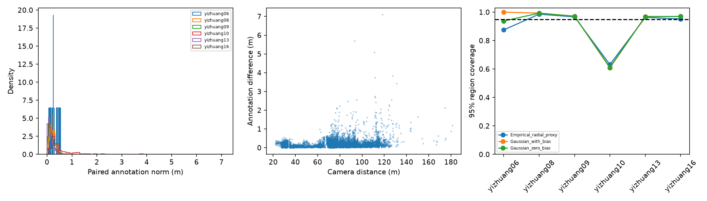

# R_pair_proxy full-data extension

10,109 eligible paired observations / 233 sequence-track groups / 34 sequences / 6 intersections. All raw ID rows, including unmatched/duplicate cases, remain in data/spd_pair_residuals.parquet.

Full-sample descriptive bias/covariance and site-cluster bootstrap are in models/r_pair_proxy_params.json. Only development intersections supply holdout means/covariances/empirical radial thresholds. No camera detector predictions are present.

| model | test_intersection | test_sequences | test_tracks | test_pairs | NLL | coverage90 | area90_m2 | coverage95 | area95_m2 |
| --- | --- | --- | --- | --- | --- | --- | --- | --- | --- |
| Gaussian_zero_bias | yizhuang06 | 4 | 9 | 16 | -0.283949 | 0.875 | 0.633858 | 0.9375 | 0.824669 |
| Gaussian_with_bias | yizhuang06 | 4 | 9 | 16 | -0.264902 | 0.875 | 0.632662 | 1 | 0.823112 |
| Empirical_radial_proxy | yizhuang06 | 4 | 9 | 16 | N/A | 0.6875 | 0.411834 | 0.875 | 0.722934 |
| Gaussian_zero_bias | yizhuang08 | 4 | 12 | 416 | -0.726553 | 0.983173 | 0.646065 | 0.992788 | 0.84055 |
| Gaussian_with_bias | yizhuang08 | 4 | 12 | 416 | -0.682151 | 0.978365 | 0.6438 | 0.992788 | 0.837603 |
| Empirical_radial_proxy | yizhuang08 | 4 | 12 | 416 | N/A | 0.927885 | 0.415538 | 0.985577 | 0.744267 |
| Gaussian_zero_bias | yizhuang09 | 9 | 44 | 2033 | -0.606345 | 0.962125 | 0.689468 | 0.971471 | 0.897018 |
| Gaussian_with_bias | yizhuang09 | 9 | 44 | 2033 | -0.609415 | 0.962125 | 0.688617 | 0.971471 | 0.895912 |
| Empirical_radial_proxy | yizhuang09 | 9 | 44 | 2033 | N/A | 0.92425 | 0.428055 | 0.966552 | 0.780302 |
| Gaussian_zero_bias | yizhuang10 | 5 | 29 | 301 | 13.8018 | 0.564784 | 0.443315 | 0.611296 | 0.576767 |
| Gaussian_with_bias | yizhuang10 | 5 | 29 | 301 | 13.7992 | 0.561462 | 0.44254 | 0.607973 | 0.575758 |
| Empirical_radial_proxy | yizhuang10 | 5 | 29 | 301 | N/A | 0.501661 | 0.372707 | 0.631229 | 0.643095 |
| Gaussian_zero_bias | yizhuang13 | 4 | 70 | 2684 | -0.558777 | 0.960134 | 0.706142 | 0.969076 | 0.918711 |
| Gaussian_with_bias | yizhuang13 | 4 | 70 | 2684 | -0.557732 | 0.961624 | 0.704742 | 0.969076 | 0.916891 |
| Empirical_radial_proxy | yizhuang13 | 4 | 70 | 2684 | N/A | 0.935917 | 0.441945 | 0.963115 | 0.75957 |
| Gaussian_zero_bias | yizhuang16 | 8 | 69 | 4659 | -0.473151 | 0.954067 | 0.769113 | 0.969736 | 1.00064 |
| Gaussian_with_bias | yizhuang16 | 8 | 69 | 4659 | -0.474674 | 0.954497 | 0.767602 | 0.969521 | 0.998673 |
| Empirical_radial_proxy | yizhuang16 | 8 | 69 | 4659 | N/A | 0.884954 | 0.394281 | 0.952136 | 0.757558 |

Site macro:

| model | coverage90 | coverage95 | area95_m2 | NLL |
| --- | --- | --- | --- | --- |
| Empirical_radial_proxy | 0.810361 | 0.895601 | 0.734621 | N/A |
| Gaussian_with_bias | 0.882179 | 0.918472 | 0.841325 | 1.86838 |
| Gaussian_zero_bias | 0.883214 | 0.908644 | 0.843059 | 1.85883 |

Pair micro:

| model | covered90 | covered95 | area95_m2 |
| --- | --- | --- | --- |
| Empirical_radial_proxy | 0.896429 | 0.949649 | 0.758657 |
| Gaussian_with_bias | 0.947077 | 0.960036 | 0.936795 |
| Gaussian_zero_bias | 0.94678 | 0.960135 | 0.938561 |

Empirical_radial_proxy uses empirical development Mahalanobis quantiles, preserving the Gaussian covariance shape. It is a diagnostic empirical region, not a continuous density model; NLL is N/A. The 2,000-resample parameter bootstrap keeps entire intersections together and is weak with only six sites.

No conditional distance/occlusion model was selected from Test. Existing spd_condition_counts.csv and the new figure are descriptive support checks only. Shared boxes, asynchronous timestamps, annotation dependence and supplied camera-matrix/projection issues remain; this does not identify R_camera.

Overlap with the previous Example export: 253 pairs; no Example rows were pooled. Any numerical export differences are recorded rather than overwriting old outputs.

