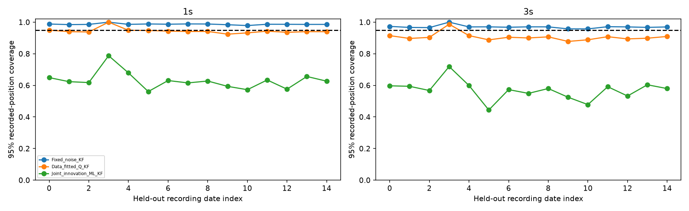
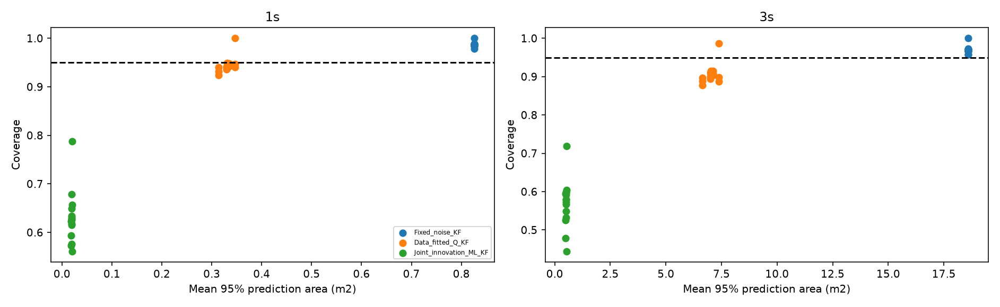
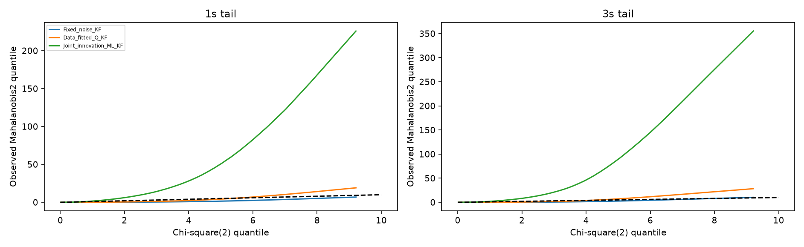

# Q_effective full-data extension

Canonical Full01–05, never pooled with Samples. Status2 finite XYZ segments break at non-increasing time or >60ms. One-second past-only warmup, 0.2s origin stride, paired 1/3s future availability within20.1ms, actual timestamp separation. No future smoothing.

Five recording-date grouped outer folds. All sequences/tracks from a recording date stay in one fold. Fixed noise grid is chosen on development dates; scalar q is forecast-NLL fitted on development dates with selected R fixed. The optional joint R/q baseline is IMPTC-only innovation ML, not EM and not physical identifiability. No Test-driven interval calibration.

State [x,y,vx,vy], continuous white acceleration spectral density q (m2/s3), Q(dt)=q[[dt3/3 I,dt2/2 I],[dt2/2 I,dt I]]. Isotropic R=rI (m2), P0=diag(r,r,4,4), velocity0. Forecast covariance includes filtered state uncertainty, future q and future R because the target is the recorded trajectory.

Forecast micro:

| model | horizon_s | test_sequences | test_tracks | predictions | RMSE_m | MAE_m | p95_error_m | max_error_m | coverage90 | coverage95 | mean_area90_m2 | mean_area95_m2 | mean_radius95_m | NLL | test_recording_dates |
| --- | --- | --- | --- | --- | --- | --- | --- | --- | --- | --- | --- | --- | --- | --- | --- |
| Data_fitted_Q_KF | 1 | 264 | 1906 | 265578 | 0.164676 | 0.105324 | 0.349053 | 5.72809 | 0.923401 | 0.940959 | 0.254546 | 0.331172 | 0.324657 | -1.42953 | 15 |
| Data_fitted_Q_KF | 3 | 264 | 1906 | 265578 | 0.914123 | 0.577593 | 2.07834 | 19.006 | 0.883115 | 0.904288 | 5.40988 | 7.03841 | 1.49669 | 1.97373 | 15 |
| Deterministic_CV | 1 | 264 | 1906 | 265578 | 0.176965 | 0.113012 | 0.37716 | 5.8683 | N/A | N/A | N/A | N/A | N/A | N/A | 15 |
| Deterministic_CV | 3 | 264 | 1906 | 265578 | 0.938623 | 0.592674 | 2.13779 | 19.4374 | N/A | N/A | N/A | N/A | N/A | N/A | 15 |
| Fixed_noise_KF | 1 | 264 | 1906 | 265578 | 0.156409 | 0.100131 | 0.331588 | 5.68476 | 0.977999 | 0.986433 | 0.634487 | 0.825487 | 0.512602 | -1.01006 | 15 |
| Fixed_noise_KF | 3 | 264 | 1906 | 265578 | 0.899963 | 0.568676 | 2.04524 | 18.6574 | 0.954902 | 0.969022 | 14.2965 | 18.6002 | 2.43323 | 2.2358 | 15 |
| Joint_innovation_ML_KF | 1 | 264 | 1906 | 265578 | 0.136755 | 0.0877205 | 0.289832 | 4.69266 | 0.577066 | 0.626829 | 0.0147629 | 0.0192069 | 0.0781838 | 4.14415 | 15 |
| Joint_innovation_ML_KF | 3 | 264 | 1906 | 265578 | 0.865232 | 0.546707 | 1.96227 | 18.2275 | 0.530364 | 0.577111 | 0.385158 | 0.501102 | 0.399346 | 12.3038 | 15 |

Date-level test metrics:

| recording_date | model | horizon_s | test_sequences | test_tracks | predictions | RMSE_m | MAE_m | p95_error_m | max_error_m | coverage90 | coverage95 | mean_area90_m2 | mean_area95_m2 | mean_radius95_m | NLL |
| --- | --- | --- | --- | --- | --- | --- | --- | --- | --- | --- | --- | --- | --- | --- | --- |
| 20230322 | Data_fitted_Q_KF | 1 | 29 | 187 | 29681 | 0.149365 | 0.0978588 | 0.326612 | 1.36163 | 0.933392 | 0.949227 | 0.253951 | 0.330398 | 0.324298 | -1.56915 |
| 20230322 | Data_fitted_Q_KF | 3 | 29 | 187 | 29681 | 0.850496 | 0.540215 | 1.9667 | 6.98825 | 0.894309 | 0.914659 | 5.39625 | 7.02068 | 1.49491 | 1.82133 |
| 20230322 | Deterministic_CV | 1 | 29 | 187 | 29681 | 0.162208 | 0.105953 | 0.354423 | 1.47007 | N/A | N/A | N/A | N/A | N/A | N/A |
| 20230322 | Deterministic_CV | 3 | 29 | 187 | 29681 | 0.876771 | 0.556279 | 2.03015 | 7.10814 | N/A | N/A | N/A | N/A | N/A | N/A |
| 20230322 | Fixed_noise_KF | 1 | 29 | 187 | 29681 | 0.141794 | 0.0930065 | 0.309264 | 1.29093 | 0.981166 | 0.988242 | 0.634486 | 0.825485 | 0.512601 | -1.05975 |
| 20230322 | Fixed_noise_KF | 3 | 29 | 187 | 29681 | 0.837008 | 0.531705 | 1.93968 | 6.90711 | 0.960682 | 0.973215 | 14.2965 | 18.6002 | 2.43323 | 2.18047 |
| 20230322 | Joint_innovation_ML_KF | 1 | 29 | 187 | 29681 | 0.123866 | 0.081459 | 0.26949 | 1.11079 | 0.598868 | 0.649001 | 0.0146749 | 0.0190925 | 0.0779571 | 2.5074 |
| 20230322 | Joint_innovation_ML_KF | 3 | 29 | 187 | 29681 | 0.804096 | 0.510884 | 1.84929 | 6.65513 | 0.550453 | 0.59715 | 0.382842 | 0.49809 | 0.398179 | 10.4227 |
| 20230323 | Data_fitted_Q_KF | 1 | 12 | 90 | 15718 | 0.20807 | 0.106505 | 0.3485 | 5.72809 | 0.923654 | 0.939878 | 0.241262 | 0.313889 | 0.316091 | -0.957837 |
| 20230323 | Data_fitted_Q_KF | 3 | 12 | 90 | 15718 | 1.05138 | 0.579679 | 2.12492 | 19.006 | 0.874793 | 0.896933 | 5.10707 | 6.64445 | 1.4543 | 2.3623 |
| 20230323 | Deterministic_CV | 1 | 12 | 90 | 15718 | 0.221758 | 0.113707 | 0.372566 | 5.8683 | N/A | N/A | N/A | N/A | N/A | N/A |
| 20230323 | Deterministic_CV | 3 | 12 | 90 | 15718 | 1.07425 | 0.593694 | 2.17966 | 19.4374 | N/A | N/A | N/A | N/A | N/A | N/A |
| 20230323 | Fixed_noise_KF | 1 | 12 | 90 | 15718 | 0.197176 | 0.100861 | 0.327648 | 5.68476 | 0.976587 | 0.984413 | 0.634487 | 0.825487 | 0.512602 | -0.84572 |
| 20230323 | Fixed_noise_KF | 3 | 12 | 90 | 15718 | 1.0356 | 0.570205 | 2.09023 | 18.6574 | 0.952602 | 0.966599 | 14.2965 | 18.6002 | 2.43323 | 2.36863 |
| 20230323 | Joint_innovation_ML_KF | 1 | 12 | 90 | 15718 | 0.172326 | 0.0883254 | 0.286243 | 4.69266 | 0.576536 | 0.623362 | 0.0139817 | 0.0181906 | 0.0760936 | 10.2601 |
| 20230323 | Joint_innovation_ML_KF | 3 | 12 | 90 | 15718 | 0.998555 | 0.5484 | 2.0135 | 18.2275 | 0.551661 | 0.593969 | 0.364608 | 0.474366 | 0.388581 | 17.9396 |
| 20230523 | Data_fitted_Q_KF | 1 | 23 | 195 | 27035 | 0.166472 | 0.107665 | 0.35679 | 2.63227 | 0.919586 | 0.93771 | 0.253952 | 0.3304 | 0.324298 | -1.41524 |
| 20230523 | Data_fitted_Q_KF | 3 | 23 | 195 | 27035 | 0.925731 | 0.584979 | 2.14293 | 10.883 | 0.884483 | 0.903532 | 5.39626 | 7.02069 | 1.49491 | 2.00047 |
| 20230523 | Deterministic_CV | 1 | 23 | 195 | 27035 | 0.178641 | 0.115281 | 0.386787 | 2.77746 | N/A | N/A | N/A | N/A | N/A | N/A |
| 20230523 | Deterministic_CV | 3 | 23 | 195 | 27035 | 0.949967 | 0.599613 | 2.19527 | 11.1178 | N/A | N/A | N/A | N/A | N/A | N/A |
| 20230523 | Fixed_noise_KF | 1 | 23 | 195 | 27035 | 0.158094 | 0.10236 | 0.338766 | 2.53089 | 0.975809 | 0.985722 | 0.634487 | 0.825487 | 0.512602 | -1.00402 |
| 20230523 | Fixed_noise_KF | 3 | 23 | 195 | 27035 | 0.911359 | 0.576032 | 2.10133 | 10.7058 | 0.951211 | 0.965489 | 14.2965 | 18.6002 | 2.43323 | 2.24624 |
| 20230523 | Joint_innovation_ML_KF | 1 | 23 | 195 | 27035 | 0.138221 | 0.0897216 | 0.296876 | 2.26325 | 0.569558 | 0.61757 | 0.0146749 | 0.0190925 | 0.0779572 | 4.36187 |
| 20230523 | Joint_innovation_ML_KF | 3 | 23 | 195 | 27035 | 0.876222 | 0.553991 | 2.0152 | 10.4019 | 0.52051 | 0.567339 | 0.382843 | 0.49809 | 0.398179 | 12.7127 |
| 20230525 | Data_fitted_Q_KF | 1 | 1 | 5 | 612 | 0.0847172 | 0.0682511 | 0.162384 | 0.297661 | 0.996732 | 1 | 0.266212 | 0.346349 | 0.332034 | -1.96248 |
| 20230525 | Data_fitted_Q_KF | 3 | 1 | 5 | 612 | 0.477241 | 0.368378 | 0.954017 | 1.94652 | 0.98366 | 0.986928 | 5.67632 | 7.38507 | 1.53321 | 1.19252 |
| 20230525 | Deterministic_CV | 1 | 1 | 5 | 612 | 0.0910673 | 0.0732382 | 0.174997 | 0.318749 | N/A | N/A | N/A | N/A | N/A | N/A |
| 20230525 | Deterministic_CV | 3 | 1 | 5 | 612 | 0.489671 | 0.376976 | 1.00981 | 2.00691 | N/A | N/A | N/A | N/A | N/A | N/A |
| 20230525 | Fixed_noise_KF | 1 | 1 | 5 | 612 | 0.0807358 | 0.0650637 | 0.156112 | 0.282851 | 1 | 1 | 0.634487 | 0.825487 | 0.512602 | -1.21466 |
| 20230525 | Fixed_noise_KF | 3 | 1 | 5 | 612 | 0.470413 | 0.363398 | 0.943795 | 1.91384 | 1 | 1 | 14.2965 | 18.6002 | 2.43323 | 1.93795 |
| 20230525 | Joint_innovation_ML_KF | 1 | 1 | 5 | 612 | 0.0706106 | 0.0569445 | 0.136579 | 0.245275 | 0.722222 | 0.787582 | 0.0156758 | 0.0203946 | 0.0805718 | -2.68888 |
| 20230525 | Joint_innovation_ML_KF | 3 | 1 | 5 | 612 | 0.452525 | 0.34999 | 0.902385 | 1.83612 | 0.645425 | 0.718954 | 0.409175 | 0.532349 | 0.411645 | 1.89264 |
| 20230526 | Data_fitted_Q_KF | 1 | 6 | 23 | 4014 | 0.151042 | 0.0963555 | 0.330937 | 1.01734 | 0.933732 | 0.94843 | 0.257175 | 0.334593 | 0.32635 | -1.55033 |
| 20230526 | Data_fitted_Q_KF | 3 | 6 | 23 | 4014 | 0.872826 | 0.54876 | 2.04232 | 4.72118 | 0.896861 | 0.914798 | 5.46983 | 7.11642 | 1.50507 | 1.87272 |
| 20230526 | Deterministic_CV | 1 | 6 | 23 | 4014 | 0.164321 | 0.10457 | 0.358198 | 1.09177 | N/A | N/A | N/A | N/A | N/A | N/A |
| 20230526 | Deterministic_CV | 3 | 6 | 23 | 4014 | 0.900701 | 0.566127 | 2.13755 | 4.75332 | N/A | N/A | N/A | N/A | N/A | N/A |
| 20230526 | Fixed_noise_KF | 1 | 6 | 23 | 4014 | 0.143464 | 0.0915926 | 0.313766 | 0.960892 | 0.979571 | 0.986049 | 0.634486 | 0.825485 | 0.512601 | -1.05432 |
| 20230526 | Fixed_noise_KF | 3 | 6 | 23 | 4014 | 0.858998 | 0.539979 | 2.01701 | 4.66026 | 0.95441 | 0.969856 | 14.2965 | 18.6002 | 2.43323 | 2.19934 |
| 20230526 | Joint_innovation_ML_KF | 1 | 6 | 23 | 4014 | 0.125273 | 0.0801056 | 0.269838 | 0.823458 | 0.629796 | 0.678874 | 0.0149387 | 0.0194357 | 0.0786547 | 2.56134 |
| 20230526 | Joint_innovation_ML_KF | 3 | 6 | 23 | 4014 | 0.824749 | 0.518227 | 1.92687 | 4.60116 | 0.558296 | 0.599153 | 0.389782 | 0.507119 | 0.401772 | 10.8475 |
| 20230720 | Data_fitted_Q_KF | 1 | 1 | 3 | 437 | 0.16407 | 0.120682 | 0.333946 | 0.695161 | 0.915332 | 0.947368 | 0.266212 | 0.346349 | 0.332034 | -1.42602 |
| 20230720 | Data_fitted_Q_KF | 3 | 1 | 3 | 437 | 0.966873 | 0.702968 | 2.0925 | 3.55383 | 0.855835 | 0.887872 | 5.67632 | 7.38507 | 1.53321 | 2.09362 |
| 20230720 | Deterministic_CV | 1 | 1 | 3 | 437 | 0.176708 | 0.129861 | 0.360624 | 0.760885 | N/A | N/A | N/A | N/A | N/A | N/A |
| 20230720 | Deterministic_CV | 3 | 1 | 3 | 437 | 0.994583 | 0.7225 | 2.1638 | 3.6267 | N/A | N/A | N/A | N/A | N/A | N/A |
| 20230720 | Fixed_noise_KF | 1 | 1 | 3 | 437 | 0.156259 | 0.114944 | 0.312319 | 0.658505 | 0.98627 | 0.988558 | 0.634487 | 0.825487 | 0.512602 | -1.0106 |
| 20230720 | Fixed_noise_KF | 3 | 1 | 3 | 437 | 0.95205 | 0.692269 | 2.05546 | 3.51967 | 0.954233 | 0.970252 | 14.2965 | 18.6002 | 2.43323 | 2.28461 |
| 20230720 | Joint_innovation_ML_KF | 1 | 1 | 3 | 437 | 0.136424 | 0.10055 | 0.277734 | 0.579154 | 0.508009 | 0.560641 | 0.0156758 | 0.0203946 | 0.0805718 | 3.5988 |
| 20230720 | Joint_innovation_ML_KF | 3 | 1 | 3 | 437 | 0.913081 | 0.663933 | 1.97745 | 3.40369 | 0.391304 | 0.443936 | 0.409175 | 0.532349 | 0.411645 | 13.0116 |
| 20230824 | Data_fitted_Q_KF | 1 | 32 | 133 | 18833 | 0.15843 | 0.104777 | 0.34431 | 1.81318 | 0.925928 | 0.943238 | 0.257176 | 0.334594 | 0.32635 | -1.48602 |
| 20230824 | Data_fitted_Q_KF | 3 | 32 | 133 | 18833 | 0.915214 | 0.583533 | 2.0914 | 7.79907 | 0.884671 | 0.904476 | 5.46984 | 7.11643 | 1.50507 | 1.97295 |
| 20230824 | Deterministic_CV | 1 | 32 | 133 | 18833 | 0.170433 | 0.112376 | 0.371982 | 1.95661 | N/A | N/A | N/A | N/A | N/A | N/A |
| 20230824 | Deterministic_CV | 3 | 32 | 133 | 18833 | 0.940955 | 0.59902 | 2.15286 | 7.95743 | N/A | N/A | N/A | N/A | N/A | N/A |
| 20230824 | Fixed_noise_KF | 1 | 32 | 133 | 18833 | 0.150489 | 0.0996518 | 0.327453 | 1.75609 | 0.978814 | 0.986991 | 0.634487 | 0.825487 | 0.512602 | -1.03077 |
| 20230824 | Fixed_noise_KF | 3 | 32 | 133 | 18833 | 0.900575 | 0.574429 | 2.05795 | 7.67479 | 0.954442 | 0.967716 | 14.2965 | 18.6002 | 2.43323 | 2.23635 |
| 20230824 | Joint_innovation_ML_KF | 1 | 32 | 133 | 18833 | 0.131362 | 0.0872531 | 0.284983 | 1.55487 | 0.577391 | 0.630383 | 0.0149387 | 0.0194357 | 0.0786548 | 3.31801 |
| 20230824 | Joint_innovation_ML_KF | 3 | 32 | 133 | 18833 | 0.864286 | 0.551735 | 1.96047 | 7.38796 | 0.52323 | 0.572984 | 0.389783 | 0.507119 | 0.401772 | 12.0868 |
| 20230907 | Data_fitted_Q_KF | 1 | 22 | 100 | 13133 | 0.159821 | 0.107185 | 0.347919 | 1.53717 | 0.919973 | 0.940912 | 0.253356 | 0.329624 | 0.323918 | -1.4777 |
| 20230907 | Data_fitted_Q_KF | 3 | 22 | 100 | 13133 | 0.924154 | 0.606687 | 2.07446 | 7.73987 | 0.874438 | 0.899947 | 5.38266 | 7.003 | 1.49303 | 1.99693 |
| 20230907 | Deterministic_CV | 1 | 22 | 100 | 13133 | 0.17182 | 0.114957 | 0.376491 | 1.676 | N/A | N/A | N/A | N/A | N/A | N/A |
| 20230907 | Deterministic_CV | 3 | 22 | 100 | 13133 | 0.949613 | 0.622872 | 2.13283 | 7.85529 | N/A | N/A | N/A | N/A | N/A | N/A |
| 20230907 | Fixed_noise_KF | 1 | 22 | 100 | 13133 | 0.151666 | 0.101817 | 0.329825 | 1.45967 | 0.979898 | 0.988731 | 0.634487 | 0.825487 | 0.512602 | -1.02672 |
| 20230907 | Fixed_noise_KF | 3 | 22 | 100 | 13133 | 0.909248 | 0.596973 | 2.0319 | 7.61082 | 0.956217 | 0.970304 | 14.2965 | 18.6002 | 2.43323 | 2.24429 |
| 20230907 | Joint_innovation_ML_KF | 1 | 22 | 100 | 13133 | 0.132428 | 0.0891041 | 0.288413 | 1.2762 | 0.565522 | 0.615472 | 0.0146476 | 0.019057 | 0.0778848 | 3.60332 |
| 20230907 | Joint_innovation_ML_KF | 3 | 22 | 100 | 13133 | 0.872946 | 0.57316 | 1.94956 | 7.43456 | 0.505597 | 0.549151 | 0.382126 | 0.497157 | 0.397806 | 12.6296 |
| 20230911 | Data_fitted_Q_KF | 1 | 15 | 81 | 12554 | 0.177127 | 0.105695 | 0.348385 | 4.02273 | 0.924247 | 0.941134 | 0.253952 | 0.3304 | 0.324298 | -1.31096 |
| 20230911 | Data_fitted_Q_KF | 3 | 15 | 81 | 12554 | 0.939768 | 0.57711 | 2.09181 | 12.8279 | 0.887287 | 0.906882 | 5.39626 | 7.02069 | 1.49491 | 2.03557 |
| 20230911 | Deterministic_CV | 1 | 15 | 81 | 12554 | 0.189175 | 0.113161 | 0.375239 | 4.21998 | N/A | N/A | N/A | N/A | N/A | N/A |
| 20230911 | Deterministic_CV | 3 | 15 | 81 | 12554 | 0.961914 | 0.591422 | 2.1605 | 12.965 | N/A | N/A | N/A | N/A | N/A | N/A |
| 20230911 | Fixed_noise_KF | 1 | 15 | 81 | 12554 | 0.168468 | 0.100489 | 0.330054 | 3.78948 | 0.978812 | 0.988291 | 0.634487 | 0.825487 | 0.512602 | -0.965392 |
| 20230911 | Fixed_noise_KF | 3 | 15 | 81 | 12554 | 0.926065 | 0.56831 | 2.06266 | 12.6726 | 0.953561 | 0.970129 | 14.2965 | 18.6002 | 2.43323 | 2.25991 |
| 20230911 | Joint_innovation_ML_KF | 1 | 15 | 81 | 12554 | 0.147868 | 0.088022 | 0.289101 | 3.33004 | 0.575116 | 0.62737 | 0.0146749 | 0.0190925 | 0.0779572 | 5.7223 |
| 20230911 | Joint_innovation_ML_KF | 3 | 15 | 81 | 12554 | 0.892293 | 0.546719 | 1.97933 | 12.2167 | 0.53011 | 0.579895 | 0.382843 | 0.49809 | 0.398179 | 13.2497 |
| 20230912 | Data_fitted_Q_KF | 1 | 12 | 47 | 6925 | 0.174518 | 0.112654 | 0.392305 | 2.16568 | 0.903538 | 0.924043 | 0.241262 | 0.313889 | 0.316091 | -1.34273 |
| 20230912 | Data_fitted_Q_KF | 3 | 12 | 47 | 6925 | 0.980817 | 0.639455 | 2.33006 | 6.54049 | 0.855884 | 0.877978 | 5.10707 | 6.64445 | 1.4543 | 2.1592 |
| 20230912 | Deterministic_CV | 1 | 12 | 47 | 6925 | 0.186922 | 0.120502 | 0.418466 | 2.18327 | N/A | N/A | N/A | N/A | N/A | N/A |
| 20230912 | Deterministic_CV | 3 | 12 | 47 | 6925 | 1.00662 | 0.656112 | 2.38126 | 6.62491 | N/A | N/A | N/A | N/A | N/A | N/A |
| 20230912 | Fixed_noise_KF | 1 | 12 | 47 | 6925 | 0.165071 | 0.106676 | 0.37095 | 2.09663 | 0.97213 | 0.983682 | 0.634487 | 0.825487 | 0.512602 | -0.978312 |
| 20230912 | Fixed_noise_KF | 3 | 12 | 47 | 6925 | 0.964106 | 0.628498 | 2.28572 | 6.33485 | 0.941516 | 0.957401 | 14.2965 | 18.6002 | 2.43323 | 2.29629 |
| 20230912 | Joint_innovation_ML_KF | 1 | 12 | 47 | 6925 | 0.144221 | 0.093342 | 0.320811 | 1.69085 | 0.542527 | 0.593646 | 0.0139817 | 0.0181906 | 0.0760936 | 5.65729 |
| 20230912 | Joint_innovation_ML_KF | 3 | 12 | 47 | 6925 | 0.926123 | 0.603279 | 2.18385 | 6.73359 | 0.474801 | 0.524765 | 0.364608 | 0.474366 | 0.388581 | 15.1738 |
| 20230914 | Data_fitted_Q_KF | 1 | 4 | 25 | 3064 | 0.166928 | 0.114512 | 0.366566 | 0.901658 | 0.913185 | 0.932115 | 0.241262 | 0.313889 | 0.316092 | -1.42042 |
| 20230914 | Data_fitted_Q_KF | 3 | 4 | 25 | 3064 | 0.965498 | 0.661616 | 2.26212 | 4.03006 | 0.867167 | 0.888381 | 5.10707 | 6.64445 | 1.4543 | 2.11697 |
| 20230914 | Deterministic_CV | 1 | 4 | 25 | 3064 | 0.179063 | 0.122617 | 0.395363 | 0.981502 | N/A | N/A | N/A | N/A | N/A | N/A |
| 20230914 | Deterministic_CV | 3 | 4 | 25 | 3064 | 0.991015 | 0.679171 | 2.30463 | 4.07527 | N/A | N/A | N/A | N/A | N/A | N/A |
| 20230914 | Fixed_noise_KF | 1 | 4 | 25 | 3064 | 0.157841 | 0.108307 | 0.348119 | 0.846189 | 0.970627 | 0.97846 | 0.634487 | 0.825487 | 0.512602 | -1.00493 |
| 20230914 | Fixed_noise_KF | 3 | 4 | 25 | 3064 | 0.949096 | 0.650163 | 2.20468 | 3.97602 | 0.947454 | 0.957245 | 14.2965 | 18.6002 | 2.43323 | 2.28176 |
| 20230914 | Joint_innovation_ML_KF | 1 | 4 | 25 | 3064 | 0.137751 | 0.0946189 | 0.301569 | 0.748991 | 0.515992 | 0.572454 | 0.0139817 | 0.0181906 | 0.0760936 | 4.71335 |
| 20230914 | Joint_innovation_ML_KF | 3 | 4 | 25 | 3064 | 0.911537 | 0.623904 | 2.0971 | 3.85298 | 0.421997 | 0.478133 | 0.364608 | 0.474366 | 0.388581 | 14.642 |
| 20231023 | Data_fitted_Q_KF | 1 | 37 | 336 | 46136 | 0.159717 | 0.104522 | 0.34612 | 1.80337 | 0.925633 | 0.942973 | 0.257176 | 0.334593 | 0.32635 | -1.4745 |
| 20231023 | Data_fitted_Q_KF | 3 | 37 | 336 | 46136 | 0.885824 | 0.562757 | 2.03059 | 8.81513 | 0.887637 | 0.907968 | 5.46984 | 7.11642 | 1.50507 | 1.90295 |
| 20231023 | Deterministic_CV | 1 | 37 | 336 | 46136 | 0.171933 | 0.112212 | 0.373504 | 1.91193 | N/A | N/A | N/A | N/A | N/A | N/A |
| 20231023 | Deterministic_CV | 3 | 37 | 336 | 46136 | 0.910104 | 0.577247 | 2.09521 | 9.01466 | N/A | N/A | N/A | N/A | N/A | N/A |
| 20231023 | Fixed_noise_KF | 1 | 37 | 336 | 46136 | 0.1519 | 0.0995027 | 0.329498 | 1.72273 | 0.978282 | 0.986692 | 0.634487 | 0.825486 | 0.512602 | -1.02591 |
| 20231023 | Fixed_noise_KF | 3 | 37 | 336 | 46136 | 0.872375 | 0.554413 | 2.00023 | 8.66689 | 0.957734 | 0.971216 | 14.2965 | 18.6002 | 2.43323 | 2.21106 |
| 20231023 | Joint_innovation_ML_KF | 1 | 37 | 336 | 46136 | 0.132987 | 0.0872757 | 0.288435 | 1.50378 | 0.584468 | 0.634017 | 0.0149387 | 0.0194357 | 0.0786548 | 3.52605 |
| 20231023 | Joint_innovation_ML_KF | 3 | 37 | 336 | 46136 | 0.838863 | 0.533484 | 1.92302 | 8.44043 | 0.545062 | 0.591404 | 0.389782 | 0.507119 | 0.401772 | 11.2833 |
| 20231031 | Data_fitted_Q_KF | 1 | 15 | 200 | 23119 | 0.169307 | 0.114766 | 0.35743 | 2.16288 | 0.913664 | 0.935637 | 0.253356 | 0.329624 | 0.323918 | -1.38855 |
| 20231031 | Data_fitted_Q_KF | 3 | 15 | 200 | 23119 | 0.934358 | 0.623246 | 2.09329 | 7.78451 | 0.867901 | 0.893897 | 5.38266 | 7.003 | 1.49303 | 2.02241 |
| 20231031 | Deterministic_CV | 1 | 15 | 200 | 23119 | 0.18152 | 0.122835 | 0.387375 | 2.23491 | N/A | N/A | N/A | N/A | N/A | N/A |
| 20231031 | Deterministic_CV | 3 | 15 | 200 | 23119 | 0.958713 | 0.638907 | 2.14729 | 7.90509 | N/A | N/A | N/A | N/A | N/A | N/A |
| 20231031 | Fixed_noise_KF | 1 | 15 | 200 | 23119 | 0.160817 | 0.109097 | 0.338008 | 2.04338 | 0.978243 | 0.986375 | 0.634487 | 0.825487 | 0.512602 | -0.994118 |
| 20231031 | Fixed_noise_KF | 3 | 15 | 200 | 23119 | 0.919802 | 0.613649 | 2.06283 | 7.92355 | 0.954453 | 0.969895 | 14.2965 | 18.6002 | 2.43323 | 2.25406 |
| 20231031 | Joint_innovation_ML_KF | 1 | 15 | 200 | 23119 | 0.140702 | 0.0955836 | 0.297621 | 1.76299 | 0.522817 | 0.575803 | 0.0146476 | 0.019057 | 0.0778848 | 4.71939 |
| 20231031 | Joint_innovation_ML_KF | 3 | 15 | 200 | 23119 | 0.88432 | 0.590099 | 1.96979 | 7.59955 | 0.481422 | 0.532549 | 0.382126 | 0.497157 | 0.397806 | 13.0079 |
| 20231116 | Data_fitted_Q_KF | 1 | 21 | 164 | 24005 | 0.160183 | 0.102474 | 0.360136 | 2.3471 | 0.924224 | 0.939929 | 0.266212 | 0.346349 | 0.332034 | -1.46027 |
| 20231116 | Data_fitted_Q_KF | 3 | 21 | 164 | 24005 | 0.911801 | 0.574327 | 2.14714 | 8.32804 | 0.8779 | 0.898438 | 5.67632 | 7.38507 | 1.53321 | 1.96177 |
| 20231116 | Deterministic_CV | 1 | 21 | 164 | 24005 | 0.172683 | 0.110214 | 0.388486 | 2.53753 | N/A | N/A | N/A | N/A | N/A | N/A |
| 20231116 | Deterministic_CV | 3 | 21 | 164 | 24005 | 0.937133 | 0.58989 | 2.20783 | 8.26592 | N/A | N/A | N/A | N/A | N/A | N/A |
| 20231116 | Fixed_noise_KF | 1 | 21 | 164 | 24005 | 0.152494 | 0.0976488 | 0.342751 | 2.22489 | 0.977755 | 0.985753 | 0.634487 | 0.825487 | 0.512602 | -1.02385 |
| 20231116 | Fixed_noise_KF | 3 | 21 | 164 | 24005 | 0.898279 | 0.565839 | 2.11925 | 8.30717 | 0.950885 | 0.96684 | 14.2965 | 18.6002 | 2.43323 | 2.23426 |
| 20231116 | Joint_innovation_ML_KF | 1 | 21 | 164 | 24005 | 0.133068 | 0.0854124 | 0.298684 | 1.96084 | 0.608748 | 0.656197 | 0.0156758 | 0.0203946 | 0.0805718 | 3.18153 |
| 20231116 | Joint_innovation_ML_KF | 3 | 21 | 164 | 24005 | 0.863061 | 0.543571 | 2.03684 | 8.13688 | 0.557842 | 0.603624 | 0.409175 | 0.532349 | 0.411645 | 11.441 |
| 20231122 | Data_fitted_Q_KF | 1 | 34 | 317 | 40312 | 0.161278 | 0.104858 | 0.351397 | 1.74139 | 0.922852 | 0.939596 | 0.253356 | 0.329624 | 0.323918 | -1.46434 |
| 20231122 | Data_fitted_Q_KF | 3 | 34 | 317 | 40312 | 0.896025 | 0.567659 | 2.05213 | 8.57191 | 0.887949 | 0.909382 | 5.38266 | 7.003 | 1.49303 | 1.92812 |
| 20231122 | Deterministic_CV | 1 | 34 | 317 | 40312 | 0.173078 | 0.112227 | 0.377609 | 1.869 | N/A | N/A | N/A | N/A | N/A | N/A |
| 20231122 | Deterministic_CV | 3 | 34 | 317 | 40312 | 0.919523 | 0.581845 | 2.10666 | 8.78323 | N/A | N/A | N/A | N/A | N/A | N/A |
| 20231122 | Fixed_noise_KF | 1 | 34 | 317 | 40312 | 0.153158 | 0.0996935 | 0.334791 | 1.66668 | 0.977104 | 0.985811 | 0.634487 | 0.825487 | 0.512602 | -1.02153 |
| 20231122 | Fixed_noise_KF | 3 | 34 | 317 | 40312 | 0.882094 | 0.558958 | 2.01769 | 8.45247 | 0.955869 | 0.969711 | 14.2965 | 18.6002 | 2.43323 | 2.21968 |
| 20231122 | Joint_innovation_ML_KF | 1 | 34 | 317 | 40312 | 0.133954 | 0.0873971 | 0.291462 | 1.47167 | 0.578116 | 0.626414 | 0.0146476 | 0.019057 | 0.0778848 | 3.80408 |
| 20231122 | Joint_innovation_ML_KF | 3 | 34 | 317 | 40312 | 0.848114 | 0.537647 | 1.9346 | 8.12921 | 0.535002 | 0.57953 | 0.382126 | 0.497157 | 0.397806 | 11.8205 |

Track, sequence and date macro metrics and date-cluster bootstrap CIs are saved separately. Overlapping forecasts are dependent; no iid-frame CI is used. Deterministic CV intervals are N/A.

Sensitivity uses the same origins for past OLS windows0.12/0.4/1.0s. q_smoothing_sensitivity.csv is diagnostic; its naive q scale is not fitted Q_true. Stop/acceleration/deceleration/turn use the same frozen proxy thresholds and no conditional models. source_type/status are retained controls. No signal, weather, age or violation predictor enters fitting.

Tiny/ending valid segments may not provide both horizons. Their raw rows and exclusion reasons remain in q_validity_funnel.csv. Full end-to-end tracking/GT localization is not claimed. Independent person identity across sequences is unavailable.

The same dataset and some dates were already inspected during the sample pilot/Set01 audit. These are holdouts for the new fits, not a claim of pristine never-inspected external Test.

